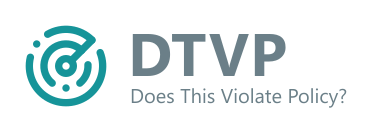

<p align="center"></p>

# DTVP: Does This Violate Policy?

DTVP is a FastAPI and Vue application for reviewing Dependency-Track findings
across project versions. It groups vulnerabilities, tracks team assessments,
and applies consistent decisions across releases.

[Main repository](https://git.baer.one/phbaer/dtvp/) ·
[GitHub mirror](https://github.com/phbaer/dtvp/)

- Team and global assessments, CVSS rescoring, the analysis response, SSVC prioritization, and exploitation evidence.
- Bulk assessment repair, audit-backed recovery, and project archive import/export.
- An assessment cleanup for inconsistent vulnerabilities: keep one version of
  the assessment for selected findings, or clear stray ones and blocks of
  teams that no longer exist, with a preview before saving
  ([Import and export](docs/import-export.md#cleaning-up-an-inconsistent-assessment)).
- Optional threat-model rescoring through tmrescore/vscorer and code analysis through Agentyzer.
- Code-analysis proposals use Agentyzer's compact `assessment.details`, with the
  human review notice first. Detailed rationale stays in the saved run payload;
  older responses retain the legacy formatter.
- Analyzer results are applied only when Agentyzer marks them eligible; see
  [Analysis integrations](docs/analysis-integrations.md#analyzer-result-validity).
- Optional access for AI agents: personal access tokens and an MCP endpoint to
  read vulnerabilities, draft team assessments (including justification) that
  stay pending review, and add code evidence that a person reviews beside the
  Agentyzer runs. Agent evidence follows the visible dependency findings,
  separately from analyzer application targets.
- Local-first: DTVP imports from Dependency-Track, works on its own database,
  which is the record for assessments, and exports them back automatically or
  on request. Findings Dependency-Track stops reporting are kept as gone, with
  a reason, once its analysis of a BOM upload finished; the assessment of a
  replaced component is carried over to its successor, pending review.
- Mock services for local development and testing.

[Quick start](#quick-start) · [Deployment](#docker-deployment) ·
[Commands](#command-reference) · [Review workflow](#review-workflow) ·
[Architecture](#repository-and-architecture) · [Documentation](#documentation)

## Quick Start

Requirements: Python 3.14+, `uv`, `npm`, `pm2`, and Node.js 26 LTS or a newer
supported Node.js release (24.15+ still works).
DTVP's Python environment and test suite are independent of Agentyzer, which
is accessed through the optional code-analysis HTTP integration.

```bash
uv sync --dev
cd frontend
npm ci --include=optional
cd ..
pm2 start ecosystem.config.js --update-env
```

| Service | URL |
| :--- | :--- |
| Frontend | http://localhost:5173 |
| Backend API | http://localhost:8000/api/version |
| Mock Dependency-Track | http://localhost:8081 |
| Mock tmrescore | http://localhost:8090/ui |
| Mock code analysis | http://localhost:8095 |

Open `/login`, choose **Sign in with SSO**, then **Login as Reviewer** on the
mock Dependency-Track page. Inspect services with `pm2 list` or `pm2 logs`.
Stop the stack with:

```bash
pm2 delete mock-dt mock-tmrescore mock-code-analysis dtvp-backend dtvp-frontend
```

For separate backend/frontend processes and authentication overrides, see
[Development and testing](docs/development.md).

## Docker Deployment

```bash
cp .env.dist .env
# Configure .env before starting services.
docker compose up -d
```

Set the Dependency-Track API URL/key, public frontend URL, OIDC settings, and
`DTVP_SESSION_SECRET_KEY`: at least 32 random bytes, for example from
`openssl rand -base64 48`. DTVP refuses to start without such a key; see
[Deployment](docs/deployment.md) for the file-based alternative. Compose
serves DTVP under `/dtvp` by default; `DTVP_HTTP_PORT` controls the host port.
Persistent data lives in `./data`; run one DTVP process per data directory,
which an instance lock enforces. Sign-ins expire after at most 12 hours without use
and one week in total, logout ends all of a user's sessions, and reviewers can
revoke a user's sessions; see [Deployment](docs/deployment.md).
Set the Dependency-Track API URL/key, public frontend URL, OIDC settings, and a
strong `DTVP_SESSION_SECRET_KEY`. Compose serves DTVP under `/dtvp` by default;
`DTVP_HTTP_PORT` controls the host port. Persistent data lives in `./data`;
run one DTVP process per data directory, which instance locks enforce.

The published DTVP image uses Python 3.14 free threading. Code analysis uses
a separately deployed Agentyzer service; set `DTVP_CODE_ANALYSIS_URL` to its
reachable base URL and configure repository mappings in that service.
See [Deployment](docs/deployment.md) for networking, authentication, runtime
checks, and release details, and [Configuration](docs/configuration.md) for
all environment variables.

## Command Reference

Use `uv` from the repository root for Python/backend work and `npm` from
`frontend/` for frontend work.

| Task | Command |
| :--- | :--- |
| Run DTVP Python tests | `uv run pytest` |
| Run frontend unit tests | `cd frontend && npm run test:unit -- --run` |
| Run focused frontend tests | `cd frontend && npm run test:unit -- --run ProjectView` |
| Build the frontend | `cd frontend && npm run build` |
| Run browser tests | `cd frontend && npm run test:ui` |
| Run manual real-stack tests | `cd frontend && npm run test:ui:real-stack` |
| Capture documentation screenshots | `cd frontend && npm run test:ui:docs -- --project=chromium` |
| Benchmark grouped queries | `uv run python scripts/benchmark_group_queries.py` |
| Benchmark the assessment record | `uv run python scripts/benchmark_assessment_store.py --assessments 50000` |
| Back up the instance (online) | `uv run python -m dtvp.backup export` |
| Check a dump | `uv run python -m dtvp.backup verify FILE` (`--deep` also stages it; `inspect FILE` reads only the manifest) |
| Delete old dumps | `uv run python -m dtvp.backup prune data/backups --keep 7` |
| Restore a dump (backend stopped) | `uv run python -m dtvp.backup restore FILE --dry-run`, then without `--dry-run`; `recover --resume\|--abort` after an interruption |

Browser tests cover Chromium, Firefox, and WebKit. CI's Playwright image must
match the version in `frontend/package-lock.json`. See
[Development and testing](docs/development.md) for test fixtures, toolchain
constraints, and CI conventions.

## Review Workflow

1. Open a project to review vulnerabilities across its versions.
2. Filter by lifecycle, team, component, version, or evidence; open a finding
   for context and assessment details.
3. Record team assessments, optionally using earlier team assessments,
   threat-model or code-analysis proposals. Reviewers approve global decisions
   and adjust CVSS scores. **Reset to Original** removes saved rescoring on
   the next Global save, including a rescore identical to the source vector;
   **Clear Global assessment…** clears Global fields and Awaiting review
   while keeping all team assessments, even without a saved General block;
   a [team overview](docs/screens.md#team-overview)
   on the Global assessment shows what every team decided, disagreeing and
   missing teams first. A save never drops another team's assessment; a
   block it leaves out is kept as historical, and a team's historical block
   stays beside its new assessment. Reviewers can [request changes to a
   team assessment](docs/review-workflows.md#requesting-changes) with a
   rationale. The team's technical decision stays visible while approval
   waits for its resubmission.
4. Use **Bulk Changes** to apply automatic assessments, run the combined
   repair (synchronization, former-team assessments kept as historical, CVSS
   restore, the SSVC record and response the findings agree on, rescoring), or restore lost team assessments from a
   Dependency-Track export as historical blocks; use archives to export and
   restore project data. Bulk Changes looks at the whole project unless you
   set list filters yourself; its scope line shows and switches it. Reviewers
   run the same repair for one vulnerability with **Repair…** on its card.

| Lifecycle | Meaning |
| :--- | :--- |
| **Open** | No assessment started |
| **Incomplete** | Required team or finding coverage is missing |
| **Conflicting** | Assessment data disagrees or needs repair |
| **Ready for approval** | Only the reviewer's approval is left, including a pending Global decision that covers teams without their own assessment |
| **Assessed** | Complete with no pending approval; includes legacy assessments |

Use the clear button in **Decision & rationale** to remove a saved Global or
team assessment. Clearing Global leaves the team verdicts available.

Without a reviewer's Global decision, the decision is derived: the worst team
assessment ([the Global decision](docs/assessment-model.md#the-global-decision)).
The exact rules, their order, the API values and who resolves each state are
in the [lifecycle decision table](docs/assessment-model.md#lifecycle-decision-table)
([ADR 0014](docs/adr/0014-lifecycle-decision-table.md)).

**Quick views** cover the common jobs: **Needs my assessment** (Open and
Incomplete, including Conflicting; with teams selected, their assessment is
missing), **Awaiting review** (every assessment submitted and not yet approved,
including a team's submission while other teams are still open, and proposals
saved pending review; `awaiting_review=true`), **Conflicting**, **New findings**
and **All**. Analysts start with Needs my assessment, reviewers with Awaiting review.
Untouched defaults follow role changes; custom status choices stay selected.
Conflicting findings retain their badge and require repair before approval;
**Clean up…** on the banner makes the findings agree.
After an approval or save the list refreshes in place; when the selected
vulnerability leaves it, the next one is selected
([stable list](docs/screens.md#stable-list)).

Select one or more **Teams** to enable **Assessment for selected teams**:
**Not recorded** finds a missing assessment among responsible selected teams;
**Recorded** requires all responsible selected teams to have an assessment
(including pending approval, or a recorded Global decision that covers them); **Any** adds no restriction. Analysts start with
Not recorded when selecting their first team; reviewers start with Any.
Clearing teams removes this restriction. Status choices remain unchanged.

Plain search still matches team names, without selecting teams. `team:` tokens
resolve to visible team selections; ambiguous matches require a choice.
Filters combine with AND across categories and OR within a category. Option
counts exclude their own category; result totals and bulk actions include all
filters. Specialist controls live under **More filters**; the threat-model and
automatic-assessment filters sit in its legacy section until their removal in
2.1.0. Selections persist in shared URLs (retired parameters of saved links are
mapped; see [filters](docs/review-workflows.md#project-review)); Reset returns
to the default view. Legacy assessments retain a **Legacy** badge.

The **Cutoff** lists what was known by a date (`cutoff=YYYY-MM-DD`, or rolling
`<N>d`) on one of two dates (`cutoff_basis`): **Published (premarket)**, the
earliest publication of the vulnerability and its aliases, for scoping a
release or submission; or **First attributed (postmarket)**, the earliest
Dependency-Track attribution to the component in any version of the project,
since when monitoring knows of it. Undated findings stay listed and are
counted. A cutoff is a planning aid, not a compliance boundary
([details and the FDA guidance](docs/review-workflows.md#cutoff-and-the-fda-guidance)).
It replaces the attribution-age filter.
**Views** in the filter sidebar saves filter states as personal or (reviewers)
shared views with a short link `/v/<code>`, sets my default per project or for
all projects and role defaults; unsaved filters are shared as the full URL; a
project opened without filters shows the default view
([saved views](docs/review-workflows.md#saved-views-and-short-links),
[ADR 0015](docs/adr/0015-saved-views-cutoff-and-short-links.md)).
Combined Team and Version selections require team ownership in one of the
selected project versions; ownership in another release does not match.

Team Open/Assessed statistics and the **Assessment for selected teams** filter
follow one rule ([per-team status](docs/assessment-model.md#per-team-status)):
each team's recorded assessment, including pending approval, and a recorded
Global decision or a closed vulnerability counts for every assigned team,
even when team documentation is incomplete. Approve is offered only for
Ready for approval; the card says what is missing otherwise. Group totals count each finding once and remain
Open while an unclosed finding has a responsible member without an assessment.
With a version filter, team and group breakdowns include only owners in those
releases. Team selections restrict these breakdowns to selected teams and their
containing groups. The `*` fallback uses its configured team name (for example Unknown)
and that team's recorded assessments. Older summary caches are rebuilt when
assessment metadata changes.
Statistics include donut charts with counts and percentages for severity,
analysis states, and selectable team/group coverage. Project-review charts
follow the current filters; the standalone Statistics page uses its project/ID scope.

The team mapping is organised by team: each team lists its aliases, the
Dependency-Track projects it owns and component selectors (`name`,
`group:name`, `purl::…`, `project:<project>::<selector>`); one team owns the
catch-all `*` ([ADR 0012](docs/adr/0012-team-centric-mapping.md),
[format](docs/assessment-model.md#team-mapping-and-analyzer-guidance)). A
mapped component takes precedence over its mapped ancestors, even across
alternate dependency paths; independent owners can both appear; a project's
team owns what no component entry owns. Settings → Team Mapping opens on the
unowned findings from a background report, with views for the projects and
their BOM trees (each node's owner, including unsaved changes), the teams and
the checks (with inline fixes); a save bar reviews, discards or saves the
draft ([screen](docs/screens.md#settings-team-mapping)). The backend's
resolved finding tags drive the list and detail views. Mapping edits rerun the
project query so both views use the same ownership.

Vulnerability cards group the effective verdict, original severity and
rescored severity in left-aligned columns. Wide headers show finding scope and
evidence beside the scores. The tint follows the saved rescore, falling back to
original severity. A green folded corner marks **Assessed** list cards.
The list cards sit flush with the assessment card in the split view. Team
names and review markers wrap in the list. The expanded header keeps
vulnerability-level information above the tabs. Publication and first
attribution appear as ages in the list and dates in the expanded header.
The [assessment form](docs/screens.md#assessment-tab) starts with the team
selector and Global option for reviewers. The advisory summary and decision
fields scroll with the card while tabs and actions stay in view. From a
1280px wide viewport the vulnerability detail can open a
full-screen [assessment workspace](docs/screens.md#assessment-workspace) with
the context beside the assessment form.

After an upgrade DTVP shows [what's new](docs/screens.md#whats-new) since the
version a user last saw: a large dialog for a new major version, a small one
otherwise; **What's new** in the header and footer opens it again.

See [Assessment model](docs/assessment-model.md) for exact state, ownership,
SSVC, and evidence rules; [Review workflows](docs/review-workflows.md) for
filtering, editing, bulk operations, and archives; or the
[screen guide](docs/screens.md) for UI examples.

## Repository And Architecture

```text
Browser → Vue SPA → FastAPI → Dependency-Track + local database/outbox
                           → optional tmrescore and code-analysis services
AI agent → MCP endpoint (access token) ┘ same assessment rules as the browser;
                                          code evidence is stored, never applied
```

| Path | Purpose |
| :--- | :--- |
| `dtvp/` | Backend routes, domain logic, integrations, and migrations |
| `frontend/` | Vue pages, components, API client, and browser tests |
| `test_setup/` | Mock Dependency-Track, tmrescore, and code-analysis services |
| `tests/` | Backend tests |
| `data/` | Local mappings, rules, database, and archives |
| `openapi/` | Integration API specifications |
| `docs/` | Detailed guides, references, diagrams, and screenshots |
| `skills/` | Agent entry points that route back to this README |

Grouped tasks serve filtered summary windows and hydrate full details on demand.
Assessment saves commit to the local SQLite database first and are exported to
Dependency-Track in the background, or on request in manual export mode. The
background refresh of open projects also reads the affected version ranges of
their vulnerabilities, from which the CycloneDX VDR derives a recommendation;
an export itself only reads the local database. Task registries are process-local: the supplied deployment
uses one backend worker; horizontal scaling requires shared task storage.

[Runtime and capacity](docs/runtime.md) documents the key modules, caching,
concurrency, access boundaries, benchmarks, and sizing guidance.
[ADR 0004](docs/adr/0004-background-sync-and-event-stream.md) (accepted, in
progress) moves every Dependency-Track read into a background scheduler and
announces changes to clients on one event stream. The stream exists:
`GET /api/events` tells clients about project-list, assessment, export,
cache-refresh, and Dependency-Track state changes
([Event channel](docs/runtime.md#event-channel)). Every read of a project
version is recorded in its sync state, with content digests:
`GET /api/sync/versions?product=&changed_since=` and `GET /api/sync/status`
([Sync state](docs/runtime.md#sync-state)). The browser announces the
products its tabs show with `PUT /api/events/interest`
([Product interest](docs/runtime.md#product-interest)). A sync scheduler
reads Dependency-Track in the background, and only while DTVP is in use: a
version once, then on its change signals, a request, or when it is opened and
was last read longer ago than the safety interval. Without users it reads
only what the export and explicit requests need. All of it runs within one
request budget shared with the export
([Sync scheduler](docs/runtime.md#sync-scheduler)). Reviewers can request a
read now (`POST /api/sync/requests`), ask the source to analyse again
(`POST /api/sync/analysis-requests`) and export now, from the project view's
Sync menu ([Manual requests](docs/runtime.md#manual-requests)).

## Documentation

| Guide | Contents |
| :--- | :--- |
| [Assessment model](docs/assessment-model.md) | Lifecycle rules, team ownership, SSVC, original severity, and official evidence |
| [Review workflows](docs/review-workflows.md) | Search, filters, assessments, gone findings, bulk changes, and project archives |
| [Analysis integrations](docs/analysis-integrations.md) | Threat-model rescoring, code analysis, live analysis progress, full assessment reports, downloads, and job IDs, follow-ups, and automatic scanning |
| [Runtime and capacity](docs/runtime.md) | Module map, background tasks, caching, concurrency, and benchmarks |
| [Development and testing](docs/development.md) | Separate processes, test guidance, toolchain constraints, and CI |
| [Deployment](docs/deployment.md) | Docker, networking, OIDC, persistent data, and Python runtime images |
| [Configuration](docs/configuration.md) | Environment variables and defaults |
| [Screen guide](docs/screens.md) | UI walkthrough and screenshots |
| [Workflow diagrams](docs/workflow-flowcharts.md) | Visual workflow reference |
| [Import and export](docs/import-export.md) | The local database as the record for assessments, adoption on import, automatic and manual export, failing exports, gone findings and carry-over to replacing components, and history |
| [CycloneDX inventory and VDR](docs/cyclonedx-export.md) | Downloading the BOM and a VDR with assessments in standard fields per project version, the recommendation derived from the fixed versions Dependency-Track holds, the field mapping, and its limits |
| [Native vulnerability matcher: investigation](docs/vulnerability-matcher-investigation.md) | How Dependency-Track matches today, vulnerability sources including European ones, matching beyond CPE, the chosen design and its plan ([ADR 0009](docs/adr/0009-native-vulnerability-matcher.md)); not built yet |
| [Version overrides: design](docs/version-overrides-design.md) | Assessing a vulnerability differently per product version on purpose: one base assessment plus marked exceptions ([ADR 0010](docs/adr/0010-version-overrides.md)); design and plan; the marker is stored and kept by every writer, the rest is not built yet |
| [AI and API access](docs/ai-access.md) | Access tokens, the MCP endpoint and its tools, write limits, agent code evidence, and the audit log |
| [Integration API](docs/integration-api-surface.md) | Integration endpoints and contracts |
| [Backup and restore](docs/backup-and-restore.md) | The instance dump `dtvp.dump/1`: export, verify, restore and recovery, encryption at rest, format, JSON Schemas, versioning, and validation rules |
| [Architecture decisions](docs/adr/README.md) | Accepted and proposed decisions with their implementation status |

OpenAPI specifications: [tmrescore](openapi/tmrescore-openapi.json) and
[code analysis](openapi/code-analysis-openapi.json).

This README is the canonical project overview and documentation entry point for
humans and AI agents. Keep it brief; put detailed behavior and configuration in
the linked guides. Meaningful behavior, architecture, API, integration,
configuration, workflow, command, or structure changes must update this overview
or its guide links in the same change, together with the relevant reference.
If documentation conflicts with source, tests, configuration, or lockfiles,
trust the source and update the documentation. Keep `AGENTS.md` and agent skills
as routing hints; the generic entry point is `skills/project-entrypoint/SKILL.md`
(`skills/dtvp-project-memory/SKILL.md` is the compatibility entry point).

## License And SBOM

[MIT License](LICENSE). The DTVP image includes CycloneDX frontend/backend SBOMs,
served at `/api/sbom` and `/api/sbom/html`.
