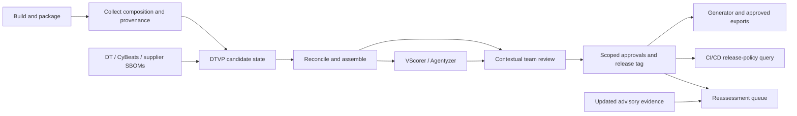

# DTVP DevSecOps Evidence Coordination and Controlled Publication

Decision proposal, 15 October 2026. Audience: development, security, architecture,
OSS clearance and quality teams. Implementation detail: [rewrite plan](rewrite-plan.md).

## Direction

Proceed with DTVP as the shared evidence and decision layer between build
pipelines, specialist analysis services and controlled outputs. Its value is
reusing trustworthy composition and reviewed decisions across versions, teams,
vulnerability work, licensing and architecture documentation. The strongest case
is reducing inconsistent manual reconciliation between these activities.

Do not make DTVP a universal scanner, pipeline engine or compliance authority.
The hardest problem is establishing what was actually built and delivered.
A consistent database, generated diagram or human approval cannot repair an
unidentified statically linked library or evidence from the wrong source commit.
Adding integrations before establishing that boundary would amplify errors.

Scope is cybersecurity, license compliance and software architecture documentation.
Device/system safety analysis is outside scope. Intended use: support controlled,
traceable evidence preparation, analysis and review. Release authorization,
architecture acceptance and license-clearance decisions remain explicit processes,
which DTVP can support and record. Qualification and product-specific regulatory
applicability must be established for the actual use.

## Pipeline responsibilities

| Element | Responsibility |
| :--- | :--- |
| Build pipelines and collectors | Produce composition, build/deployment facts and coverage limitations for exact subjects |
| DTVP | Retain originals; assemble product states; reconcile identities; manage evidence, ownership, reviews, history and API access |
| CPE discovery | Move into DTVP as an internal module; retain attributed candidates and reviewed mappings |
| VScorer | Produce threat-model/context-specific scoring evidence and proposals |
| Agentyzer | Produce source/reachability/impact evidence for a pinned analysis subject |
| Generator | Preserve established audit-document generation using pinned DTVP inventory and curated inputs |
| Authorized reviewers | Accept bounded conclusions, resolve conflicts and approve publication for a stated purpose |
| Export adapters | Deliver approved, pinned artifacts with target mappings, receipts and separately controlled write-back |

The flow is collect -> retain -> reconcile/assemble -> analyze -> review ->
publish/export. Analysis and document generation can repeat without changing an
approved baseline. UI and CLI use the same application contracts. External
services stay separate; no bundled Agentyzer, mandatory broker or S3 dependency.

## Exemplary pipeline integration

The following describes the target workflow, not a claim that all integrations
already ship. CI/CD remains responsible for building, testing, packaging and
deployment. DTVP receives evidence at explicit boundaries and returns scoped
status or approved outputs. It does not need to sit inside every build step.

### Integration points across a typical lifecycle

| Pipeline boundary | Evidence submitted or consumed | DTVP action and useful result |
| :--- | :--- | :--- |
| Pull request / feature build | Optional candidate SBOM, resolved dependencies, source/configuration identity | Compare with an explicit base state; highlight new components, licenses, findings and missing identity. Use a candidate namespace so ephemeral builds cannot replace the authoritative nightly baseline. |
| Successful build and packaging | Exact final artifact digest, SBOMs, collector details and source/build provenance | Validate intake, retain originals and advance the matching product-version candidate. A lockfile alone must not be presented as verified shipped composition. |
| Product assembly / integration build | Manifest selecting required constituent revisions and deployment variant | Check required parts, build coherence and attachment relationships. Publish a coherent selected baseline atomically; retain incomplete candidates for investigation. |
| After intake or material evidence changes | Vulnerability observations from sources, advisory updates and relevant usage facts | Reconcile attributed evidence; run configured CPE discovery and queue specialist analyses for exact subjects. Show meaningful changes and revalidation needs rather than duplicating unchanged work. |
| Review queue, outside the critical build path | Team-specific component/dependency contexts and combined evidence | Analysts assess their contexts; required teams review each vulnerability; the security coordinator handles contextual scoring. License and architecture decisions retain their own owners. |
| Release candidate / publication | Exact artifact/assembly state, required reviews and output-specific policy | Return ready, blocked or unknown with concrete reasons and pinned inputs. CI/CD enforces the configured gate; DTVP records evidence and decisions, not deployment authority. |
| Controlled documentation and export | Approved pinned state, curated architecture mappings, templates and disclosure scope | Generator produces the established documents from DTVP. Authorized adapters deliver SBOM/VEX/VDR or other supported outputs, retaining digests, loss reports and receipts. |
| After release / scheduled monitoring | New advisories, vendor corrections and additional analysis evidence | Open reassessment against affected released subjects without modifying the release tag. Preserve what was known at release alongside current knowledge about that release. |

An early PR check can be advisory while release publication is stricter. Define
the gate per purpose: input integrity, vulnerability review, license clearance
and architecture-document readiness are separate results. Unknown coverage or
an unavailable service must not silently produce a passing status. Conversely,
an optional external analysis outage need not stop compilation; policy decides
whether publication can proceed with an explicitly accepted limitation.

### Example 1: managed application with a nightly build

For a Java, .NET, Python or JavaScript application, export resolved dependency
information during the build and collect evidence from the packaged deliverable.
Submit both as attributed views of the same subject, with the build ID, source
revision, configuration and artifact digest. They are not two additive inventories.
If DT or CyBeats performs the first vulnerability analysis, import its observations
and preserve its original ratings and attribution; DTVP owns subsequent decisions.

The nightly build advances only its version branch. DTVP compares the new baseline
with the previous accepted build, retains applicable assessments and queues new
or changed contexts. Teams see their ownership realm and the evidence needed for
assessment. VScorer receives the scoped vulnerability worklist plus the relevant
threat-model/deployment inputs; Agentyzer receives a qualified, pinned source
subject. Their results are comparable proposals, not automatic approvals.

Before release, CI/CD queries readiness for the exact state and artifact it will
publish. After the required decisions, freeze the release tag and generate
documentation from those pinned inputs. The likely onboarding gap is proving
that dependency export reflects packaging, including optional features and
bundled code; DTVP cannot infer that equivalence from a successful upload.

### Example 2: legacy C/C++ product or firmware

Add collection around the existing build without first requiring a build-system
rewrite. Gather available compiler/linker evidence, installed outputs, supplier
inventories and source/license scan results. The producer combines these into
the best available subject-specific composition and explicitly declares unknown
versions, vendored code, local patches and collection limits. Store supporting
evidence alongside the original SBOM rather than pretending a binary scan alone
recovered every static dependency.

DTVP makes unresolved identities and ownership actionable; internal CPE discovery
can propose identifiers with provenance. Analysts review the actual product usage,
including configuration-specific inclusion, rather than treating every source-tree
library as delivered. Agentyzer source analysis needs the source/configuration
relationship to that binary; a verified commit by itself does not establish it.
License clearance may additionally need file-level notices and linking facts.

This is the highest-effort onboarding case. The acceptance criterion is a reviewed
reference inventory for representative builds, with known blind spots and a
producer correction path. If the product cannot establish source-to-deliverable
identity, restrict conclusions accordingly rather than manufacturing precision.

### Example 3: containerized service with several delivery parts

Collect from each final image by digest and platform, retaining application and
OS package evidence separately. Supply deployment descriptors for services,
sidecars and other declared delivery parts; runtime-mounted content needs its
own evidence where it belongs to the product scope. An integration build submits
an assembly manifest selecting, for example, backend, frontend and gateway
revisions. A new backend build replaces that part only; a failed frontend scan
does not remove the frontend from the product.

DTVP shows both part-level deltas and the assembled product delta. The same
package in different consuming trees can require separate contextual assessments;
shared identity does not collapse those usage contexts. Preserve distro/vendor
fixed-state evidence when reconciling upstream vulnerability claims. Generator
combines the accepted assembly with curated deployment/interface mappings;
package dependencies alone do not establish service communication architecture.

The main gate is coherent subject selection: an image tag is insufficient to
freeze a release, and unrelated platform builds must not become one apparent
installation. Initial native delivery-part selection is implemented; overlapping
evidence views and cross-part relationship mapping remain planned. Legacy combined SBOMs can bridge
intake but cannot restore provenance already discarded by an assembler.

### Example 4: supplier binary or externally maintained subsystem

Receive the supplier SBOM and any VEX/VDR with the delivered artifact identifier,
digest, supplier attribution and declared applicability scope. Retain originals
and revisions; treat later supplier corrections as new evidence. When identity or
scope is missing, make the limitation visible and request correction from the
producer. A supplier's not-affected statement remains attributed evidence until
the organization's policy and appropriate reviewer accept it for the actual use.

DTVP adds value by relating that subsystem to product contexts and recording the
review trail. It cannot independently prove a proprietary binary's completeness
or use Agentyzer source analysis when the relevant source is unavailable. Release
policy must distinguish that limitation from a confirmed absence of vulnerabilities.

### Example 5: parallel maintenance and feature versions

Nightly pipelines for `6.15.6`, `7.1.1`, `7.1.2` and `7.2.0` submit to independent
version branches. Build ordering is evaluated within the declared source/version
stream; a late `7.1.1` job must not overwrite `7.1.2`. A cascading code merge can
carry provenance that proposes assessment reuse, but DTVP checks the target
inventory and contexts before extending the approved applicability range.

Compare `7.1.1` and `7.1.2` by pinned states, including assembly, composition,
coverage and decision differences. Released tags remain immutable when a later
advisory appears or a team changes. Monitoring creates new knowledge and review
work linked to those releases; it does not rewrite the original release record.

### Recommended first integration

Start with one representative product and one nightly pipeline: upload the final
artifact's SBOM/provenance, expose the baseline delta, assign team review and
produce one pinned Generator output. Measure producer correction effort, unresolved
identity, review time and output parity. Then add a required second constituent
to prove assembly behavior. Run a legacy C/C++ and container pilot before claiming
broader acquisition coverage. Defer mandatory PR blocking until the evidence and
decision contracts have proved useful and predictable in these pilots.

## Composition acquisition and its limits

| Project type | Preferred evidence | Effort and likely gaps |
| :--- | :--- | :--- |
| Managed ecosystems | Resolved dependency export, lockfiles, build metadata and shipped artifact scan | Usually easiest. Separate development/runtime, optional features, bundled code and resolved versus delivered packages |
| Modern C/C++ | Conan/vcpkg metadata where present, actual build targets, compiler/linker inputs, link maps and installation outputs | Configuration/platform-sensitive; generated code, static libraries, local modifications and vendor code need extra evidence |
| Legacy C/C++ | Instrument existing build where practical; archive/object/link records; source/license scanning; reviewed supplier inventory | High onboarding effort. Missing versions, copied headers, patched forks and opaque proprietary build steps prevent complete automatic recovery |
| Binary-only and firmware | Supplier SBOMs, ELF/PE metadata, symbols/build IDs, archive extraction and specialist fingerprints | Often partial. Stripping, LTO and static linking limit identification. Strings or absent matches cannot establish exact versions or absence |
| Containers | Digest-pinned final image plus application build evidence, platform and base-image lineage | Builder contents differ from shipped contents. Distinguish OS and application packages; account for distro backports, sidecars and runtime-mounted software |
| Deployment and architecture | Deployment descriptors, reviewed system/item/unit mappings, interfaces and runtime observations | Package graphs do not identify all interfaces, trust boundaries or intended architecture; observations cover only exercised behavior |

For C/C++, `compile_commands.json` is useful compiler-invocation evidence, not a
complete package or linker inventory. CMake's File API supplies target/build
information that can complement it. [CMake compiler commands](https://cmake.org/cmake/help/latest/variable/CMAKE_EXPORT_COMPILE_COMMANDS.html),
[CMake File API](https://cmake.org/cmake/help/latest/manual/cmake-file-api.7.html).
Use existing collectors and source/license scanners, selected by demonstrated
capability on representative artifacts, rather than adding a scanner framework
to DTVP. Examples include cataloger-specific SBOM/binary extraction and ScanCode;
tool coverage must be recorded, not assumed universal.
[Anchore capabilities](https://oss.anchore.com/docs/capabilities/sbom/),
[ScanCode](https://github.com/aboutcode-org/scancode-toolkit).

## Subject identity and evidence contract

Every input needs a versioned envelope: product/version, part or evidence-view
identity, artifact digest where available, source revision, pipeline/build ID,
platform/configuration, collector/version/options, collection time, declared
scope, omissions and original artifact digest. Unknown fields remain unknown.
Authenticated submission identifies a sender; it does not prove that sender's
claims are complete. Supply-chain provenance helps bind outputs to their build
and source, but does not itself enumerate shipped composition.
[SLSA provenance](https://slsa.dev/spec/v1.2/provenance).

SBOM correctness is the producer's responsibility at this interface: inputs must
describe the delivered subject as accurately as possible. DTVP validates supported
structure, reference integrity, identity consistency, declared scope and conflicting
claims; it cannot certify the absence of undiscovered composition. Input acceptance
and release/publication acceptance are different gates. Legacy inputs with missing
provenance can remain useful for triage while publication policy requires the
missing evidence or an explicitly reviewed limitation. Collector onboarding and
producer corrections address input defects; DTVP must not silently repair them
into unsupported conclusions.

Preserve four distinctions throughout storage, UI, CLI and exports:

- Declared by a producer or supplier.
- Observed by a collector, with its coverage limits.
- Proposed or inferred by an analysis service.
- Concluded and approved by an authorized person for a defined scope.

Keep inventory, dependency, file/license, deployment and analysis coverage
separate. A complete snapshot means replacement within a declared scope; it is
not proof that every product component was found. Missing graph information is
different from an explicitly reported empty graph. CycloneDX provides composition
completeness information; adapters must retain it rather than promote an import
flag into a coverage guarantee. [CycloneDX model](https://cyclonedx.org/specification/overview/).

Use typed relationships: inventory membership, containment, built-from,
links-to, dependency and communication are different claims. Preserve original
relationship kinds when conversion cannot express them. Package lineage can be
shared, while concrete builds and usage occurrences remain distinct. A CPE is
an attributed identity assertion, not evidence of vulnerability applicability;
NVD applicability can involve logical conditions beyond an individual name.
[NVD CPE FAQ](https://nvd.nist.gov/general/faq-sections/cpe-faqs).
Vendor/distro backport and fixed-state assertions remain attributed evidence;
a CPE or upstream-version comparison cannot automatically override them. Numeric
confidence alone cannot resolve contradictory applicability claims.

The journal retains complete immutable logical states and byte-exact file inputs;
PostgreSQL holds rebuildable active projections. Product versions advance
independently, release tags freeze states, and shared assessments reference exact
reviewed context/version coverage. Cascading development merges propose reuse
against actual target-build evidence; they do not confer automatic approval.

## Product assembly from several SBOMs

Assembly is first-class state. Each version references an assembly manifest with
stable part IDs, required/optional roles, selected import revisions, subject/build
identities, attachment roots, relationship types, mapping policies and declared
coverage. Keep original constituent documents; a flattened combined SBOM is a
reproducible export, not the only record of product composition.

Different delivery parts and overlapping evidence views need different treatment.
A source SBOM and container scan may describe the same delivered component;
their counts cannot simply be added. Two mutually exclusive platform builds
must not become one apparent installation merely because the version matches.

Publish a selected, coherent assembly atomically. Updating part A replaces A's
previous complete snapshot, not the inventories of B and C. Missing or failed
nightly delivery is not removal; removal is explicit. Mixed-build selections
remain visibly mixed unless a build manifest or reviewed compatibility policy
establishes that the selected parts belong together. Required-part failures
block publication as complete; incomplete candidates remain available for work.

Resolve source refs within `(part revision, source ref)`. Do not deduplicate on
name/version alone. Preserve ecosystem, qualifiers, hashes, provenance and
separate consuming contexts. A dependency removed from A may remain in B; its
assessments remain historical even when absent from every current part.
Compare assembly manifests first, then drill into changed parts and coverage.

The inspected `cdxcombine` CLI is a useful legacy workflow reference, but requires
hardening before it can establish an authoritative assembly. Its mapper uses
group/name/version and a global old-ref map; merging creates a new top-level BOM,
and intake removes tool metadata. Its SPDX converter omits important identity,
relationship and licensing distinctions. Input failures can be logged/skipped;
validation errors do not necessarily prevent an output file being written.
These are code-inspection findings, not results of a malformed-input test campaign.
See `../cdxcombine/cdxcombine.py`, especially `ComponentMapper`, `process_files`,
`merge_boms` and `validate_and_save`.

Therefore accept legacy combined output as attributed input with declared losses.
For the new path, retain constituent originals and an assembly manifest, require
explicit input acceptance/results, and fail complete publication on required-input
errors. Whether normalization runs in DTVP or a hardened external assembler is
secondary to this contract. Do not recreate separate inventories in each tool.

## Three controlled output workflows

### Vulnerability analysis

Combine source matches, advisory/VDR/VEX statements, usage evidence and specialist
proposals into a contextual evidence view. Show contradictions, stale inputs and
missing coverage. Analysts assess applicability; independent team reviews and
coordinator-owned contextual scoring remain distinct. Source severity is retained.
Matching a package or finding no exploit path is not sufficient to conclude not
affected without the required context/evidence. Preserve non-US provider options
and upstream lineage; mirrors are not independent corroboration.

### License evidence and clearance

Track declared, detected and concluded licenses separately, preserving expression
structure, exceptions, LicenseRef text, copyright/notice material and file-level
evidence. An upstream concluded license remains that publisher's conclusion.
SPDX explicitly distinguishes declaration, conclusion and unasserted information.
[SPDX licensing terms](https://spdx.org/rdf/spdx-terms-v2.3/).

Clearance additionally depends on distribution, linking, modification and usage
context, applicable obligations and evidence that actions were completed. Finding
a license identifier does not establish satisfaction of its obligations. Provide
an OSS/legal-clearance role and workflow separate from security approval.
Reports distinguish known license evidence, unresolved components and reviewed
obligation fulfillment; no universal license-compliant percentage is inferred.

### Architecture documentation

Preserve Generator's established audit-document production, templates and
review/publication workflow. Replace its direct DT inventory reads with pinned
DTVP data. Curated system/item/unit mappings, deployment boundaries, interfaces
and rationale remain essential inputs. DTVP owns accepted shared product metadata;
Generator remains the document producer. Freeze mappings, templates, configuration
and input revisions with every artifact, retaining unresolved mappings explicitly.

Dependency diagrams are views of evidence, not recovered design intent or proof
of runtime architecture. Architecture reviewers approve the relevant mapping
and documentation scope. Newly inferred architecture remains a proposal until
accepted; this does not reclassify Generator's existing controlled documents as
mere proposals. Cutover must demonstrate semantic parity with its established
audit-ready outputs, including identifiers, provenance and controlled formatting.
Prevent feedback loops: a claim generated from DTVP and returned by Generator
is derived evidence, not independent corroboration.

## Integration readiness and blocking contracts

The table records the initially inspected repository baselines, not deployed
interfaces. Subsequent isolated fixes are listed under
[reviewed integration increments](#reviewed-integration-increments); the baseline
gaps below must be read together with that status.

| Service | Existing seam | Blocking work before trusted automation |
| :--- | :--- | :--- |
| DTVP | Journal-backed v3 inventory/tag/diff core; separate v2 review runtime | Advanced assembly reconciliation, identity, contextual review and controlled publication workflows are not yet delivered end-to-end |
| VScorer | TM7/SBOM/CVE-worklist intake, explicit configuration/deployment profile, reviewed Environmental proposals | Agree machine authorization, exact subject/input binding, returned provenance and division of VScorer versus DTVP review responsibilities |
| Agentyzer | Assessment, polling/results and follow-ups; source/AST/LLM evidence with eligibility flags | Request contract lacks reliable exact build-commit binding; configured checkout can resolve default-branch HEAD. Require pinned checkout and returned analyzed revision; account for process-local jobs and retry ambiguity |
| CPE discovery | Actual checkout is `../cpeservice`; lookup and reviewed mapping overrides | Integrate core discovery into DTVP, preserve reviewed rules and provenance, replace separate persistence deliberately; dictionary membership is not applicability |
| Generator | InventorySource seam; DT/CycloneDX/snapshot inputs, curated CSV/config and output manifests | Current checkout has no native DTVP consumer. Earlier separate consumer branch is not proof of delivery here. Resolve ownership of mappings/enrichment and freeze all curated inputs |
| cdxcombine | CLI grouping several documents into CycloneDX | Document-scoped refs, strong identity, full provenance, typed relations, loss reporting and fail-closed acceptance |

Generator, VScorer, Agentyzer and optional assembly tooling remain separate. CPE
discovery is the exception: bring its reusable core into DTVP with an optional
transitional adapter, not another mandatory deployment. Preserve exact package
identity, reviewed overrides, source attribution, cache/failure semantics and
mapping history. Migrate Git-backed mappings into DTVP-owned revisioned storage;
keep catalog refresh and optional external queries in durable jobs. Retire the
standalone service only after lookup/rule parity and migration checks pass.
No service should independently overwrite accepted shared metadata. Use immutable
input bundles, explicit result submission and idempotent jobs/receipts. Outbound
code or sensitive design data needs configured destinations and access controls.

Evidence intake is an untrusted-content boundary. Bound parsing and resource use,
retain XML/archive limitations and avoid automatic external-reference retrieval.
Do not execute uploaded builds or let source/advisory text authorize actions.
Isolate specialist runners and treat prompt injection in analyzed material as
untrusted input, not instructions. These controls belong in integration acceptance
tests and the deployment threat model, including data egress permissions.

## Review and publication controls

Human review needs a bounded claim, qualified role, exact inputs, visible unknowns
and an explicit decision meaning. A general approval button cannot validate an
unsupported exclusion or compensate for an unobserved build configuration.
Review only changed relevant evidence; retain prior decisions and provenance.
Extending assessment ranges requires verified coverage and the appropriate review.

Exports are separately authorized publications: destination, purpose, product
states, target-ID mappings, disclosure scope, output format, normalizer/generator
versions and output digests. Preview before applying remote changes. Separate
artifact generation, publication approval, delivery receipt and remote acceptance.
Retries must not duplicate remote decisions; ambiguous writes require reconciliation.
Third-party formats that lose context or provenance need explicit loss reports.

Do not label document output approved merely because its input assessments were
approved. Review validity, license clearance, architecture approval and release
authorization are different decisions and may have different owners.

## Quality and regulatory applicability

Qualify the intended automation under the organization's actual quality system.
Maintain requirements, risk-based assurance, representative acceptance fixtures,
known limitations, change control and evidence of correct outputs. Include
permissions, independent review, wrong-subject detection, stale-input rejection,
reconstruction, backup/restore, migration compatibility and export reconciliation.
Hash integrity against trusted references is not publisher authenticity, a
qualified electronic signature or proof the source assertions were true.

| Context | Applicable distinction |
| :--- | :--- |
| US medical-device cybersecurity | FDA's February 2026 guidance addresses device cybersecurity design and premarket documentation, including cyber-device considerations. It does not certify this supporting application. [FDA cybersecurity guidance](https://www.fda.gov/regulatory-information/search-fda-guidance-documents/cybersecurity-medical-devices-quality-management-system-considerations-and-content-premarket) |
| Production and quality-system automation | FDA's February 2026 software-assurance guidance describes risk-based assurance for production/QMS software. Evaluate DTVP by its actual intended use and process risk. Human approval alone does not establish assurance. [FDA software assurance](https://www.fda.gov/regulatory-information/search-fda-guidance-documents/computer-software-assurance-production-and-quality-management-system-software) |
| EU medical devices | Determine MDR/IVDR product applicability for cybersecurity documentation. MDCG cybersecurity guidance is nonbinding, not a certification route; DTVP does not perform device-safety analysis. [MDCG guidance](https://health.ec.europa.eu/system/files/2022-01/md_cybersecurity_en.pdf) |
| EU Cyber Resilience Act | Article 2 excludes products to which MDR/IVDR apply; this is not an exemption for every health-related tool/component. Scope the actual product. Article 71 phases application dates; avoid treating every obligation as already applicable in October 2026. [Official CRA text](https://eur-lex.europa.eu/legal-content/EN/TXT/?uri=celex%3A32024R2847) |

Freeze generated results and their input/model/tool versions. Exact retained
outputs can be reconstructed even when re-running nondeterministic analysis
does not reproduce identical prose. Changes to models, parsers, normalization,
policy or templates require impact assessment and proportionate regression tests.
No claim of IEC/ISO compliance or electronic-record/signature compliance follows
solely from using the workflow; relevant requirements need an explicit mapping.

## Statistics and workload semantics

Carry forward latest DTVP `origin/main` behavior from `f236a96`: recorded team
work is independent of overall approval lifecycle; team/version filters require
ownership in the same version; counts use the full filtered result, aliases are
deduplicated and group counts consider the responsible selected members.
Charts use the same filtered distributions, with zero/updating states and a
single team/group scope rather than summing overlapping team slices.

The new model must additionally distinguish recorded, submitted and currently
approved coverage. Do not copy v1's approved-General shortcut into the new approval
gates, or invent missing team documentation from closure. Expose historic closure
separately when importing legacy records. Statistics are projections of the same
scoped backend facts used by lists, CLI, bulk previews and exports.

For the broader outputs, report separate denominators: known product parts,
components with identity evidence, reviewed vulnerability contexts, components
with license evidence, completed obligations and reviewed architecture mappings.
An unknown total is reported as unknown; it does not become 100 percent coverage.

## Delivery sequence and stop criteria

1. Define artifact/evidence and assembly contracts. Add executable fixtures across
   the actual services. Require document-scoped identity, exact subjects, losses,
   typed relationships and explicit unknowns before automatic propagation.
2. Pilot a managed application, a legacy C/C++ build with a vendored/static
   dependency, and a digest-pinned container with OS backport evidence. Compare
   outputs with independently reviewed reference inventories and record effort.
3. Deliver assembly publication and the journal-backed team context/review path.
   Demonstrate nightly part replacement, parallel versions, retained approvals,
   bounded revalidation, tag immutability and complete reconstruction.
4. Connect Generator to frozen DTVP inputs and curated configuration, preserving
   established audit documents; integrate the CPE core and reviewed mapping history.
   Connect VScorer/Agentyzer only after subject binding and authorization
   contracts are verified. Avoid duplicating human review without a defined purpose.
5. Add license clearance and architecture review as distinct workflows. Then add
   explicit third-party publication with loss reports, receipts and reconciliation.

Stop expansion if a pilot cannot bind observations to the delivered artifact,
silently loses required inputs, or propagates conclusions across incompatible
contexts. Fix acquisition/identity first. Defer universal binary discovery,
autonomous not-affected decisions, generic pipeline orchestration and a broad
custom vulnerability-matching engine.

Success means lower review/reconciliation effort without more erroneous reuse,
traceable approved outputs, visible unresolved composition and reproducible
release evidence. More imported vulnerabilities or generated diagrams alone is
not evidence of process improvement.

## Current implementation boundary

Implemented foundation: local immutable states, conditional atomic publication,
version branches/tags, SQL projection recovery, API imports/comparison and an
API-only playground. This increment adds original-byte file intake/download,
collection scope/provenance, separate declared coverage and typed source relations.
Current structural parser checks do not establish full semantic conformance of
every supported document or correctness of supplier assertions.
It rejects changing declared target/platform/configuration through ordinary
baseline replacement; that is a guard, not full variant or assembly support.

Native delivery-part assembly now separates constituent source intake from product
publication. Complete pinned selections retain required/optional declarations;
omission, withdrawal and policy changes need explicit reasons. Inventory and
source observations are replaced atomically while assessment/review knowledge
remains retained. Original inputs and selected source states remain reachable;
comparison exposes part-level deltas. Missing required inputs, empty selections
or unverified coherence prevent release tags. Producer-declared coherence is
attributed evidence, not verified compatibility or approval of the whole release.
The API-only demo covers replacing one part while reusing another unchanged.

Still planned: overlapping-view/advanced assembly reconciliation, cross-version
source reuse, cross-part relationship mapping, stable cross-import/context identity,
new review workspace/range coverage, evidence synthesis, VDR/VEX application,
specialist result integration, license clearance and controlled architecture/export
workflows. The existing v2 UI is not evidence these new contracts already ship.

### Reviewed integration increments

The following fixes are isolated review branches, not merged sibling defaults or
deployed services. They address concrete baseline gaps without establishing full
end-to-end qualification.

| Repository / branch | Verified increment | Remaining gate |
| --- | --- | --- |
| `cdxcombine`, `fix/strict-evidence-assembly`, `ea0e672` | Required inputs, references and validation fail closed; atomic output and scoped reference mapping. 52 tests passed, one optional-fixture skip. | Conversion still loses some metadata; native DTVP assembly retains original constituents and remains the preferred new path. |
| `cpeservice`, `feat/dtvp-evidence-contract`, `98049fc` | Truthful rule/identity provenance, requested/resolved identifiers and deterministic result digest. 213 tests passed. | No invented confidence or approval; internal DTVP storage/migration remains planned. |
| `generator`, `feat/dtvp-snapshot-integrity`, `a0fcde5` | Native DTVP snapshot adapter verifies pinned identity/content, retains exact manifests and uses approved team coverage. Existing renderer/templates preserved. 23 focused tests passed; full suite 628 passed, six failures also reproduced on baseline, one skip. | Adapter targets v2 snapshots; v3 cutover, frozen enrichment/configuration and controlled document parity remain gates. |
| `agentyzer`, `fix/immutable-source-binding`, `cfb27b3` | Exact requested Git commit, isolated clean worktree and explicit verified/unverified source evidence. 493 tests passed. | Commit identity does not verify binaries, submodules or LFS; durable remote jobs and complete artifact binding remain gaps. |

DTVP's v2 adapter additionally requires producer-qualified repository/commit
binding before external Agentyzer proposals become eligible. Reports without it
remain evidence. This closes an eligibility gap in the existing workflow; it
does not implement journal-backed v3 analysis orchestration.
The adapter change is `d0a55ab`: full working-tree suite 107 passed with one
unconfigured PostgreSQL skip; a separate disposable PostgreSQL integration test
passed. Isolated staged validation also passed, excluding earlier UI experiments.
