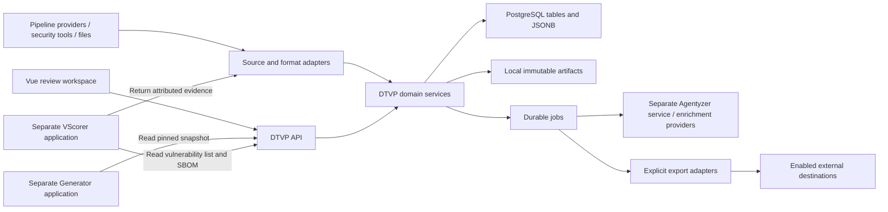

# DTVP Rewrite Plan

[Project overview](../README.md) · [Shipped API](api.md)

Proposal, 2026-10-14. Target: self-hosting with optional managed services,
team workspaces within one organization, PostgreSQL with local artifact storage,
and `../generator` plus `../vscorer` as independent API consumers.

DTVP should own inventory, component metadata, decisions, permissions, and
history. Dependency-Track (DT), CyBeats, and SBOM files supply observations.
Imports must preserve DTVP decisions; writing to an external system requires a
separate, explicit export operation.

## Implementation status

The rewrite branch replaces the legacy runtime rather than layering another cache
on it. Shipped: owned inventory/metadata, immutable imports and artifacts, scoped
team access and machine credentials, assessments/four-eye approval/revalidation,
consumer snapshots, full DT analysis reads with tagged/plain legacy compatibility, OSV matching, NVD/CIRCL advisory ports, themes,
durable leased jobs, searchable bounded catalogs, shareable review filters and user-local saved views, next/previous review navigation, bulk approval previews, large-inventory playground scenarios, an offline PostgreSQL playground, implicit schema upgrades
with pre-upgrade data backups, and a separate PostgreSQL copy-upgrade helper.
Generator's native snapshot consumer is isolated on `feat/dtvp-snapshot-consumer`.
VScorer's actual parsers accept the worklist/SBOM; its workflow remains separate.

Shipped additionally: external Agentyzer submission/polling/follow-ups, bounded analysis history, immutable reports and explicitly accepted drafts; offline analysis scenarios exercise the durable worker.

Scope still requiring integration work: verified native CyBeats/EUVD/JVN APIs,
direct VScorer snapshot selection, automatic legacy assessment migration/cutover,
advanced ownership inheritance/policy parity, and non-SCA detector adapters.
External source write-back is not enabled; explicit exports are local downloads.
The detailed design below remains the target, not a claim that every phase ships.
The feature/code inventory describes baseline `bdc7ba41a40697b0a3f5aa1b619518216e5087f8`.

### Matching and evidence boundary

Use a hybrid approach: import existing tool matches and plug independent matchers
into file-only inventory. Own package/occurrence identity, match evidence, provider
coverage, deduplication and reevaluation; defer a broad custom CPE/range engine.
Keep advisory records, match assertions, contextual assessments and approved
human decisions distinct. Provider hosting geography does not establish independent
upstream data; preserve publisher lineage instead of counting mirror copies twice.

Non-US source options include ENISA EUVD, Luxembourg's CIRCL and Japan's JVN;
regional/vendor CSAF feeds can supply additional evidence. Advisory feeds and
package-matching services are separate ports. VScorer's NVD/KEV preparation policy
must be coordinated separately if end-to-end independence from US services matters.

Deliver the streamlined review workflow in the first owned-inventory slice.
Default UI shows the needed decision and decisive evidence; power users expand
technical source comparisons and history. Uncertainty and coverage gaps stay visible.

## Product Direction

DTVP becomes an extensible DevSecOps pipeline observer and support tool.
SBOM/component vulnerability review is the first domain module. The common core
correlates assets, pipeline/tool runs, security reports, findings, evidence, and
human decisions across different pipeline setups.

Pipeline engines and external tools retain their execution responsibilities.
DTVP collects security-relevant outcomes, explains changes and coverage, routes
review work, and exposes approved information through its API. Add other finding
types incrementally: SAST, DAST, secrets, container, infrastructure, and policy
results. Each type keeps its own semantics; CVE, CVSS, and SSVC are optional.

Generator and VScorer remain separate applications and deployments. Both consume
the public DTVP snapshot API. Generator owns document generation/publication;
VScorer owns threat-model placement and human-reviewed Environmental assessments.

Low-effort local exploration and automated verification are release requirements
for every implemented module and adapter. Ship the playground with the first
vertical slice and extend its scenarios alongside subsequent features.

## Current Capabilities

| Area | Functionality to preserve | Main implementation |
| :--- | :--- | :--- |
| Inventory and review | Project versions; vulnerability grouping by IDs/aliases; affected components; direct/transitive dependency paths; statistics; search, facets, shared URLs, and bulk selection | DT client (legacy `../dtvp/dt_client.py` at `bdc7ba4`), grouping (legacy `../dtvp/logic.py` at `bdc7ba4`), query API (legacy `../dtvp/general_api_routes.py` at `bdc7ba4`) |
| Ownership | Component/PURL selectors, precedence along dependency paths, independent owners, historical team aliases, nested team groups | Team mapping (legacy `../dtvp/team_mapping.py` at `bdc7ba4`), team groups (legacy `../dtvp/team_group_services.py` at `bdc7ba4`) |
| Decisions | Team/global assessments, assignments, analyst submission, reviewer approval, coverage/conflict detection, historical team transfer, concurrent-edit protection | Assessment services (legacy `../dtvp/assessment_services.py` at `bdc7ba4`), assessment model (legacy `assessment-model.md` at `bdc7ba4`) |
| Prioritization | Original/effective CVSS, version-aware rescoring rules, SSVC, KEV and CISA exploitation evidence, evidence freshness and historical snapshots | Rescoring (legacy `../dtvp/rescore_rule_services.py` at `bdc7ba4`), SSVC (legacy `../dtvp/ssvc_services.py` at `bdc7ba4`), enrichment (legacy `../dtvp/ssvc_enrichment_services.py` at `bdc7ba4`) |
| Analysis | Threat-model proposals; code reachability/exploitability; manual/automatic queues; fingerprint deduplication; follow-ups; saved evidence; assessment comparison; remediation drafts | Integration guide (legacy `analysis-integrations.md` at `bdc7ba4`), analysis queue (legacy `../dtvp/analysis_queue_services.py` at `bdc7ba4`) |
| Bulk operations | Apply analyzer proposals; synchronize incomplete coverage; transfer team assessments; recover CVSS from audit comments; repair rescoring rules; preview before apply | Bulk workflows (legacy `dtvp/bulk_workflows/` at `bdc7ba4`), review guide (legacy `review-workflows.md` at `bdc7ba4`) |
| Preservation | Project archive export/import, UUID remapping, scheduled snapshots, optional Git-friendly exports | Archive services (legacy `../dtvp/project_archive_services.py` at `bdc7ba4`) |
| Access and operations | OIDC login, analyst/reviewer roles, settings, task progress/events, analyzer operations, mocks, tests, runtime/capacity tooling | [Authentication](../dtvp/auth.py), settings (legacy `../dtvp/settings_routes.py` at `bdc7ba4`), runtime guide (legacy `runtime.md` at `bdc7ba4`) |

Current architectural constraints:

- Projects, components, findings, and primary identifiers come from DT.
- DTVP encodes team decisions and other metadata in DT assessment text.
  SQLite outboxes/results and JSON files already provide some durable local state.
- Assessment saves automatically queue DT synchronization. This becomes optional export.
- Team filters describe ownership and workflow; they do not enforce team data isolation.
  Roles are application-wide JSON mappings. Missing role configuration defaults
  everyone to reviewer in the current role resolver (legacy `../dtvp/logic.py` at `bdc7ba4`).
- Live tasks/queues are process-local. The current deployment uses one backend worker.
- `/api/sbom` distributes DTVP's own software SBOM. Existing project data APIs
  primarily serve the UI and analysis tasks; a stable consumer contract is needed.

## Integration Inventory

| Integration | Current role | Rewrite role |
| :--- | :--- | :--- |
| Dependency-Track | Inventory/findings/assessment backend; BOM upload and assessment writes | Read-only source connector; separately enabled exporter |
| CyBeats | No current connector | Source connector; SBOM-file import fallback; exporter only for verified capabilities |
| CycloneDX and SPDX | CycloneDX graphs and DT/archive/threat-model flows; no general SPDX importer | Independent, versioned format adapters; original files retained |
| OIDC provider | Browser identity | Identity plus explicit team/workspace membership; independent machine credentials |
| CISA KEV/Vulnrichment | Exploitation enrichment | Evidence providers with freshness, provenance, and saved decision snapshots |
| VScorer | Legacy DTVP session/inventory adapter for threat-model proposals and VEX | Separate consumer of pinned vulnerability worklists/SBOMs; active artifact/assessment API; attributed results imported into DTVP |
| Agentyzer | Separate `../agentyzer` service for code analysis, follow-ups, comparison and repository/model configuration | External HTTP analysis provider; preserve evidence and conservative verdict handling; never vendor its code, dependencies, tests or deployment |
| Git, advisory/package services, LLMs | Mostly accessed through Agentyzer; optional archive Git publishing | Preserve adapter boundaries and identify which service receives data |
| Jira | Copy ticket draft and open create screen; no authenticated ticket creation | Keep existing action; authenticated ticket synchronization is a later option |
| Generator | Separate application reading DT directly | Separate application consuming pinned DTVP API snapshots |
| Pipeline providers and security tools | No general observer contract | Versioned adapters and push/upload API; normalize security outcomes and preserve execution provenance |

CyBeats documents CycloneDX/SPDX ingest and export. Connector implementation
still needs the deployed API contract, permissions, pagination, identifiers,
finding export, and write capabilities verified; standard SBOM support alone
does not establish those capabilities. [CyBeats product documentation](https://www.cybeats.com/product/sbom-studio).

## Proposed Architecture

Keep FastAPI and Vue. Build a modular monolith with explicit observation,
inventory, metadata, ownership, assessment, authorization, and integration modules.
Durable workers handle ingestion, enrichment, analysis, and explicit support actions.



Use the core database for initial job persistence, leases, retries, and the
transactional outbox. Add a queue service or search engine only when measured
workloads require one. Model dependencies as edges in SQL initially.
Agentyzer is maintained and deployed from `../agentyzer`; DTVP retains only the
client contract and attributed result evidence. Its checkout, dependency lock,
tests, model configuration and container release stay outside this repository.

### Pipeline Extension Model

| Common entity | Purpose |
| :--- | :--- |
| Asset | Product, repository, component, image, or deployment with stable identity |
| Execution | Pipeline run/job or tool invocation; provider, external ID, commit/ref, build/artifact identity, timestamps, and outcome when available |
| Artifact | Original SBOM, scanner report, evidence, or attestation; checksum, format/schema, producer, and subject |
| Observation | Source result tied to an execution/asset, including detector version, scope, completeness, and tool-specific fields |
| Finding | Actionable security concern correlated across observations within a defined scope; kind-specific identifiers and evidence |
| Decision | Assessment, exception, approval, or required action, bound to finding/asset scope and evidence revision |

Start with explicit, versioned adapter interfaces for transport, parsing,
normalization, and optional actions. Register adapters through configuration;
vendor-specific code lives outside core domain services. Polling, authenticated
webhooks, API submissions, and file uploads share one ingestion path. A pipeline
can submit reports directly without requiring a provider-specific connector.

Each input carries a connector/source identity, external event ID, schema version,
subject/context, occurrence time, and ingestion time. Preserve raw input and
namespaced provider metadata; retries/out-of-order events cannot erase newer
observations. Reprocessing with a new parser preserves prior versions and decisions.
Any adapter actions declare capabilities and require scoped authorization.

Correlate on verified repository/commit, artifact digest, product release, and
component identity. Branches/environments retain distinct applicability. A clean
or successful pipeline run does not establish security coverage. Resolve missing
findings only from a successful comparable scan covering the relevant scope;
missing/failed/partial scans remain unknown. Redact secret values in normalized
findings and scope sensitive evidence access.

Implement the common envelope and one representative pipeline ingestion first.
Extend adapters from actual pipeline/report fixtures; keep the initial feature
set focused on SBOM/SCA and review.

### Canonical Data and Ownership

| Data | DTVP responsibility |
| :--- | :--- |
| Products/releases/SBOM revisions | Stable DTVP IDs; separate product and component versions; immutable import revisions; document checksum, source, timestamp, parser version, and inventory completeness |
| Packages and occurrences | Separate package/version identity from each occurrence in an SBOM; preserve PURL qualifiers, hashes, CPE, supplier, licenses, services, and typed relationships |
| Vulnerabilities/findings | Advisory identifiers and alias claims with provenance; source observations per component occurrence; affected ranges, original scores, suppression, first/last observation, and match evidence |
| Component metadata | Typed supplier/manufacturer, repository, ownership, support/EOL, license clearance, testing, deployment/threat context, and release evidence; extensible properties and attachments |
| Assessments/approvals | Typed state, justification, rationale, author, assignments, scope, original/effective CVSS, SSVC model/version, evidence, approval revision, and history |
| Pipeline context | Asset/execution/artifact links, source observations, detector versions, coverage, and finding kinds; provider extensions in versioned JSONB |
| Access/operations | Workspaces, memberships, project grants, service accounts, mapping/policy revisions, connectors, source-ID mappings, jobs, exports, and audit events |

Key rules:

- External UUIDs and BOM refs are source/document references. Maintain explicit
  mappings to DTVP IDs; never merge components on name alone. Flag ambiguous
  identity and artifact variants instead of propagating decisions speculatively.
- Preserve imported fields and unknown extensions. DTVP annotations have explicit
  package, occurrence, release, environment, or team scope and source precedence.
- Imports update source observations. They cannot overwrite curated metadata,
  human assessments, approvals, or historical evidence.
- An assessment applies to a defined set of releases/components/teams/context.
  Reuse across releases requires matching evidence and applicability checks.
- Approval records the exact assessment, coverage, evidence, and policy revision.
  Relevant changes create work for revalidation while preserving the prior approval.
  Bulk previews bind selection and revisions; apply rejects changed inputs.
- Keep affectedness, workflow status, CVSS severity, and SSVC priority separate.
  Missing or stale evidence remains unknown. Automation produces proposals.
- Preserve current dependency ownership, alias grouping, legacy assessments,
  and global-approval precedence during migration. New approval policies can
  require team coverage or an explicit reviewer exception; version those policies.

### Imports and Exports

Import pipeline: validate → retain original → normalize → resolve identities →
stage differences → publish a complete revision → enrich findings.

Repeated imports are idempotent. Failed/partial source fetches cannot imply
component deletion; successful snapshots retain removed occurrences as history.
Use source-specific identity rules and expose conflicts between sources.

Start with DT and CycloneDX JSON, then CycloneDX XML and SPDX 2.3 JSON.
Freeze exact supported versions/serializations against real input fixtures;
reject unsupported input visibly. SPDX 3 needs a separate profile-aware adapter.
Preserve format-specific relationships and report conversion losses.
[CycloneDX model](https://cyclonedx.org/specification/overview/),
[SPDX profiles](https://spdx.dev/understanding-spdx-profiles/).

**Plain SBOMs may contain no vulnerability findings.** Provide independent
advisory/matching adapters and periodic reevaluation, or explicitly import
findings supplied by another source. Record ecosystem/version-range semantics,
advisory revisions, and match coverage; unsupported matching remains unknown.
Using DT as an optional matcher must explicitly authorize sending inventory to it.

External writes require an export permission, destination, scope, preview, and
explicit execution. Optional recurring export policies must be enabled explicitly.
Use separate read/write credentials, revision checks, retries, and receipts.
Source assessment/VEX statements remain attributed imports until adopted through
DTVP review. Export failure never reverses a committed DTVP decision.

## Storage Decision

Recommend **one PostgreSQL database plus local artifact files**. Optional managed
PostgreSQL can use the same schema. Separate the database choice from the artifact
storage choice; flexible report formats do not require a document database.

| Option | Fit and tradeoff |
| :--- | :--- |
| PostgreSQL with JSONB | Recommended: tables/constraints for shared identities, memberships, graph edges, findings, approvals, and jobs; JSONB for versioned tool-specific metadata and bounded parsed observations. |
| Document database, such as MongoDB | Viable when independently retrieved reports/observations dominate. Shared components, cross-release queries, permissions, and approvals still need references or duplicated projections. These workflows reduce the advantage of embedding whole reports. |
| SQLite | Candidate only if avoiding a database server becomes a requirement. Concurrent writes serialize; WAL requires same-host processes and does not support network filesystems. Maintain one database implementation initially. [SQLite guidance](https://www.sqlite.org/whentouse.html), [WAL constraints](https://www.sqlite.org/wal.html). |

### Document Database Assessment

Document databases fit variable nested payloads and aggregate-oriented reads.
MongoDB supports multi-document transactions, so consistency is achievable;
standalone deployments do not support those transactions. Documents have a
16-MiB limit, and embedding is less suited to complex many-to-many relationships.
Large SBOMs and independently edited decisions should therefore be separate
records even in a document design.
[MongoDB transactions](https://www.mongodb.com/docs/manual/core/transactions-production-consideration/),
[document limits](https://www.mongodb.com/docs/manual/data-modeling/embedding/),
[relationship guidance](https://www.mongodb.com/docs/manual/data-modeling/enforce-consistency/embed-data/).

PostgreSQL supports indexed JSONB alongside relational data. Use stable columns
for access, identity, status, and frequently filtered fields; JSONB holds validated,
namespaced adapter extensions. Promote frequently queried extension fields to
explicit columns/indexes as needed. Updates lock the whole row, so avoid one
mutable JSONB document containing an entire release and all its decisions.
Keep original bytes in local files: JSONB does not preserve formatting/key order.
[PostgreSQL JSON guidance](https://www.postgresql.org/docs/current/datatype-json.html).

For the proposed workloads, PostgreSQL with JSONB offers document flexibility
and a simpler model for shared relationships. Revisit a dedicated document store
only if measured workloads show a concrete advantage; do not operate both initially.

### Local Artifact Storage

Use a persistent local volume for immutable source reports, SBOMs, attachments,
and snapshot exports. Store metadata, searchable fields, and relationships in
PostgreSQL. Normal API/UI queries use database indexes; files are parsed during
ingestion and streamed only for detail/export. Local storage is a reasonable
baseline; actual efficiency depends on disk, file sizes, retention, and workload.

- Use checksum-addressed files in sharded directories; authorize access through
  database records rather than filesystem paths. Deduplication must respect
  permission and retention boundaries.
- Stage writes, verify checksum/size, durably finalize, then publish the database
  reference. Clean up orphaned staged files and unreferenced artifacts safely.
- Keep large raw payloads out of frequently updated database rows. Compress
  suitable immutable artifacts; bound upload size, retained logs, and disk use.
- Back up the database and referenced files together; test restoration. Initial
  workers share one host/volume. Multiple hosts would need an explicit artifact
  access/replication design, not independent local copies.

Validate large imports, mixed report sizes, filtering, concurrent reviews, bulk
approval, and Generator exports. Measure query latency, ingestion/stream throughput,
lock contention, file/inode count, disk growth, and recovery. No performance
benefit is assumed from moving files into a document database.

## Automatic Schema Migrations and Database Upgrades

### Implicit Schema Updates

Starting a new DTVP release automatically initializes an empty database or applies
pending schema migrations to an existing one. Normal deployments, playgrounds,
and integration tests use the same migration path. A separate operator-run schema
command is unnecessary.

- Package reviewed, versioned migrations with the release; retain an immutable
  revision history. Use one migration runner, preferably Alembic, which supports
  programmatic upgrades. [Alembic integration](https://alembic.sqlalchemy.org/en/latest/cookbook.html#sharing-a-connection-across-one-or-more-programmatic-migration-commands).
- Serialize migration execution with a database advisory lock held for the entire
  migration session. Concurrent starts wait and recheck the revision; a closed
  connection releases the lock. [PostgreSQL advisory locks](https://www.postgresql.org/docs/current/explicit-locking.html#ADVISORY-LOCKS).
- Run the migration bootstrap with dedicated schema privileges, then serve the
  application with its restricted runtime role. Gate API/worker readiness until
  the expected schema is available; report progress through startup status/logs.
- For a populated database with pending migrations, enter shared maintenance
  state, block new writes/job dispatch, drain active writes, and create a local
  backup of database/role definitions and referenced immutable artifacts.
  Restarting without pending migrations skips that backup. Failed backup or
  migration leaves the application unready with an actionable error.
- Use transactions for compatible changes; explicitly checkpoint/recover steps
  requiring separate transactions. Large data backfills are resumable jobs;
  enable dependent features only after completion. Schema changes are authored
  during development and automatically applied from those scripts.
- Prefer additive changes, backfill, then removal in a later release. Record the
  application's supported schema/engine range; reject unknown/newer incompatible
  revisions. Recovery uses a tested compatible app version or backup restore,
  with preservation/replay of subsequent decisions where applicable.

Initial self-hosted upgrades use a maintenance window. The deployment
helper coordinates existing API/workers as well as the new startup process;
readiness checks alone cannot stop an older process from writing during migration.

### PostgreSQL Engine Upgrades

| Change | Low-effort workflow |
| :--- | :--- |
| DTVP schema revision | Automatically applied during application startup, including first installation |
| PostgreSQL minor release | Deployment helper installs the tested image/binaries and restarts PostgreSQL; checks release-specific requirements and verifies DTVP |
| PostgreSQL major release | Explicit one-command maintenance workflow performs preflight, backup, cluster conversion, automatic DTVP migrations, and validation |

PostgreSQL minor updates normally preserve the data format. Major upgrades need
dump/restore or `pg_upgrade`; replacing the container image alone cannot convert
the existing cluster. Pin supported engine/image versions in the release manifest.
[PostgreSQL upgrade policy](https://www.postgresql.org/support/versioning/).

Planned repository-root administration commands:

```bash
uv run dtvp-admin upgrade --to RELEASE
uv run dtvp-admin database-upgrade --to MAJOR
```

The regular upgrade helper selects the release, checks compatibility/disk space,
quiesces writers, backs up local state, updates services, and invokes the implicit
migration bootstrap. Reuse these steps in the engine-upgrade helper. Initially
use logical dump/restore into a new persistent cluster volume: include required
roles/grants, extensions/configuration, and artifact references, then validate
schema, inventory/decisions, permissions, snapshot exports, and health before
reopening writes. Retain the old volume and matching app/configuration through
the rollback window. Store progress locally so interrupted upgrades can resume.

For larger databases, add a tested `pg_upgrade` copy/clone path if dump/restore
downtime becomes excessive. Copy/clone can preserve the old cluster; link mode
can compromise that rollback path after the new cluster starts.
[PostgreSQL cluster upgrade](https://www.postgresql.org/docs/current/pgupgrade.html),
[logical backup and role handling](https://www.postgresql.org/docs/current/backup-dump.html).

Validate the persistent-volume layout against the chosen image. PostgreSQL's
official Docker images use version-specific data directories from version 18,
with the parent `/var/lib/postgresql` as the volume target. The baseline
`compose.yml` at `bdc7ba4` used the legacy `/var/lib/postgresql/data` mount;
audit that cluster before migrating it into the new volume. Upgrade preflight must
detect existing cluster data and refuse an accidental empty replacement.
[Official PostgreSQL image layout](https://hub.docker.com/_/postgres).

For optional managed PostgreSQL, the provider owns engine conversion/maintenance;
DTVP still performs its schema migrations and checks compatibility.

## Team Workspaces and Permissions

Use one organization with team workspaces and explicit sharing of projects.
A project may be visible in several workspaces without duplicating its inventory.
Component ownership determines responsibility; workspace/project grants determine
access. Ownership changes cannot silently grant access to private evidence.

- Separate viewer, analyst, reviewer, workspace administrator, and organization
  administrator capabilities. Administration alone need not grant approval rights.
- Bind users to verified OIDC issuer/subject identities and explicit memberships;
  support controlled group mappings. No membership means no access.
- Scope team mappings, aliases, analyzer guidance, policies, and credentials.
  Permit explicitly designated reviewers to review across teams.
- Enforce access in services and queries, including counts, dependency paths,
  shared tasks, result deduplication, event streams, archives, and artifact downloads.
  Saved views are convenience filters within the authorized dataset.
- Introduce expiring/revocable sessions, protected mutation requests, and scoped,
  rotatable machine credentials. Consumer read permissions differ from evidence/
  proposal-ingestion permissions. Generator/VScorer own authorization for their
  workflows and limit DTVP reads to the granted project/workspace scope.
- Test denied access across two team workspaces, including indirect links and jobs.
  PostgreSQL row security can reinforce applicable row boundaries; application
  checks still enforce shared-project rules. Avoid privileged runtime roles that
  bypass policies. [PostgreSQL row security](https://www.postgresql.org/docs/current/ddl-rowsecurity.html).

## Public API and Consumers

Expose a versioned `/api/v2` contract with OpenAPI, stable IDs, explicit filters,
cursor pagination, provenance, revision/ETag conflict checks, and durable job IDs.
Inventory queries read DTVP storage without creating a temporary grouping task
or calling a source. Small saves commit directly; expensive work returns `202`.

| Resource family | Consumer contract |
| :--- | :--- |
| `/projects`, `/projects/{id}/releases` | Accessible products and exact release identity, including inactive releases |
| `/releases/{id}/components`, `/releases/{id}/dependencies`, `/releases/{id}/findings` | Complete inventory, typed graph edges, and occurrence-level findings; suppression and assessment visibility are explicit filters |
| `/components/{id}`, `/vulnerabilities/{id}` | Metadata/details and identifier resolution within authorized data |
| `/assets`, `/pipeline-runs`, `/observations`, `/ingestions` | Shared execution context and security outcome ingestion; connector/parser schemas are versioned |
| `/findings/{id}/assessments`, `/assessments/{id}/approvals` | Structured team/global decisions, scope, author, evidence, scoring, approval, and history |
| `/releases/{id}/sbom` | Original or normalized SBOM with declared format/version and conversion/completeness information |
| `POST /snapshots`, `GET /snapshots/{id}` | Freeze authorized releases, findings, metadata, ownership, decisions, and evidence for Generator/VScorer; return manifest and downloadable/paginated content |
| `/snapshots/{id}/vulnerabilities`, `/snapshots/{id}/sbom` | Matching immutable vulnerability list and SBOM with exact occurrence/ref mappings, original scores, scope, and completeness |
| `/snapshots/{id}/exports/vscorer` | Consumer manifest and validated CycloneDX 1.6/CVE-worklist artifacts for VScorer's strict input contract |
| `/jobs/{id}`, `/jobs/{id}/events` | Restart-safe progress, errors, cancellation, and result references |
| `/exports` | Explicit export commands with preview/publication controls |

Paths are proposed resource families, not implemented endpoints. Snapshot reads
must remain authorized after membership changes; artifact possession does not
grant access. Snapshot creation atomically pins the included revisions; every
page/export uses those revisions even while imports and reviews continue.

### Existing Generator Dependencies

Generator already has an `InventorySource` interface in
[inventory.py](../../generator/src/architecture/inventory.py). Its DT source
loads project/version, all components, CycloneDX graph, vulnerabilities including
suppressed entries, and per-component analysis. Additional DT calls exist in
[generate.py](../../generator/src/architecture/generate.py),
[vulnerability_handler.py](../../generator/src/architecture/vulnerability_handler.py),
and the [product picker](../../generator/src/architecture/api/routes/generation.py).
Changing only the inventory source would leave direct DT dependencies.

Generator produces architecture, SOUP/OTS, vulnerability, license/support/EOL,
team, and enriched-SBOM reports. Its reproducible snapshots and curated metadata
make a consistent, complete API export more useful than separate live list calls.
[Generator overview](../../generator/README.md).

### Required Changes

1. Add `DTVPSource` to Generator's inventory interface and a `dtvp` input mode
   shared by CLI/API/UI. Add proposed `DTVP_URL`, credential, and workspace
   settings; replace the DT product picker and migrate `dtrack_version` to a
   provider-neutral source-release setting.
2. Request an immutable report snapshot at run start. Include schema version,
   snapshot ID/checksum, dataset revision, product/releases, original/normalized
   SBOM, all components, graph, advisory aliases/details, occurrence findings,
   typed assessments/approvals, ownership, and component metadata.
3. Preserve different decisions for the same vulnerability on different
   components/releases. The current DT adapter assigns analysis by `vulnId`,
   which can overwrite those differences. Consume typed decisions rather than
   parsing DTVP's legacy bracket-delimited DT text.
4. Route auxiliary component/advisory/alias lookups through the snapshot or DTVP
   client. Remove unconditional DT client creation in DTVP mode. Complete an
   uncached run with DT unavailable and with no DT credentials.
5. Pin approved decision revisions for official reports; show pending/unknown
   coverage explicitly. A team-limited snapshot must declare partial inventory;
   it cannot masquerade as a complete product report. Retain Generator's existing
   evidence-completion/publication gates.
6. Keep generation jobs, progress, downloads, templates, and publication in
   Generator. DTVP supplies the stable snapshot API. An optional deep link can
   carry product/release context; ingestion of Generator completion metadata is
   a later pipeline adapter, without moving its runtime into DTVP.
7. Move shared component metadata into DTVP progressively: team aliases/mappings,
   supplier/manufacturer, license clearance, support/EOL, component corrections,
   test references, and VSBOM release evidence. Import existing curated records
   as reviewed proposals. Generator retains templates, document IDs/revisions,
   and architecture-specific configuration. Declare one owner for each field.

Generator run manifests retain the DTVP snapshot identity plus Generator version,
configuration/template fingerprints, document revision, and output checksums.
External enrichment affecting reports must also be pinned. Scope Generator
credentials to selected projects/snapshots and the operator's permissions;
generation requests cannot expand access.

### VScorer Consumer

Target the active minimal rewrite in `../vscorer`, whose existing API uses native
artifact upload, preparation, and resumable per-CVE assessments. It accepts a
strict JSON/CSV CVE list and CycloneDX 1.5/1.6; it does not expose the legacy
session/inventory contract. Direct DTVP snapshot consumption is a planned source
adapter in VScorer, not an existing capability.

Export a release-scoped worklist with exact SBOM refs and immutable original
Base vectors, including explicit unresolved/non-CVE coverage. VScorer retains
its admission checks, TM7/profile review, and Environmental scoring. Return
evidence/proposals tied to the source snapshot and require valid scope before
DTVP adoption; a lower score never establishes `NOT_AFFECTED`.

Use `vscorer` consistently in the rewrite's UI, configuration, routes, modules,
mocks, and provider identities. Translate legacy configuration/data during
migration. The inspected interface, consumer API, export rules, authentication
boundary, capacity limits, and tests are in the
[VScorer consumer contract](vscorer-consumer-contract.md).

## Streamlined Review Workflow

Primary navigation: **My work**, **Approval queue**, **Products**; settings and
integration operations move to administration. Saved views remain shareable.
Products include a compact pipeline-security timeline showing run, commit/build,
security coverage, new findings, and required decisions; detailed logs/reports
remain expandable.

1. Import/refresh: show changes, completeness, unresolved identity, and ownership.
2. Analyze: prioritize actionable changes using original severity, contextual
   decisions, SSVC, exploitation evidence, and release exposure. Offer one clear
   next action and inline analysis progress.
3. Assess: show scope, concise verdict, decisive evidence, proposed decision,
   and rationale together. Submit a team decision; save drafts with conflict checks.
4. Approve: show the proposed decision, changes since prior review, release/team
   coverage, evidence freshness, and blockers. Approve, request changes, or record
   an explicit policy exception; support previewed bulk approval.
5. Continue: move to the next item while retaining filters, keyboard navigation,
   and draft state. New evidence reopens only decisions whose applicability changed.

Compact rows show vulnerability, affected product releases, owner, original
severity/current priority, decision/lifecycle, and next action. Expand advisory
prose, full CVSS calculators, paths, raw evidence, and history on demand.
Conflicts, missing coverage, uncertainty, and stale evidence remain visible.
Display **Saved** for committed DTVP decisions; optional external export has its
own status and does not complicate the review action.

Provide **System / Light / Dark** themes with a persisted preference. Define
semantic tokens for surfaces, text, borders, focus, and security statuses in the
UI foundation, then apply them consistently to review screens, charts, and
calculators. Status must remain understandable without color. The baseline
stylesheet at `bdc7ba4` had a fixed dark scheme. The rewritten
[stylesheet](../frontend/src/style.css) now uses theme tokens for System,
Light and Dark.

## Local Playground and Automated Testing

### Startup and Interactive Exploration

Provide one repository-root command that starts the real frontend/backend,
PostgreSQL, local artifact volume, lightweight OIDC provider, and deterministic
integration simulators. It builds/downloads prerequisites, applies migrations,
loads a baseline dataset, waits for readiness, and prints the UI/API URLs.
Use an isolated Compose configuration and instance-specific database/volume;
configuration, credentials, memberships, and sample data are supplied automatically.
Host prerequisites are `uv` and Docker Compose; Node/frontend tooling can run
inside containers. Offer a contributor mode with hot reload.

Planned command interface:

```bash
uv run dtvp-playground up
uv run dtvp-playground scenario release-update
uv run dtvp-playground reset
uv run dtvp-playground test
uv run dtvp-playground down
```

Default operation uses synthetic data and simulated external APIs, with no real
accounts, API keys, model downloads, or live vulnerability-service requests.
After dependencies/images are prepared, it must run offline. Stop/start retains
work; reset restores the selected seed scenario. Reset targets only the named
playground database/volume. Startup fails visibly on readiness/configuration
errors and supports an instance/port override for parallel work.

The UI shows a playground banner and compact controls to select a scenario,
reset it, replay/step pipeline events, and inject integration failures. A local
login offers viewer, analyst, reviewer, and administrator personas in two teams,
including a reviewer with explicit cross-team access. Persona switching uses
real sessions and authorization through the test OIDC provider. Demonstrate
team-private and shared projects; retain unrestricted navigation/editing so users
can try workflows beyond the scripted examples.

Include downloadable CycloneDX/SPDX and scanner-report samples, short walkthroughs,
and an API example collection with local scoped credentials. Scenario controls
are available only in the isolated playground configuration.
Generator/VScorer are optional via `up --with generator` or `up --with vscorer`.
The core stack is independently explorable; optional profiles run each separate
consumer against the same snapshot API/data. VScorer uses synthetic reference
observations with AI disabled; its permanent reference/prompt caches have separate
volumes and survive ordinary database resets.

### Shared Fixtures and Scenarios

Maintain versioned synthetic fixture files and scenario manifests under
`test_setup/`. The playground and automated suites consume the same inputs,
simulator responses, and independently specified expected outcomes. Load inventory,
pipeline events, and decisions through production ingestion/domain interfaces;
fixture loaders must not create states that normal application flows cannot reach.
Use stable source IDs, fixed seeds, and a controllable domain clock. Workers still
use real completion/readiness signals; tests do not rely on arbitrary sleeps.

| Scenario | Workflows and edge cases |
| :--- | :--- |
| Baseline | Two teams; private/shared projects; multiple releases; direct/transitive dependencies; open, incomplete, conflicting, pending, approved, and legacy decisions |
| Release update | Added/removed/changed components and advisories; assessment reuse/revalidation; preservation of prior approvals and pinned snapshots |
| Source reconciliation | CycloneDX/SPDX and DT/CyBeats simulator inputs; aliases, identity ambiguity, conflicting metadata, unknown/partial inventory |
| Analysis and approval | Deterministic Agentyzer/VScorer evidence, queues, follow-ups, deduplication, manual precedence, CVSS/SSVC/evidence, bulk preview and stale-revision conflicts |
| Pipeline events | Multiple provider/report shapes; duplicate/out-of-order delivery; success/failure/partial coverage; non-CVE findings as their adapters ship |
| Permissions and consumers | Persona/team scopes, unauthorized direct/API/artifact access, counts/events, scoped service accounts, complete/partial snapshots, optional Generator output and VScorer worklist/assessment round trip |
| Failure and recovery | Timeouts, rate limits, malformed responses, unavailable sources, stale evidence, worker restart, concurrent edits, backup/restore, failed explicit exports |
| Upgrade | Empty/previous schema, populated data preservation, simultaneous startup, interrupted migration/backfill, PostgreSQL upgrade, volume persistence, backup/restore, and rollback before writes reopen |
| Scale and presentation | Parameterized large inventories/event histories; pagination/filtering; light/dark/system themes when available; keyboard navigation and responsive layouts |

Keep the baseline small and immediately useful; generate larger datasets on
demand. New adapters ship with representative valid/invalid input, capability
contracts, an interactive example, and automated expectations. Simulators check
request/response contracts; optional live-service suites verify vendor compatibility.

### Automated Verification

Retain root `uv run pytest`, frontend Vitest, and Playwright coverage. Add a root
runner that provisions isolated state and runs the relevant suites headlessly;
the planned `dtvp-playground test` command owns startup, seeding, readiness,
verification, and teardown without manual service preparation.

- Domain/parser tests cover identity, graph ownership, lifecycle, evidence,
  matching, and decision invariants independently of network/UI behavior.
- Adapter/API contract tests cover schemas, authentication, source-ID mapping,
  idempotency, malformed input, and consumer snapshots.
- Backend integration tests use actual PostgreSQL migrations, runtime database
  privileges, artifact files, and job workers. Isolate databases/schemas and
  artifact roots per runner; verify transactions, persistence, and recovery.
- Keep fast component and mocked-browser tests. Also run critical browser flows
  through the actual API/auth/database in CI: import → analyze → submit → approve
  → snapshot/export, plus denied cross-team access and concurrent edits.
- Exercise Generator and VScorer on small pinned snapshots in the consumer suite;
  verify report/proposal content, worklist/SBOM agreement, original vectors, and
  provenance. Validate exported worklists with VScorer's actual parsers. Keep real
  models/provider accounts in explicit opt-in suites with clear prerequisites.

Use readiness checks and bounded event/state waits. Record scenario/seed,
logs, failing API payloads, and browser traces/screenshots on failure, with a
single command to reproduce the scenario locally. Test upgrades and combined
database/artifact restores against legacy fixtures as migration work progresses.
Exercise startup migrations on every relevant change, including repeated startup,
concurrent starts, failure/retry, and old-schema fixtures. Test supported engine
upgrade paths in disposable PostgreSQL volumes with the same administration
helper used for deployment. PostgreSQL upgrade failure must preserve the old
cluster; tests compare decisions, memberships, evidence, and artifact checksums.

Exit gate: a clean checkout can start a populated, interactive playground with
one command and run automatic checks with one command. Every shipped capability
has an appropriate test and locally runnable example; resetting reproduces the
initial state, and interactive edits do not affect another test/playground instance.

## Implementation and Migration Sequence

| Phase | Deliverable | Exit condition |
| :--- | :--- | :--- |
| 0. Contracts and fixtures | Canonical schema/adapter envelope; team access/approval rules; Generator/VScorer snapshot contracts; migration/engine policy; PostgreSQL/local-storage validation; shared scenarios/playground bootstrap | Representative inputs/expected outcomes and consumer fixtures captured; VScorer parser/format/auth/admission compatibility recorded; isolated stack starts reproducibly |
| 1. DTVP-owned vertical slice | Pipeline-context/SBOM ingestion → durable inventory/metadata → scoped API → team assessment → approval → separate Generator consumption; implicit startup migrations; one-command playground/test runner | Two team workspaces tested; uncached Generator report succeeds without DT; reimport preserves decisions; schema initializes/upgrades automatically; reset/restart/restore and real-stack browser flow pass |
| 2. Source independence | SPDX/CyBeats adapters; pluggable matching backends with traceable match observations; one representative CI/report adapter; source reconciliation; curated metadata import | Adapter fixtures/contracts and interactive scenarios pass; tool-specific data survives normalization; file-only review works without mandatory DT |
| 3. Review and analysis | Streamlined queues/timeline; durable Agentyzer integration and VScorer snapshot/result adapters; CVSS/SSVC/evidence; bulk preview/apply; theme tokens and optional light/dark delivery | Decision/ownership parity, VScorer worklist/intake/result round trip, and analysis scenarios pass; changes trigger appropriate revalidation; consumer artifacts retain provenance |
| 4. Operations and distribution | Optional source write-back, SBOM/VEX exports, events, retention, recovery, quotas, observability, one-command deployment/engine upgrades | No writes without enabled export; idempotent retries; fault/recovery/restore/load/access and supported PostgreSQL upgrade tests pass |
| 5. Cutover | Rehearsed migration, reconciliation, Generator/VScorer DTVP sources enabled, legacy integration names/data translated | Counts/edges/decisions/consumer output reconciled; legacy source reads retired; rollback accounts for new DTVP decisions |

Migration details:

- Preserve DT/source IDs, original BOMs, raw assessment text, available comments/
  audit data, mappings/aliases/roles/rules, analysis results, threat-model proposals,
  and archives, including VScorer proposal/source identities. Existing archives
  do not replay comment/audit history; collect
  available history separately and label gaps.
- Reconcile pending assessment outbox revisions with DT before freezing legacy
  writes. Keep unsynchronized local decisions; report divergence instead of
  assuming the latest DT value is authoritative.
- Parse legacy metadata once into typed records; preserve unparseable originals
  for repair. Create explicit memberships/grants from reviewed mappings; never
  import the missing-role-file reviewer default as a grant.
- Shadow-import and compare inventory, graphs, ownership, alias groups, lifecycle,
  CVSS/SSVC, evidence, Generator report content, and VScorer input/result scope.
  Keep legacy identities in a
  mapping ledger. Use reviewed semantic fixtures for intentional behavior changes.
- At cutover, briefly freeze old writes, ingest final changes, reconcile, and
  enable the new writer. Avoid simultaneous authorities. Rollback after new
  decisions requires exporting/replaying those decisions; an old backup alone
  is insufficient. Retain legacy data read-only through the rollback window.

Reuse existing domain rules and regression fixtures, especially
alias grouping (legacy `../tests/test_alias_grouping.py` at `bdc7ba4`),
assessment revisions (legacy `../tests/test_assessment_outbox_services.py` at `bdc7ba4`),
SSVC (legacy `../tests/test_ssvc_services.py` at `bdc7ba4`), and
evidence semantics (legacy `../tests/test_evidence_services.py` at `bdc7ba4`).
Replace DT-shaped persistence, text serialization, and process-local job state.
Do not promise a calendar estimate before the vertical slice and migration rehearsal.

## Further Improvement Opportunities

| Priority | Improvement | Benefit |
| :--- | :--- | :--- |
| Foundational | SBOM completeness, identity confidence, provenance, and explicit unknowns | Prevent false confidence in reviews and generated documents |
| Foundational | Revision-bound approvals and conditional assessment reuse | Reduce repeated review without carrying invalid decisions forward |
| Foundational | Durable jobs, fair per-team quotas, import/analysis/export observability | Recover work after restart and prevent one team monopolizing analysis |
| Foundational | Versioned pipeline/report adapters and execution provenance | Support different setups without coupling the core to one CI vendor |
| Foundational | One-command playground and shared automated scenarios | Explore all implemented workflows locally and reproduce test failures with minimal setup |
| Foundational | Implicit schema migrations and tested upgrade helpers | Keep installation and ongoing database maintenance low effort |
| Next | Release/SBOM diffs and reusable review policies | Focus analysts on changed risk and missing evidence |
| Next | Signed webhooks and CI integration | Notify consumers of imports, decisions, and release readiness without polling everything |
| Next | Review deadlines, reminders, and action ownership | Make stalled approvals and unresolved critical findings visible |
| Later | Authenticated issue tracking, richer license/EOL policy, deployment exposure | Extend existing remediation/metadata work after the core workflow is stable |
| Nice-to-have | System/light/dark themes built from shared semantic tokens | Improve comfort and readability across the UI |

The first milestone should prove the complete path: import a real release into
DTVP, review it under team permissions, approve a revision, and generate a
reproducible document set in Generator using the DTVP API. The VScorer milestone
then proves the same snapshot can supply an exact vulnerability worklist/SBOM,
complete its specialized review, and return scoped evidence into DTVP.
