# DTVP Screen Guide

This guide describes the application screens covered by the documentation screenshot set. Regenerate the images from the repository root with:

```bash
cd frontend && npm run test:ui:docs -- --project=chromium
```

The capture flow uses mocked API fixtures and Chromium for a consistent screenshot set. Project examples explicitly select every status; without a filter in the URL a reviewer starts on Awaiting review, an analyst on Needs my assessment.

## Entry And Project Navigation

### Login

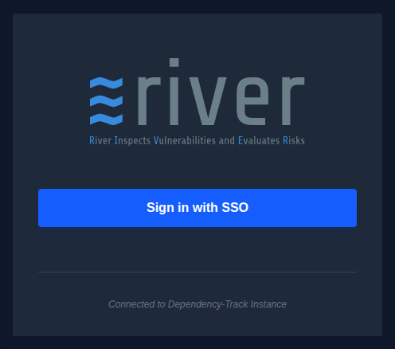

The login screen offers the SSO entry point used before DTVP loads project data.

### What's New

After an upgrade, DTVP shows what changed since the version the signed-in user
last saw, once per user and browser:

- **A new major version** (for example 1.x to 2.0.0, or to one of its
  pre-releases) opens a large dialog. Changes that need action come first, with
  their note; then what is new and what is faster; fixes are folded.
- **A minor or patch upgrade** opens a small dialog with the five most
  important entries and **Show all**.
- A first visit shows nothing, and an upgrade without changes for users is
  remembered silently.

**What's new** in the header (next to Logout) and in the footer (next to the
version) opens it again at any time, with a list of every release of the build.
The entries come from the commit history: new features, fixes, speed-ups and
breaking changes, each with its area and a link to its pull request; chores,
CI, tests, documentation, refactoring and dependency updates are left out
(`GET /api/changelog`, `releases`; `dtvp/release_notes.py`). What a user saw
is kept in the browser's local storage, per user.

### Dashboard

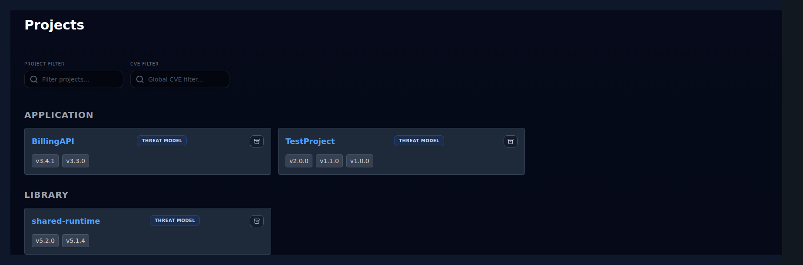

The dashboard lists Dependency-Track projects, versions, classifiers, and reviewer actions such as opening a project or exporting a project archive.

### Project Review


The project review page is the main vulnerability workflow. It combines grouped vulnerability cards, lifecycle state, team ownership, assessment controls, dependency-path context, and code-analysis shortcuts. Compact row badges identify the next useful analyst step; inside the opened card the tab status badges say what is still missing, and every action sits in the sticky bar next to the tabs. A Team filter also scopes the opened card's code evidence and assessment workflow, so another team's saved run or draft does not drive the selected team's next action.

### Filters

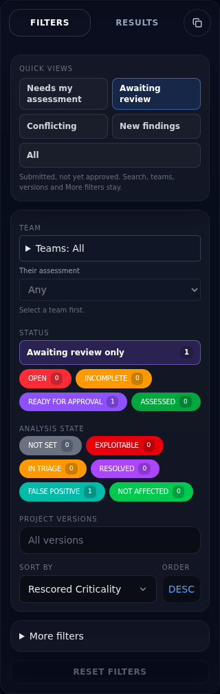

The Filters tab of the sidebar shows the filters most reviews need; everything else is one click away under **More filters**.

- **Quick views** at the top: **Needs my assessment** (Open or Incomplete; with teams selected, their assessment is missing), **Awaiting review**, **Conflicting** (any conflict reason), **New findings** and **All**. A quick view sets the status part of the selection (status, awaiting review, conflict reasons, new findings, the selected teams' assessment) and keeps search, teams, versions and More filters. The one in effect is highlighted; otherwise the line under it says Custom selection.
- **Team** with **Their assessment** (Any, Not recorded, Recorded), **Status** with the **Awaiting review only** toggle and the status chips (Open, Incomplete, Ready for approval, Assessed), **Analysis state**, **Project versions**, **Cutoff**, and the sort order.
- **Cutoff**: the date, **Published (premarket)** or **First attributed (postmarket)**, with an info button that explains which purpose each serves according to the FDA guidance and that a cutoff is a planning aid, not a compliance boundary; then On or before / After, a date, or a rolling preset (7, 14, 28 days ago). The count beside it says how many vulnerabilities the cutoff keeps; a line below says how many are listed only because a finding has no date on the basis. In the detail, findings dated after the cutoff carry an **After cutoff** badge. See [Review workflows](review-workflows.md#cutoff).
- Every option shows how many vulnerabilities it would list with the other filters as they are.
- Every active filter is a chip under the search field, labelled like its sidebar section, with × to remove it. **Reset** (toolbar) and **Reset filters** (sidebar) go back to the default view, else the role's defaults; both are available only when something differs from it.

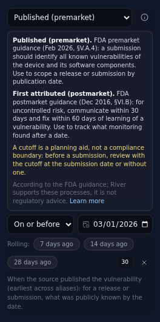

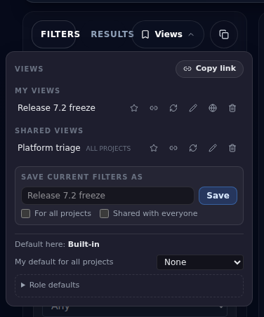

**Views** in the sidebar header lists my views and the shared ones; choosing one applies it, the star makes it my default for the project, and the icons copy its short link `/v/<code>`, update it with the current filters, rename, share (reviewers) or delete it. **Copy link** copies the full URL of the current filters. Below, the current filters are saved under a name, for this project or all projects (reviewers: shared with everyone); the footer shows the default in effect, my default for all projects, and for reviewers the role defaults. See [Saved views and short links](review-workflows.md#saved-views-and-short-links).

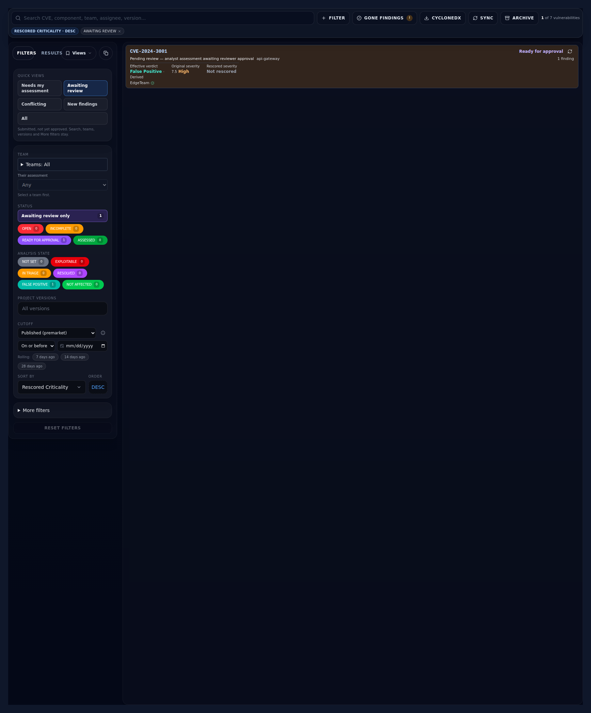

Reviewers start on **Awaiting review**. It lists every vulnerability with an assessment that was submitted for review and is not approved yet: Ready for approval, a team's submission while other teams are still open (Incomplete), a conflicting submission, and proposals saved pending review (carried-over assessments, agents' drafts). The status chips then show how those split up; picking Ready for approval narrows it to what can be approved now. See [Review workflows](review-workflows.md#awaiting-review).

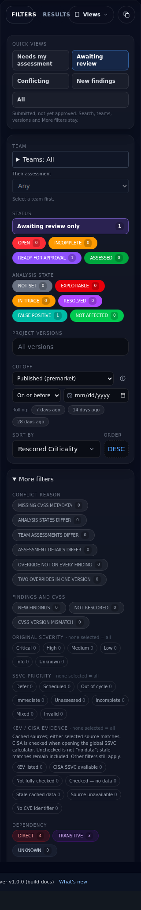

**More filters** holds conflict reasons, new findings, the CVSS toggles (not rescored, version mismatch), original severity, SSVC priority, KEV/CISA evidence and dependency; its summary says how many of them are set. **Legacy analysis filters** inside it holds the threat-model proposal and automatic-assessment filters, which go with threat-model rescoring and Agentyzer in 2.1.0.

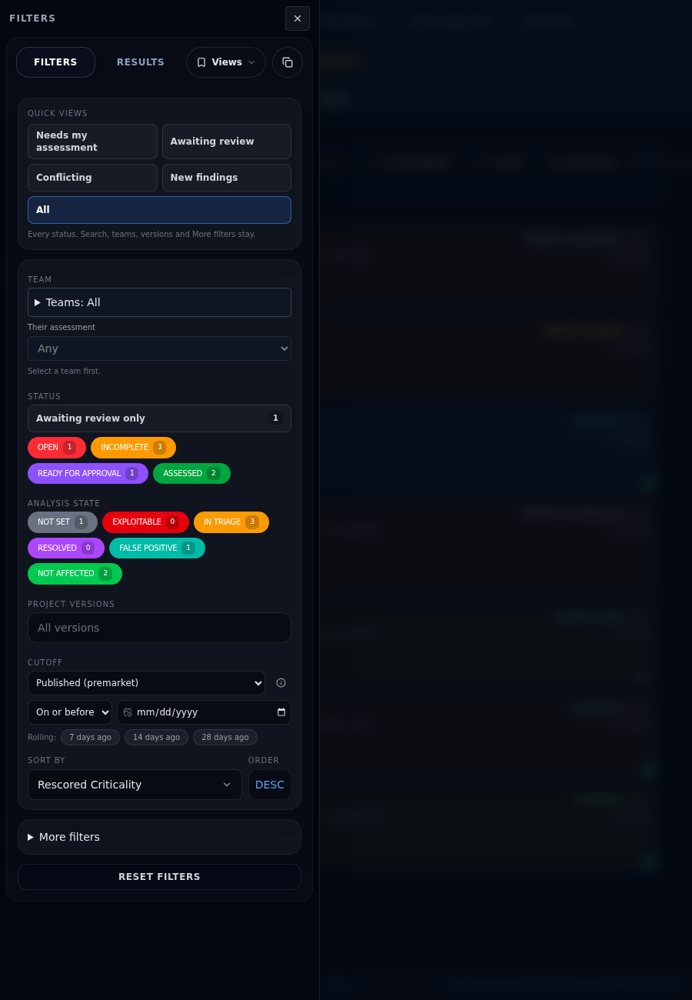

Below 1280px (1680px with a vulnerability open) the same panel opens as a drawer from **Filters** in the toolbar.

### Stable List

Selecting a vulnerability, from the list or through a link, neither reloads the list nor moves it; when the detail pane opens and narrows the list, the clicked row stays where it was.

A save, an approval, a reload of one vulnerability or new exploitation evidence asks for the list again in place: the loaded rows stay, and the scroll position with them. The selected vulnerability keeps its place on screen, even when the sort moved it. When it left the list (an approved one no longer awaits review), the next vulnerability that is still listed is selected and opened at the same place, else the previous one; so approving through Awaiting review goes from item to item without scrolling. An unsaved edit in the open card still asks first. Screen readers hear which vulnerability was selected and why. Only a new query (other filters or sort) starts again at the top.

Opening a vulnerability looks its exploitation evidence up; the list asks again only when that changed what it shows (the row's evidence, or, with an evidence filter, which vulnerabilities match).

### Lifecycle Badges

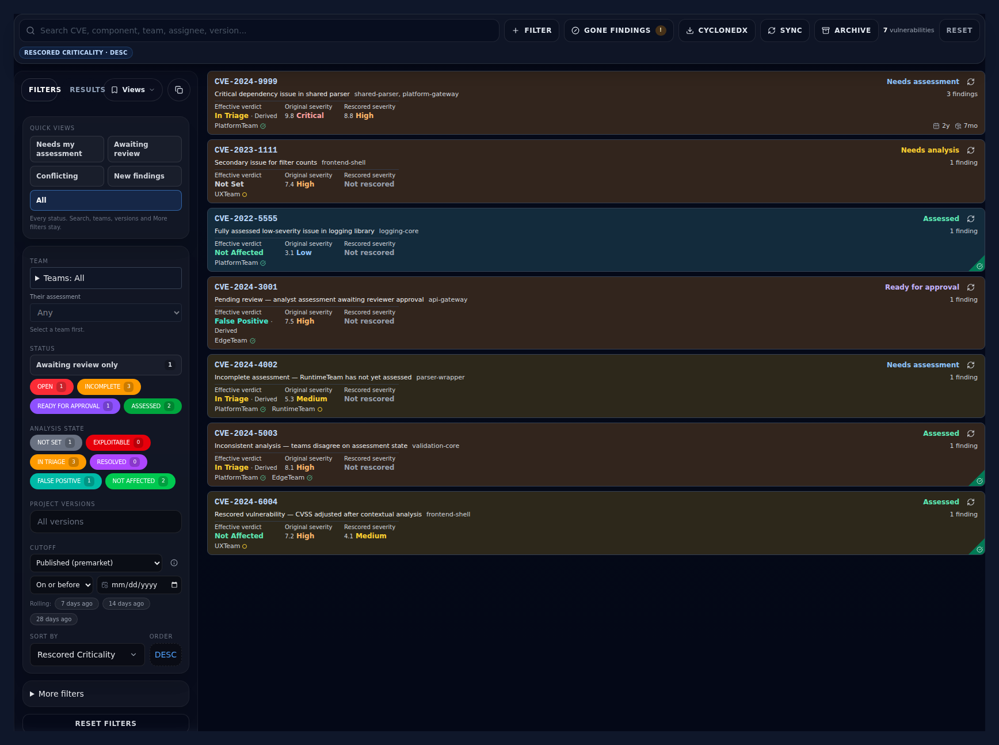

The lifecycle view shows Open, Incomplete, Conflicting, Ready for approval, and Assessed categories ([definitions](assessment-model.md#lifecycle-decision-table)), alongside rescored CVSS values.
Completed list cards have a green folded corner with a checkmark. **Assessed**
uses the standard status format in the list and expanded header.
The calendar icon marks publication. The package-with-magnifier icon marks
first attribution. The list shows ages. Hover for the date and its meaning.
The expanded header aligns component names and finding counts above the
exact UTC dates. First attribution follows the visible findings.

## Vulnerability Review Details

The **Changes requested** quick view and status toggle isolate open reviewer
requests. **History** in the project toolbar reopens recently viewed or
changed vulnerabilities without changing the list filters; **Changes only**
helps locate saved assessments that need correction.

### Vulnerability Card Context

**Where it was found** keeps wide version matrices inside a keyboard-focusable
scroll region. Component names stay fixed when scrolling across versions;
version headers stay fixed when scrolling down through many components.
The same bounds apply in the phone overlay, desktop inspector and workspace.


The Context tab uses three clearly separated sections in a fixed reading order: advisory description and references; where the vulnerability was found, as a matrix of components by project versions with each component's team and the assessment state of each finding (a component row opens its dependency chains); and the existing assessment evidence. Below the matrix, **Team-mapped components** names the components whose team mapping gives those teams: the affected component itself, one above it in a dependency chain, or the catch-all `*`. A note on the team filter appears only when it hides findings. What a section is for is in the tooltip of the info icon next to its title (and read out by screen readers), not in a subtitle.

The team-mapped component list initially shows four components and up to three
component versions/product contexts each. Expand an entry for every version,
or show all components in its bounded scroll area. The assessment tables
comma-group product versions for the same component version and decision;
component versions share a row only when their complete release coverage and
assessment agree. Different coverage and decisions remain separate.

### Assessment Tab

The same inspector and assessment card move between the desktop panel and
the narrow-screen overlay. Resizing preserves the selected team and unsaved
fields, including when entering the workspace afterward.


The Assessment tab starts with the Global and team tabs and the last assessor/reviewer metadata. The component list appears once in the reported-components table. **Reported components for <team>** lists only findings whose resolved ownership includes that team, with their product versions and that team's own current assessment. The same component name can belong to different teams at different versions; the reported-components table preserves that distinction. Team aliases are resolved; General and other teams' decisions do not substitute for the team's own block. **Show all teams** lets a reviewer choose another team independently of the outer list filter. Global is explicitly labelled **Reported components — all teams** and shows the full scope. Missing ownership or assessment stays explicit; a report or missing finding does not establish actual affectedness. **About this vulnerability** shows the first three lines of the advisory description as plain text (sanitised like the Context rendering; **Show more** expands it). The advisory title stays in the main header, and component/version coverage stays in the reported-components table. Compact icons mark the advisory's CVSS attack conditions, weakness classifications, remediation advice and external references; the long labels appear on hover and remain available to screen readers. CWE identifiers stay visible, with full names on hover and in accessibility text. References have one group icon and retain their text link labels; duplicate reference URLs are removed. The summary folds to a one-line description preview, initially folded in the workspace where Context is already visible. The decision and rationale follow, and the tabs and actions stay visible while scrolling. On the Global tab, reviewers see the [team overview](#team-overview) above the advisory summary. Below the decision, **Show generated text** (reviewers, collapsed) shows the stored text read-only with **Copy**; it is generated from the fields and is what is exported, so it is not editable. **More** → **Clean up assessment…** opens the [cleanup](#assessment-cleanup); **More** → **Clear assessment…** in the action bar clears the open team's or the Global assessment, or the whole of it (see [Review workflows](review-workflows.md)), after a confirmation naming the findings, components and versions.

For a saved decision, the clear button in **Decision & rationale** and the
**Not Set** option both open the scoped confirmation.

 While something required is missing, the decision section says what ("Still needed to submit: analysis details"); the Submit button is enabled once nothing is missing. The CWE and the fix advice are the ones Dependency-Track serves with the finding (`cwes`, `recommendation` of each grouped vulnerability).

### Team Overview

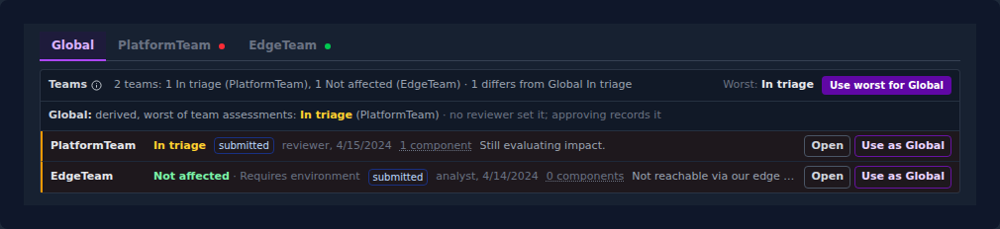

On the Global tab a reviewer sees what every team decided, above the form, in the card and in the workspace's assessment pane. It replaces the earlier one-line team summary. There is one row per team the vulnerability requires and per team with a current assessment block that it no longer requires (marked "not required", without a tab). Team names are resolved through the team mapping's aliases, so a block written under an alias is its team's row. Each row shows:

- the state and justification; an unsaved edit of the team is marked "(unsaved)", and for a team without an assessment the analyzer proposal, if any, is marked "(analyzer)";
- the status: **approved** (the block carries a reviewer, or the vulnerability is not pending review and has a Global decision), **pending review** (the vulnerability waits for a review), **submitted** (recorded, not pending, no Global decision yet) or **no assessment**;
- who assessed it and when;
- the number of the team's components, with their names in the tooltip (the "Components" of the team tab);
- the first line of the rationale; **More** shows all of it in place.

The header line sums it up, for example "4 teams: 2 Not affected, 1 Exploitable (H-Core) · 1 missing (K-Core) · 2 differ from Global Exploitable", with the worst state and **Use worst for Global**, which fills the Global form from all teams as the approval does. Only teams with a saved assessment count toward the states; drafts and analyzer proposals of a missing team do not. A row that differs from the state most teams share (all rows when states tie) or from the state in the Global form is highlighted. Highlighted rows come first, then missing teams, then the agreeing ones. With more than five teams the overview shows only the highlighted and missing rows until **Show all** is pressed. Below the header a line points to the [Global decision](assessment-model.md#the-global-decision): "Global: derived, worst of team assessments: Exploitable (H-Core)" while no reviewer has set one (approving records it), or "Global: set by reviewer: Not affected", with "differs from the worst team assessment (Exploitable, H-Core)" and **Use worst** when the two differ. The state chip of a derived decision carries "· derived".

**Open** switches to the team's tab, like a click on it; the Global draft is kept for the way back, and a team hidden by the team filter is shown. **Use as Global** puts the team's state and justification into the Global form and leaves its text alone; nothing is saved. Former teams' assessments, kept as historical blocks, are not rows: a note "N former team assessments" leads to the existing assessment evidence on the Context tab, where they are listed. The logic is in `frontend/src/lib/teamOverview.ts`, the view in `TeamAssessmentOverview.vue`.

### Assessment Workspace

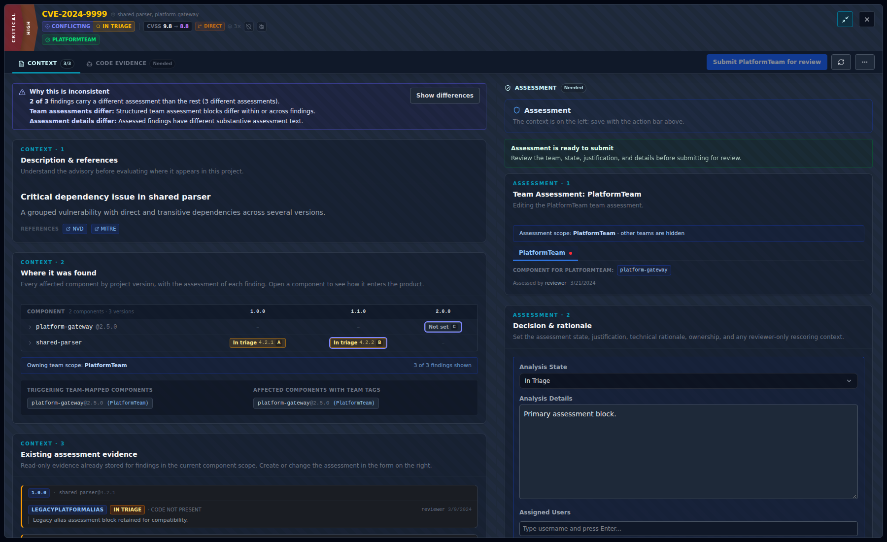

From a viewport of 1280px, the header of the vulnerability detail has a workspace button next to Close. It opens the same card full screen, with the context on the left and the assessment form always visible on the right; the action bar with Save or Submit, Approve, Reload and More spans both columns. The left pane shows the differences banner and either Context or Code Evidence, chosen by the two remaining tabs. The two panes scroll on their own, so the evidence can be read while the decision, rationale and review checks are filled in. The form starts with its status heading and the Global or team tabs. The vulnerability summary starts folded because the Context pane shows the full description.

Show differences opens the comparison in the left pane. Apply, Adopt, Use for all findings and the analyzer's apply actions fill the form without changing the left pane: the decision section scrolls into view and is briefly highlighted.

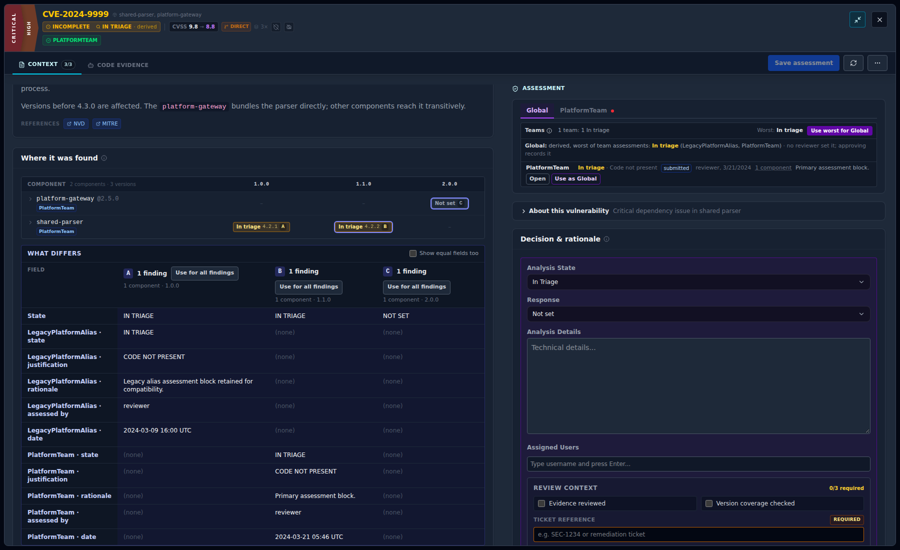

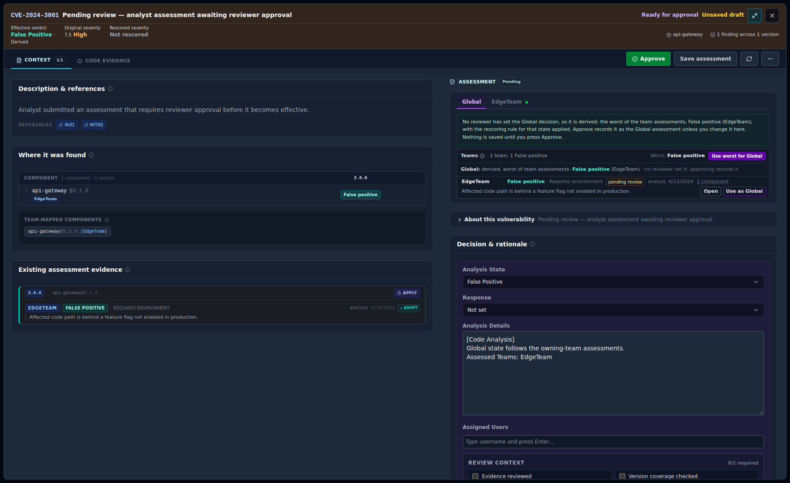

On the Global form **Approve** saves and approves the decision in place. With a team selected or Global unset, **Review & approve** opens the Global form and prepares a draft from the team decisions if needed. If approval is unavailable for a pending assessment, the reason appears below the tabs and actions. The workspace button or Esc leaves the workspace and lands on the Assessment tab with every unsaved edit kept. Esc first closes an open menu or dialog, and Esc in a text field stays with the field; on a checkbox, a button or plain text it leaves the workspace. While the workspace is open, Tab and Shift+Tab wrap inside it, and a click on plain text keeps focus in it. Close (X) still asks about unsaved edits. Below 1280px the button is not offered, and the workspace closes when the window becomes narrower than that, with focus on the Assessment tab.

### Ready For Approval

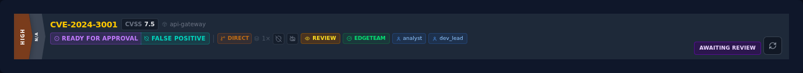

Cards distinguish **Ready for approval** from **Awaiting review**. Reviewer
actions and individual assignees are in the Assessment form.

### Assignee Filter

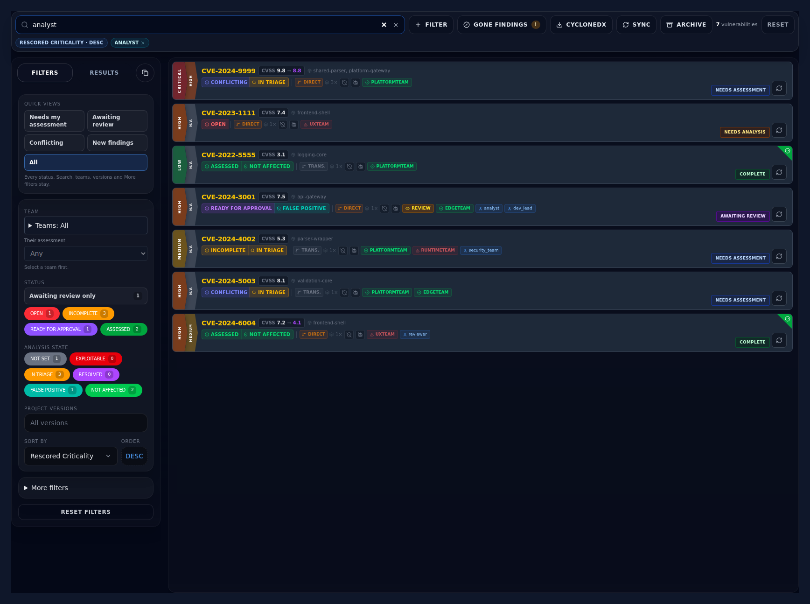

The `assignee:` search token (URL parameter `assignee`) narrows the project view to vulnerabilities assigned to a specific user.

### Automatic Assessment Filter


Automatic assessment markers show groups with saved automatic code-analysis results, and the sidebar filter (under **More filters**, **Legacy analysis filters**) can narrow the list to vulnerabilities with or without those cached assessments. These filters go with Agentyzer in 2.1.0.

### User Assignment Form


The expanded assessment form supports assigning users with known-user suggestions.

### Review Context

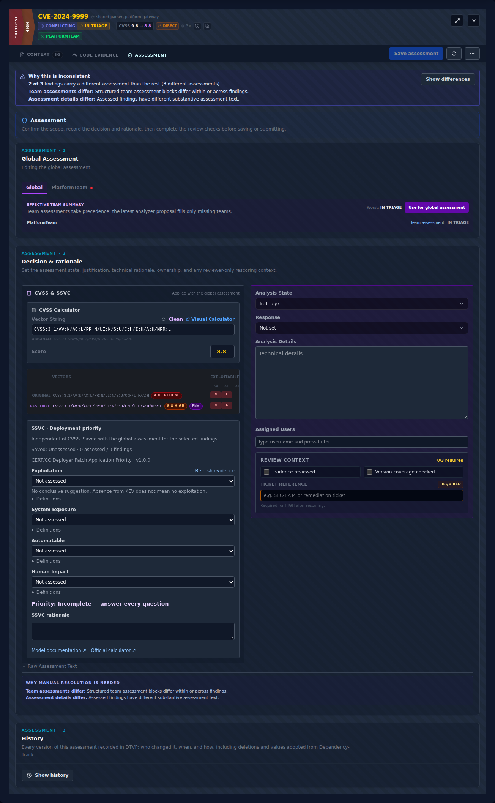

The Assessment tab uses the same section hierarchy as Context and Code Evidence: the Global or team tabs (on Global, the team overview), the vulnerability summary, then the decision and rationale. With a Team filter, analysts see only that team's subview ("Other teams are hidden by the team filter"); reviewers start focused on it and can explicitly reveal Global and all-team controls with **Show all teams**. Team subviews present the latest scoped analyzer result as an optional proposal, while saved or manually edited team assessments remain authoritative. The reviewer-only Global subview shows the team overview with the worst effective state across team decisions and analyzer fallbacks, and also contains CVSS and rescoring, after the decision fields, so the score and assessment can be evaluated together. Ticket references are marked required only when the current rescored severity is High or Critical.

### Conflicting Assessment


A banner above the tabs (at the top of the context pane in the [assessment workspace](#assessment-workspace)) states why the vulnerability is inconsistent and what each team decided. It is the only place that says so; the Global form does not repeat it. Existing assessment evidence in Context shows the conflicting team blocks. A conflict is a team that contradicts itself, or two different values of a part the findings both have; teams that decide differently, and a block, response or SSVC record some findings lack, are not ([Assessment model](assessment-model.md#vulnerabilities-and-assessments)). When the findings only differ, the neutral banner offers **Clean up…** as well. **Clean up…** on the banner opens the assessment cleanup; **Repair…** (reviewers, when a rule-based repair applies; the tooltip names the stages) opens Repair Assessments for this vulnerability.

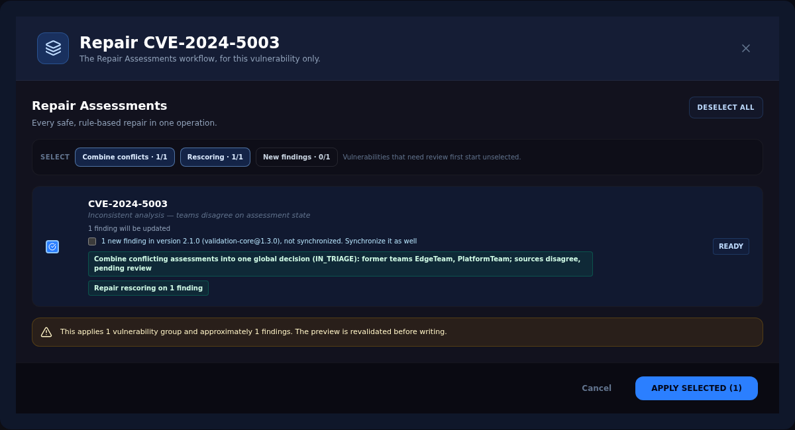

The dialog is the [Bulk Changes](#bulk-changes-dialog) preview of Repair Assessments for this vulnerability only, with the same per-finding detail, the new-findings checkbox and one Apply; afterwards the card shows the repaired assessment in place.

### Assessment Cleanup

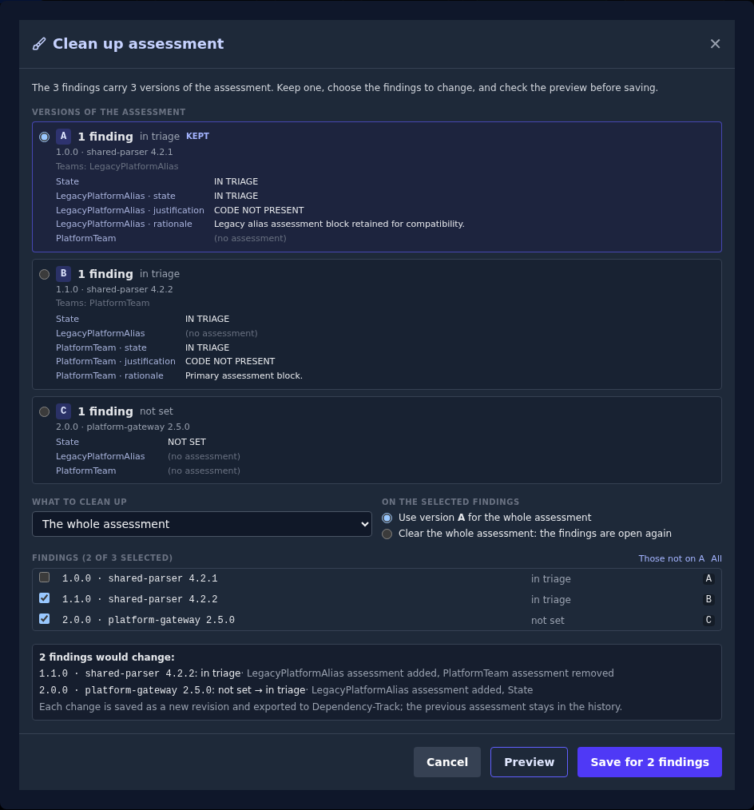

When a rule-based repair would make the findings agree, the cleanup says so above the versions, with **Repair instead…**. The cleanup lists the versions of the assessment (A is the most common) with their findings, state, teams and the fields in which they differ, including the SSVC record. Keep one, tick the findings to change (by default those not on the kept version), choose the whole assessment, the Global one or a team's (teams the mapping does not know, or only as an alias, are marked), and use the kept version or clear it. **Preview** lists per finding what changes; **Save** writes exactly that, as new revisions exported to Dependency-Track. See [Cleaning up an inconsistent assessment](import-export.md#cleaning-up-an-inconsistent-assessment).

### Differences Between Findings


When findings carry different assessments, each one has a letter in the matrix and "Show differences" compares them field by field. The card shows a warning ("Why this is inconsistent") only when the differences make the vulnerability inconsistent; differences that are expected, such as version-specific parts, get a neutral note ("Assessments differ between findings"). A version with its own assessment (a [version override](assessment-model.md#scopes-and-lifecycle)) carries "override: <label>" under its column header, and the card lists the overrides above the banner, with "pending approval" until a reviewer approves.

### Rescored CVSS


The original and rescored severity columns left-align each CVSS score and
severity label under its heading. Scores retain one decimal place. Wide headers
place affected components, finding counts and evidence alongside the scores.
An unrescored vulnerability shows **Not rescored**. The row and expanded
header use the saved rescored severity as a tint at the base background's
lightness, with original severity as the fallback. The effective verdict has
its own colour.

### Global Review CVSS And Rescoring


The Global subview of Assessment contains the vector editor, visual calculator entry point, current vector comparison, tmrescore reasoning, and analyzer CVSS notes when present. The comparison lists each vector (original, proposed, rescored) on its own line with its score, breaking a long vector after a "/", and below it one small table per metric group (Exploitability, Impact, and the groups the vectors use), which wrap onto the next line in a narrow column instead of being cut off.

### CVSS Calculator


The CVSS modal provides an interactive vector editor for contextual score adjustments.

### Bulk Changes Dialog

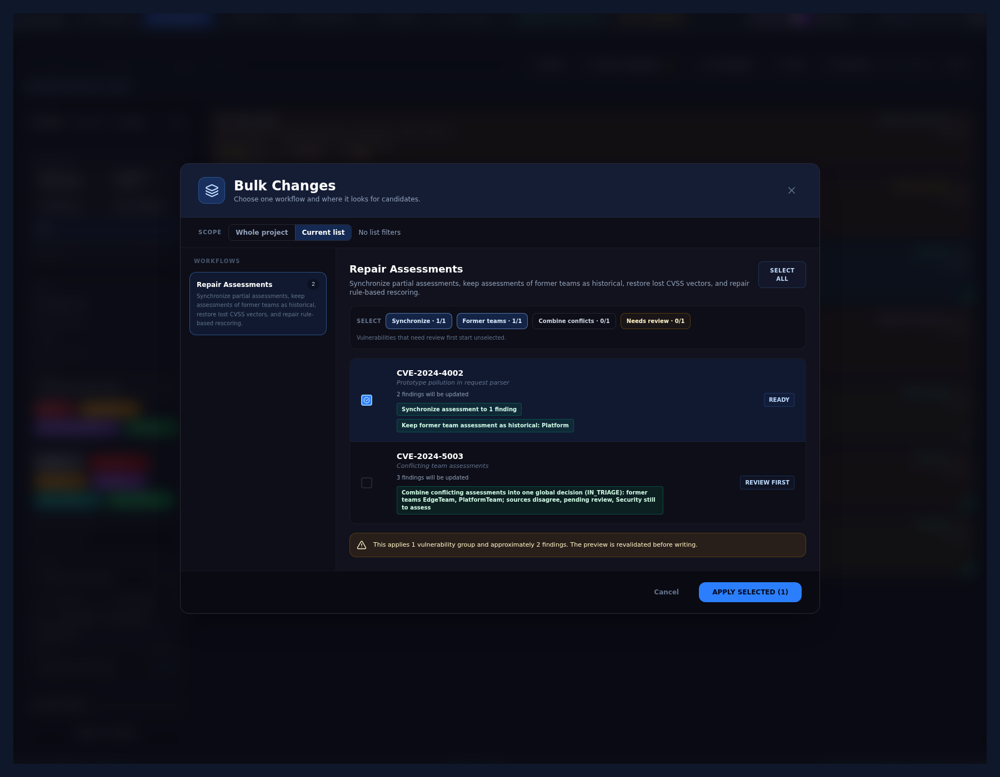

The Bulk Changes dialog previews the selected workflow before applying it in one action. The scope line above the workflows chooses **Whole project** (all versions, no list filters; the default while the list shows only its role default) or **Current list** (the list's filters, named as its chips). Repair Assessments labels each applicable repair per vulnerability; where a new version added findings, the row states their number and offers a checkbox to synchronize them as well; **New findings** in the Select row ticks it for every vulnerability at once and selects them ([New findings](review-workflows.md#new-findings)). Restore Team Assessments From Export first asks for a Dependency-Track export, shows the uploaded file (tool, project, export time, start of its SHA-256), and then lists per vulnerability the team assessments it would add as historical blocks, with the entries it could not match.

### Conflict Resolution

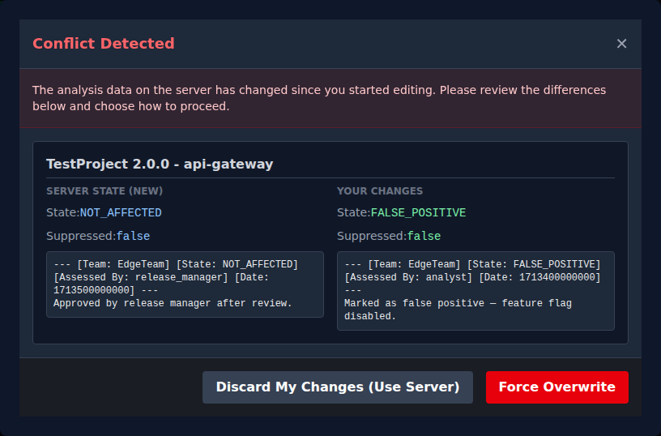

The conflict dialog appears when Dependency-Track changed the underlying analysis while a reviewer was editing; it compares the current server state with the pending change.

## Statistics

### Statistics Page

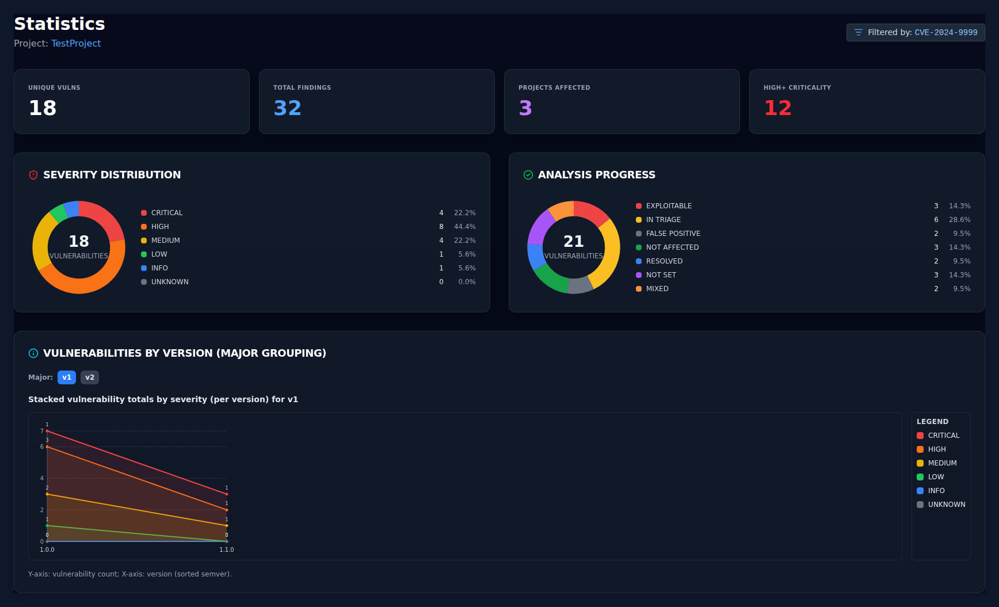

The statistics page summarizes severity and state trends across project versions.

### Statistics Sidebar


The project sidebar provides compact counts and filterable state summaries without leaving the review page.

## Configuration And Archives

### Settings


Settings opens on **Team Mapping** for reviewers; see [Settings Team Mapping](#settings-team-mapping).

Every user can open Settings for the **Access Tokens** tab, which creates and revokes personal tokens for AI agents and scripts and lists the changes made with them; see [AI and API access](ai-access.md). The remaining tabs are reviewer-only, including **Export**, which lists the assessments that have not reached Dependency-Track, shows why an export is failing, and exports or discards entries on request; see [Import and export](import-export.md).

### Settings Team Mapping


The editor works on the mapping organised by team ([ADR 0012](adr/0012-team-centric-mapping.md); format and rules in [Team mapping](assessment-model.md#team-mapping-and-analyzer-guidance)) and on the [mapping report](assessment-model.md#team-mapping-report), which the server builds in the background from the stored BOMs and findings. One sentence says what the screen is for; the **?** next to the title opens the entry syntax. The status line says when the report was built, that it is out of date and being rebuilt (the previous one stays visible), or that it failed; **Rebuild** (or **Try again**) builds it again. While the report is missing, the numbers show "–" rather than 0.

The overview shows four numbers, each opening its view: **Unowned findings** (on the catch-all, with "→ N after saving" once the draft changes it), **Owned by a team** (the share of findings), **Errors** (they block saving) and **Warnings**. Below it one view is shown at a time; the tabs follow the ARIA tabs pattern (arrow keys switch).

- **Unowned** (the default) lists the project roots and topmost components above the findings on the catch-all across all projects, by unowned findings, with projects, versions and a suggested entry and why. A row the draft already gives to a team says so.
- **Projects** lists the projects by unowned findings with their owned share, and opens on the one with the most. Picking a project shows the BOM tree of a version, loaded one level at a time, with each component's owner and why (own entry, inherited, the project, the catch-all; an icon and border tell them apart, not colour alone), its findings and those unowned. With unsaved changes the tree shows the draft's owners and marks a changed owner "was …". Components no dependency links to are listed under the root as unlinked (flat BOMs). The tree is an ARIA tree: one tab stop, arrow keys move, open and close, Home and End jump, Space or Enter (or a click) picks a component; **Assign the whole project…** picks the project.
- Picking opens **Assign … to a team**: each pick with its suggested entry (the project for a root as `project::<project>`, the package its purl names, `group:name`, or `project:<project>::<name>` for a generic name), editable, and what it owns in words. The team is a combobox of the existing teams, found by name or former name, with **Create team …** for a new name. The effect (how many findings change owner, from which team to which, in which projects, against the saved mapping) is previewed as the draft changes. **Add to …** puts the entries into the team; a confirmation offers **Undo**, and the tree and the overview update.
- **Teams** shows a collapsible card per team with its aliases, projects and component entries; search, a project filter and **Flagged entries only** narrow them. Each entry shows the components and projects it matches, the findings it owns and its flags; clicking it opens the projects view with its matches highlighted. Projects are added from the Dependency-Track project names, components with an autocomplete of stored names, groups and purls, and a live preview of what the typed entry matches and which more specific entries would win.
- **Checks** groups the problems of the draft by kind, errors first, then by the findings concerned. Errors block saving: an entry, project or the catch-all under two teams (fix: **Keep in …**), invalid entries (fix: **Remove entry**), alias clashes. Warnings do not: projects with unowned findings (**Assign project…**), near-duplicates given to different teams such as `VPStatsApp` and `vp-stats-app` (fix: **… owns all**), duplicates up to case or form (fix: keep one), entries that never win and stale entries that match no stored component (fix: **Remove entry**), broad entries, and what converting an older file could not keep. Every item also jumps to its team, entry or project.
- **Raw JSON** shows the draft as JSON, editable and checked the same way, and uploads a file in either format, which replaces the saved mapping and is stored organised by team.

Nothing is saved until **Save team mapping**. With unsaved changes a bar stays at the bottom of the screen with their number, how many findings change owner, the errors blocking the save, **Review changes** (the changes per team and their effect), **Discard** (after a confirmation) and **Save team mapping**. Leaving the tab, the page or the browser tab with unsaved changes asks first. A file still in the older format shows a note and the bar, since saving writes it organised by team.

### Settings Access Tokens


The tab shows the MCP endpoint URL, the form for a new token, the user's tokens with their access level and last use, and recent changes made with tokens.

### Settings Archives


The archive tab exports, imports, previews, applies, and downloads project archive snapshots.

## Threat-Model Rescoring

### TMRescore

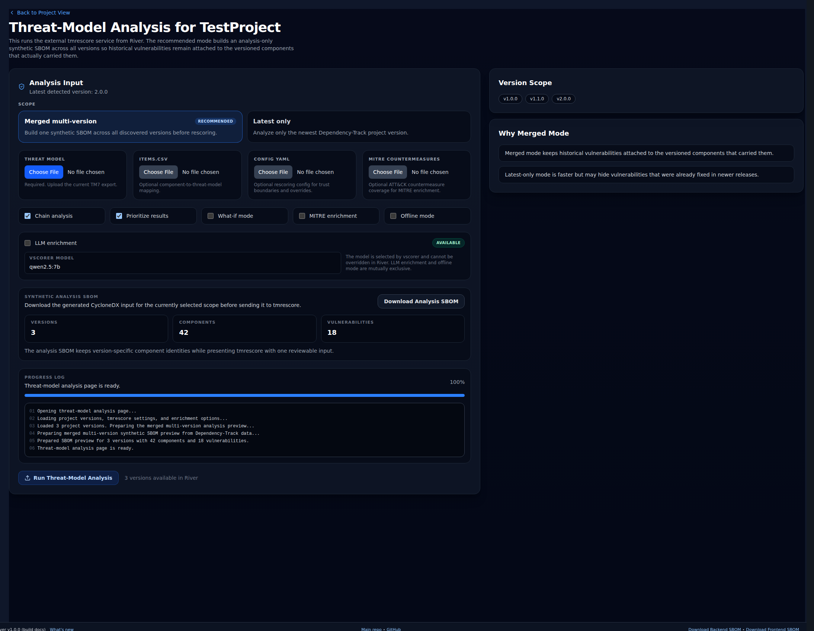

The threat-model rescoring screen prepares a synthetic analysis SBOM, selects latest-only or merged multi-version scope, and submits tmrescore inputs with optional LLM enrichment.
The configured model is reported by vscorer and shown read-only in DTVP.

## Code Analysis

### Running Inline Scan


The Code Evidence tab shows running and queued analyses above the evidence list, with queue position, active progress, and the current pipeline activity.

### Inline Scan Result

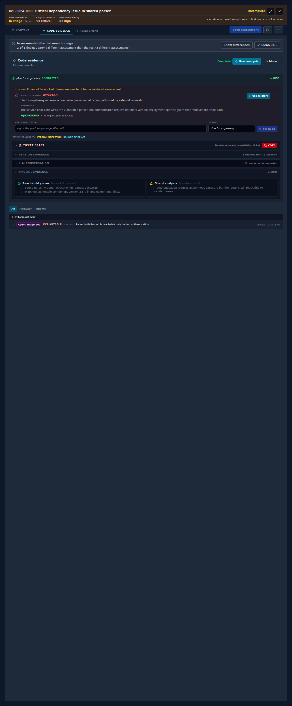

A queue result that is not saved yet opens in place with its outcome, follow-up question, and technical disclosures. Saved runs and agent evidence appear in one list below it; see [Code evidence reader](#code-evidence-reader). Derivative benchmark records do not displace a target's latest analysis. When a Team filter is active, history and availability badges include only compatible team-targeted runs (including configured aliases) plus legacy runs for the visible components; combining results stages only the filtered team's draft.

### Code Evidence Reader

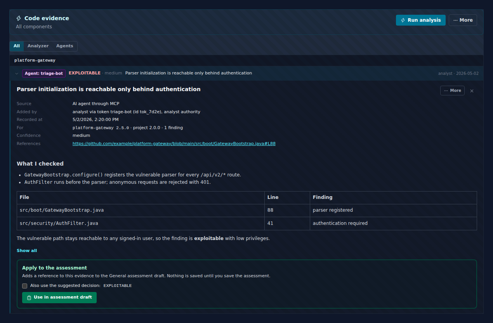

The tab header has two controls: **Run analysis** (components and guidance; hidden when no analyzer is configured) and **More** (Refresh, Clean up analyzer data). Below it, one list holds analyzer runs and the evidence AI agents added through MCP, grouped by component, with an "All components" group for evidence about the whole vulnerability. Chips filter by source (All, Analyzer, Agents); withdrawn agent evidence stays hidden unless **Show withdrawn** is ticked. Each row is one line: the source, the verdict or suggested state with confidence, the title, the author and time, and "Used in assessment" once a saved assessment referenced it. Older analyzer runs of a component sit behind **Earlier runs**.

Clicking a row opens the reader under it: the provenance (who added it, through which token or run, when, and for which components, versions, and findings; agent evidence none of whose findings Dependency-Track still reports is marked "no longer reported"), the Markdown body rendered through an allow-list sanitiser, and for analyzer runs a collapsed **Technical details** section with the assessment draft, benchmark, component results, ticket, version coverage, LLM conversation, pipeline evidence, and the follow-up question. **Apply to the assessment** is a separate box: for agent evidence it adds a one-line reference to the draft, and the suggested decision only when ticked; for an analyzer run it fills the draft with the run's state, justification, and CVSS. Nothing is saved until the assessment is saved, and only evidence whose reference line is still in the saved text is recorded as used. If the save is rejected because referenced evidence was withdrawn in the meantime, the card names it and stops sending it; the rest of the draft stays. The reader's **More** offers Withdraw (agent evidence; reviewers and the author, with a reason) and Remove run (analyzer). At the bottom, **Apply all latest analyzer results** shows the worst case across the latest runs, with the per-target cards collapsed.

Opening LLM Conversation provides a taller vertically resizable timeline with an optional near-full-screen dialog. A summary above the timeline reports Local-to-LLM and LLM-to-Local message/token totals, captured and per-turn timing, inferred inter-turn local/tool time, retries, context adaptation, model/provider coverage, and requested-versus-locally-executed tool statistics. Every captured turn separates the Agentyzer-assembled request, tool exchange, and raw model response with explicit direction labels and copy actions. Tool activity also identifies bounded local dependent-repository inspections and their returned evidence separately from web/package fetches. If no trace was persisted, configured prompt values remain visibly marked as a non-captured fallback.
The Additional guidance used panel lists the exact component/reviewer guidance found in persisted model requests and the turn numbers that received it. Guidance saved on the analyzer request but absent from the trace is marked as not verifiable; storage-policy redaction is explicit rather than being mistaken for an empty guidance configuration. Follow-up runs resolve static guidance against their selected target component as well as initial runs.
Each request, tool, and response stage is independently collapsible. Requests and tool evidence start closed while model responses remain open; Expand all and Collapse all switch the complete conversation between audit and overview modes. Expanded stage bodies are bounded, keyboard-focusable scroll regions so unusually long prompts, traces, and answers do not obscure the rest of the conversation. Inline and nested regions pass unused wheel scrolling to the surrounding detail view when they have no overflow or reach a boundary; only the full-screen dialog contains overscroll.

### Code Analysis Dashboard

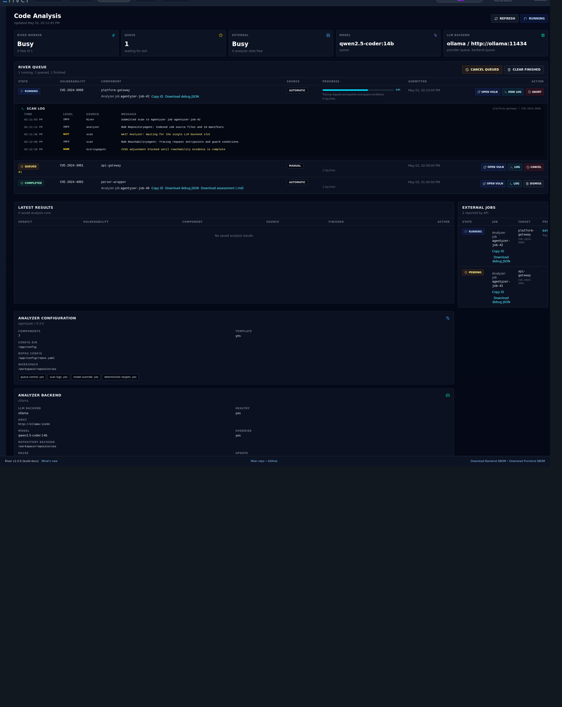

The dedicated dashboard shows DTVP worker state, queue pressure, active agents, model and LLM backend metadata, analyzer configuration, external jobs, auto-sweep status, and expandable structured scan logs. Expanded logs keep the newest line visible and use text color for log levels without boxed rows.

### Analysis Queue Dropdown


The header dropdown remains a compact shortcut for recent queued, running, and completed code-analysis jobs, with a link to the full dashboard.
