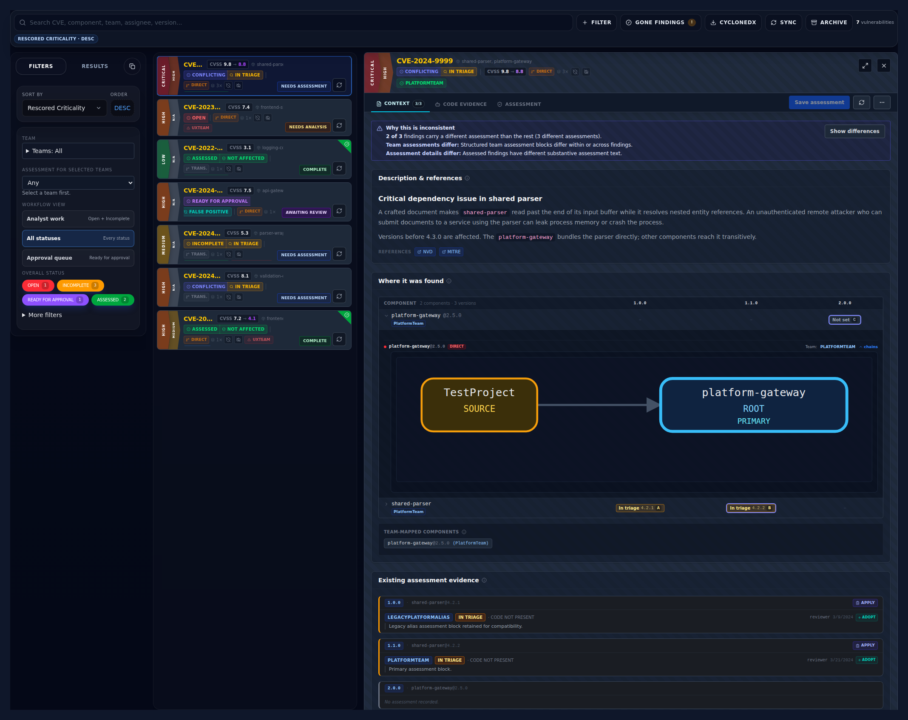
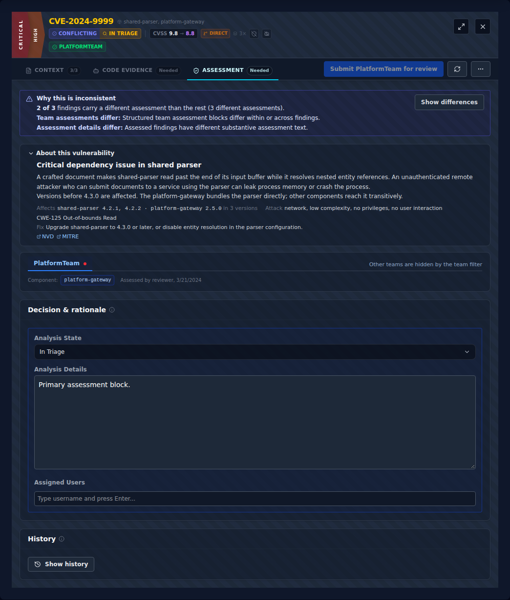
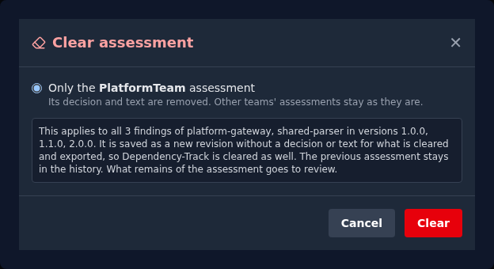
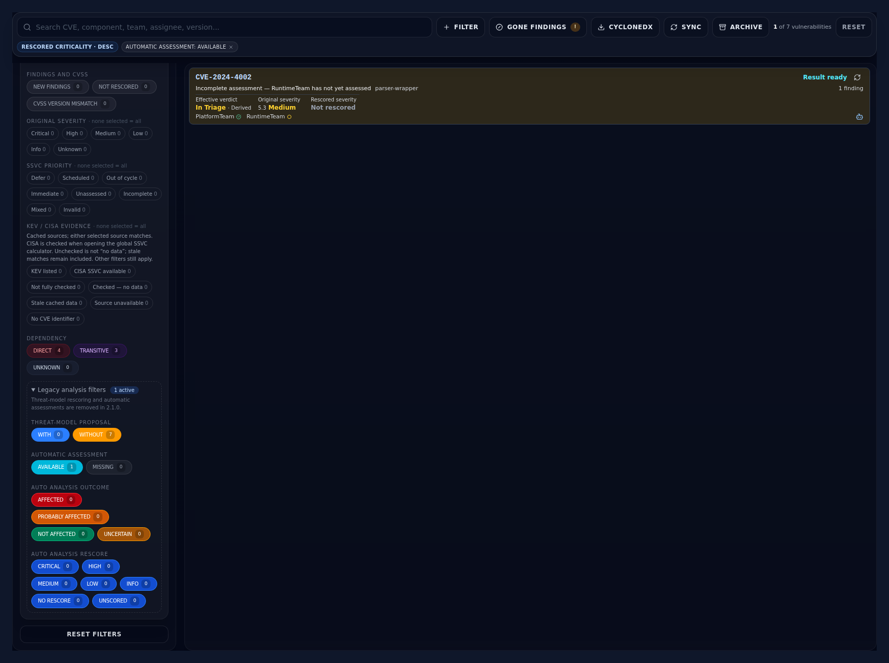
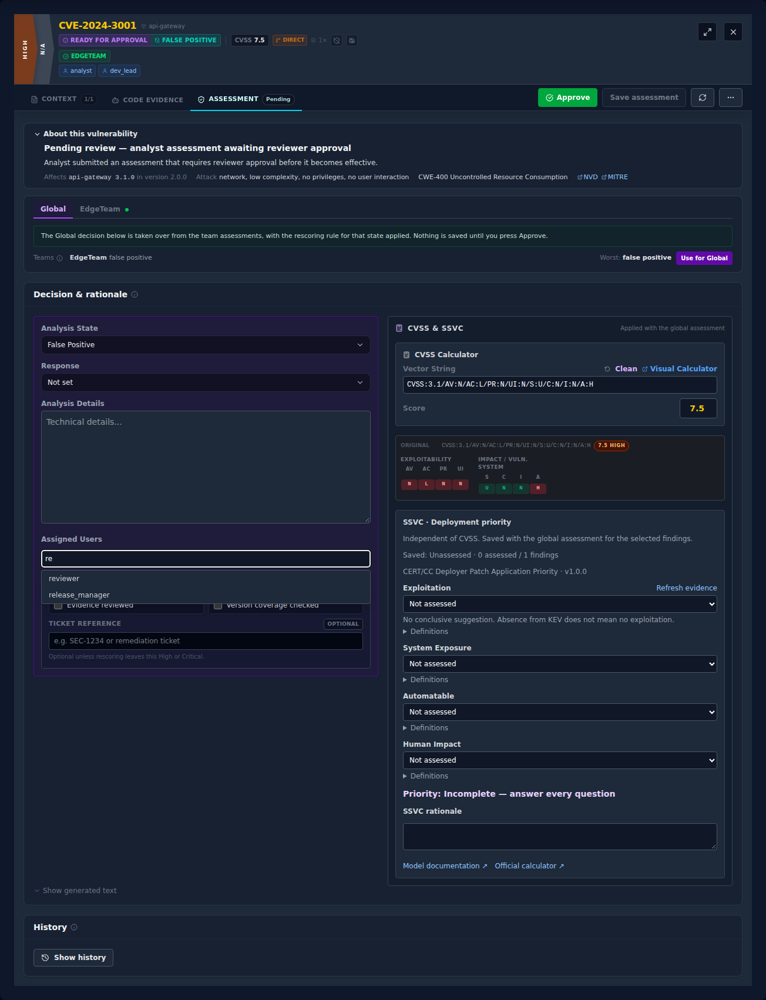
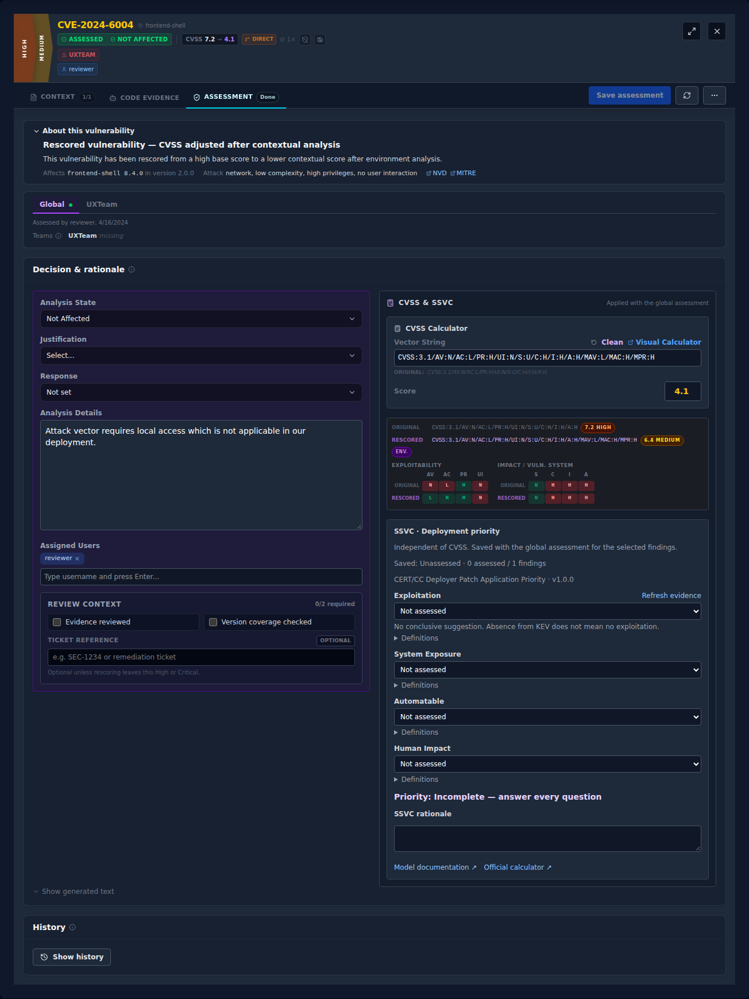
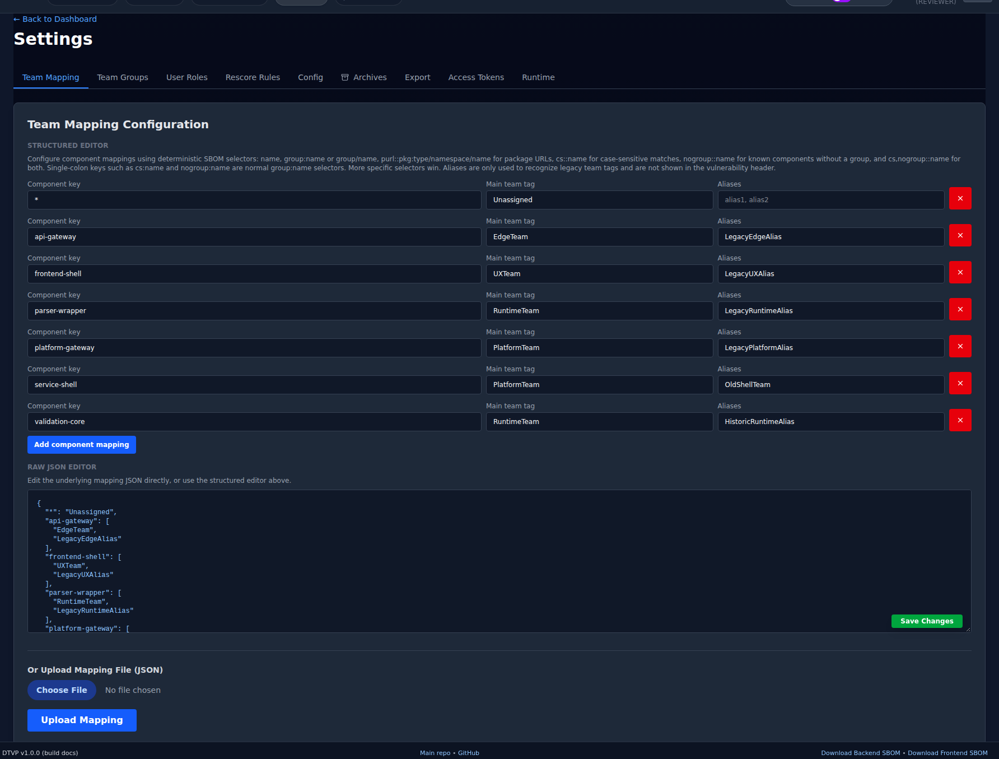
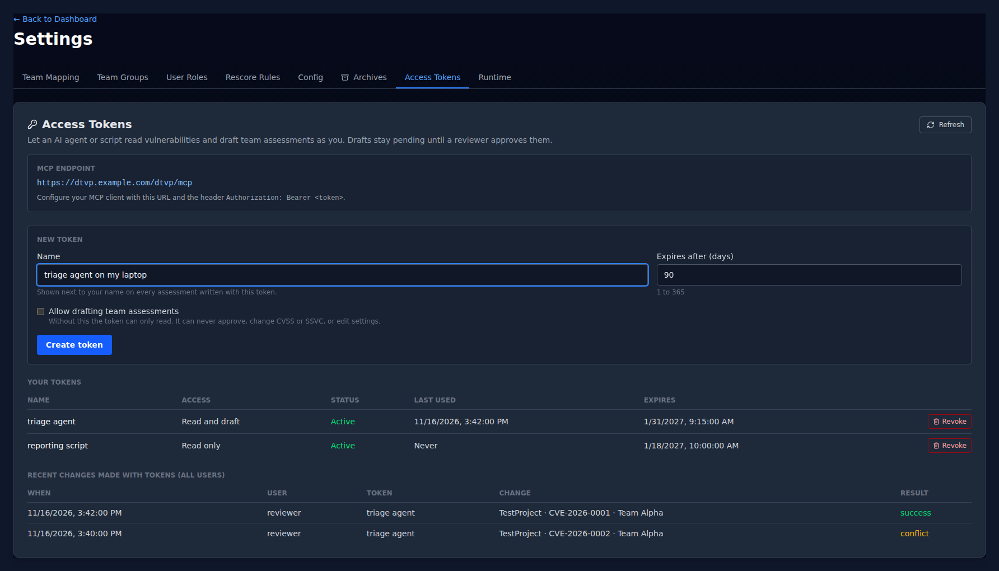
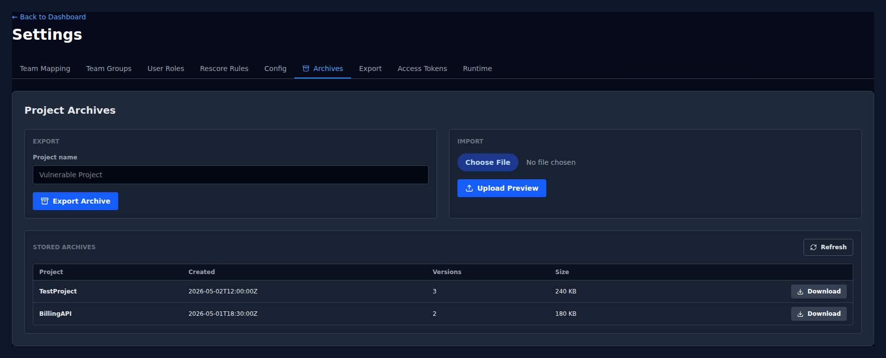
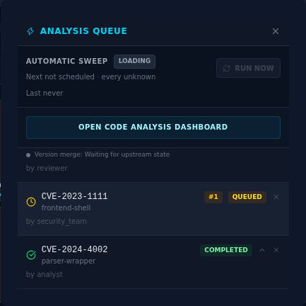

# DTVP Screen Guide

This guide describes the application screens covered by the documentation screenshot set. Regenerate the images from the repository root with:

```bash
cd frontend && npm run test:ui:docs -- --project=chromium
```

The capture flow uses mocked API fixtures and Chromium for a consistent screenshot set. Project examples explicitly select all five lifecycle categories; reviewers normally start with Ready for approval.

## Entry And Project Navigation

### Login


The login screen offers the SSO entry point used before DTVP loads project data.

### What's New

After an upgrade, DTVP shows what changed since the version the signed-in user
last saw, once per user and browser:

- **A new major version** (for example 1.x to 2.0.0, or to one of its
  pre-releases) opens a large dialog. Changes that need action come first, with
  their note; then what is new and what is faster; fixes are folded.
- **A minor or patch upgrade** opens a small dialog with the five most
  important entries and **Show all**.
- A first visit shows nothing, and an upgrade without changes for users is
  remembered silently.

**What's new** in the header (next to Logout) and in the footer (next to the
version) opens it again at any time, with a list of every release of the build.
The entries come from the commit history: new features, fixes, speed-ups and
breaking changes, each with its area and a link to its pull request; chores,
CI, tests, documentation, refactoring and dependency updates are left out
(`GET /api/changelog`, `releases`; `dtvp/release_notes.py`). What a user saw
is kept in the browser's local storage, per user.

### Dashboard


The dashboard lists Dependency-Track projects, versions, classifiers, and reviewer actions such as opening a project or exporting a project archive.

### Project Review



The project review page is the main vulnerability workflow. It combines grouped vulnerability cards, lifecycle state, team ownership, assessment controls, dependency-path context, and code-analysis shortcuts. Compact row badges identify the next useful analyst step; inside the opened card the tab status badges say what is still missing, and every action sits in the sticky bar next to the tabs. A Team filter also scopes the opened card's code evidence and assessment workflow, so another team's saved run or draft does not drive the selected team's next action.

### Lifecycle Badges


The lifecycle view shows Open, Incomplete, Conflicting, Ready for approval, and Assessed categories, alongside rescored CVSS values.

## Vulnerability Review Details

### Vulnerability Card Context


The Context tab uses three clearly separated sections in a fixed reading order: advisory description and references; where the vulnerability was found, as a matrix of components by project versions with each component's team and the assessment state of each finding (a component row opens its dependency chains); and the existing assessment evidence. Below the matrix, **Team-mapped components** names the components whose team mapping gives those teams: the affected component itself, one above it in a dependency chain, or the catch-all `*`. A note on the team filter appears only when it hides findings. What a section is for is in the tooltip of the info icon next to its title (and read out by screen readers), not in a subtitle.

### Assessment Tab



The Assessment tab starts with **About this vulnerability**: the title, the first three lines of the description as plain text (sanitised like the Context rendering; **Show more** expands it in place) and the key facts on one line: the affected components and versions in scope, what an attacker needs according to the CVSS vector (for example "network, low complexity, no privileges, no user interaction"), the CWE, the source's fix advice and the references. The block folds to one line. Below it are the Global and team tabs with the component of the selected team and who assessed it last, then the decision and rationale. On the Global tab, reviewers see one line with each team's state ("PlatformTeam in triage", an analyzer fallback marked "(analyzer)", a team without either "missing"), the worst of them and **Use for Global**; more than six teams fold behind "+N more". Below the decision, **Show generated text** (reviewers, collapsed) shows the stored text read-only with **Copy**; it is generated from the fields and is what is exported, so it is not editable. **More** → **Clear assessment…** in the action bar clears the open team's or the Global assessment, or the whole of it (see [Review workflows](review-workflows.md)), after a confirmation naming the findings, components and versions.

 While something required is missing, the decision section says what ("Still needed to submit: analysis details"); the Submit button is enabled once nothing is missing. The CWE and the fix advice are the ones Dependency-Track serves with the finding (`cwes`, `recommendation` of each grouped vulnerability).

### Assessment Workspace


From a viewport of 1280px, the header of the vulnerability detail has a workspace button next to Close. It opens the same card full screen, with the context on the left and the assessment form always visible on the right; the action bar with Save or Submit, Approve, Reload and More spans both columns. The left pane shows the differences banner and either Context or Code Evidence, chosen by the two remaining tabs. The two panes scroll on their own, so the evidence can be read while the decision, rationale and review checks are filled in. The form starts with the heading that carries its status (its tooltip says that the context is on the left and saving is in the action bar) and the vulnerability summary folded to one line, since the Context pane shows the full description; one click opens it.

Show differences opens the comparison in the left pane. Apply, Adopt, Use for all findings and the analyzer's apply actions fill the form without changing the left pane: the decision section scrolls into view and is briefly highlighted.


For a reviewer on the Global form the bar button reads Approve and approves in place; with a team selected it reads Review & approve and switches the form to Global. The workspace button or Esc leaves the workspace and lands on the Assessment tab with every unsaved edit kept. Esc first closes an open menu or dialog, and Esc in a text field stays with the field; on a checkbox, a button or plain text it leaves the workspace. While the workspace is open, Tab and Shift+Tab wrap inside it, and a click on plain text keeps focus in it. Close (X) still asks about unsaved edits. Below 1280px the button is not offered, and the workspace closes when the window becomes narrower than that, with focus on the Assessment tab.

### Assignee Chips And Approval


Cards show assigned users and reviewer approval actions when an analyst-submitted assessment is waiting for review.

### Assignee Filter


The assignee filter narrows the project view to vulnerabilities assigned to a specific user.

### Automatic Assessment Filter



Automatic assessment markers show groups with saved automatic code-analysis results, and the sidebar filter can narrow the list to vulnerabilities with or without those cached assessments.

### User Assignment Form



The expanded assessment form supports assigning users with known-user suggestions.

### Review Context


The Assessment tab uses the same section hierarchy as Context and Code Evidence: the vulnerability summary, the Global or team tabs (on Global, the one-line team summary), then the decision and rationale. With a Team filter, analysts see only that team's subview ("Other teams are hidden by the team filter"); reviewers start focused on it and can explicitly reveal Global and all-team controls with **Show all teams**. Team subviews present the latest scoped analyzer result as an optional proposal, while saved or manually edited team assessments remain authoritative. The reviewer-only Global subview summarizes the worst effective state across team decisions and analyzer fallbacks, and also contains CVSS and rescoring, after the decision fields, so the score and assessment can be evaluated together. Ticket references are marked required only when the current rescored severity is High or Critical.

### Conflicting Assessment


A banner above the tabs (at the top of the context pane in the [assessment workspace](#assessment-workspace)) states why the vulnerability is inconsistent and what each team decided. It is the only place that says so; the Global form does not repeat it. Existing assessment evidence in Context shows the conflicting team blocks.

### Differences Between Findings


When findings carry different assessments, each one has a letter in the matrix and "Show differences" compares them field by field. The card shows a warning ("Why this is inconsistent") only when the differences make the vulnerability inconsistent; differences that are expected, such as version-specific parts, get a neutral note ("Assessments differ between findings"). A version with its own assessment (a [version override](assessment-model.md#scopes-and-lifecycle)) carries "override: <label>" under its column header, and the card lists the overrides above the banner, with "pending approval" until a reviewer approves.

### Rescored CVSS


Rescored vulnerabilities show the original CVSS score, the contextual score, and the direction of the change.

### Global Review CVSS And Rescoring



The Global subview of Assessment contains the vector editor, visual calculator entry point, current vector comparison, tmrescore reasoning, and analyzer CVSS notes when present. The comparison lists each vector (original, proposed, rescored) on its own line with its score, breaking a long vector after a "/", and below it one small table per metric group (Exploitability, Impact, and the groups the vectors use), which wrap onto the next line in a narrow column instead of being cut off.

### CVSS Calculator


The CVSS modal provides an interactive vector editor for contextual score adjustments.

### Bulk Changes Dialog


The Bulk Changes dialog previews the selected workflow before applying it in one action. Repair Assessments labels each applicable repair per vulnerability; where a new version added findings, the row states their number and offers a checkbox to synchronize them as well ([New findings](review-workflows.md#new-findings)). Restore Team Assessments From Export first asks for a Dependency-Track export, shows the uploaded file (tool, project, export time, start of its SHA-256), and then lists per vulnerability the team assessments it would add as historical blocks, with the entries it could not match.

### Conflict Resolution


The conflict dialog appears when Dependency-Track changed the underlying analysis while a reviewer was editing; it compares the current server state with the pending change.

## Statistics

### Statistics Page


The statistics page summarizes severity and state trends across project versions.

### Statistics Sidebar


The project sidebar provides compact counts and filterable state summaries without leaving the review page.

## Configuration And Archives

### Settings



Settings opens on **Team Mapping** for reviewers; see [Settings Team Mapping](#settings-team-mapping).

Every user can open Settings for the **Access Tokens** tab, which creates and revokes personal tokens for AI agents and scripts and lists the changes made with them; see [AI and API access](ai-access.md). The remaining tabs are reviewer-only, including **Export**, which lists the assessments that have not reached Dependency-Track, shows why an export is failing, and exports or discards entries on request; see [Import and export](import-export.md).

### Settings Team Mapping


The editor works on the mapping organised by team ([ADR 0012](adr/0012-team-centric-mapping.md); format and rules in [Team mapping](assessment-model.md#team-mapping-and-analyzer-guidance)) and on the [mapping report](assessment-model.md#team-mapping-report), which the server builds in the background from the stored BOMs and findings. One sentence says what the screen is for; the **?** next to the title opens the entry syntax. The status line says when the report was built, that it is out of date and being rebuilt (the previous one stays visible), or that it failed; **Rebuild** (or **Try again**) builds it again. While the report is missing, the numbers show "–" rather than 0.

The overview shows four numbers, each opening its view: **Unowned findings** (on the catch-all, with "→ N after saving" once the draft changes it), **Owned by a team** (the share of findings), **Errors** (they block saving) and **Warnings**. Below it one view is shown at a time; the tabs follow the ARIA tabs pattern (arrow keys switch).

- **Unowned** (the default) lists the project roots and topmost components above the findings on the catch-all across all projects, by unowned findings, with projects, versions and a suggested entry and why. A row the draft already gives to a team says so.
- **Projects** lists the projects by unowned findings with their owned share, and opens on the one with the most. Picking a project shows the BOM tree of a version, loaded one level at a time, with each component's owner and why (own entry, inherited, the project, the catch-all; an icon and border tell them apart, not colour alone), its findings and those unowned. With unsaved changes the tree shows the draft's owners and marks a changed owner "was …". Components no dependency links to are listed under the root as unlinked (flat BOMs). The tree is an ARIA tree: one tab stop, arrow keys move, open and close, Home and End jump, Space or Enter (or a click) picks a component; **Assign the whole project…** picks the project.
- Picking opens **Assign … to a team**: each pick with its suggested entry (the project for a root as `project::<project>`, the package its purl names, `group:name`, or `project:<project>::<name>` for a generic name), editable, and what it owns in words. The team is a combobox of the existing teams, found by name or former name, with **Create team …** for a new name. The effect (how many findings change owner, from which team to which, in which projects, against the saved mapping) is previewed as the draft changes. **Add to …** puts the entries into the team; a confirmation offers **Undo**, and the tree and the overview update.
- **Teams** shows a collapsible card per team with its aliases, projects and component entries; search, a project filter and **Flagged entries only** narrow them. Each entry shows the components and projects it matches, the findings it owns and its flags; clicking it opens the projects view with its matches highlighted. Projects are added from the Dependency-Track project names, components with an autocomplete of stored names, groups and purls, and a live preview of what the typed entry matches and which more specific entries would win.
- **Checks** groups the problems of the draft by kind, errors first, then by the findings concerned. Errors block saving: an entry, project or the catch-all under two teams (fix: **Keep in …**), invalid entries (fix: **Remove entry**), alias clashes. Warnings do not: projects with unowned findings (**Assign project…**), near-duplicates given to different teams such as `VPStatsApp` and `vp-stats-app` (fix: **… owns all**), duplicates up to case or form (fix: keep one), entries that never win and stale entries that match no stored component (fix: **Remove entry**), broad entries, and what converting an older file could not keep. Every item also jumps to its team, entry or project.
- **Raw JSON** shows the draft as JSON, editable and checked the same way, and uploads a file in either format, which replaces the saved mapping and is stored organised by team.

Nothing is saved until **Save team mapping**. With unsaved changes a bar stays at the bottom of the screen with their number, how many findings change owner, the errors blocking the save, **Review changes** (the changes per team and their effect), **Discard** (after a confirmation) and **Save team mapping**. Leaving the tab, the page or the browser tab with unsaved changes asks first. A file still in the older format shows a note and the bar, since saving writes it organised by team.

### Settings Access Tokens



The tab shows the MCP endpoint URL, the form for a new token, the user's tokens with their access level and last use, and recent changes made with tokens.

### Settings Archives



The archive tab exports, imports, previews, applies, and downloads project archive snapshots.

## Threat-Model Rescoring

### TMRescore


The threat-model rescoring screen prepares a synthetic analysis SBOM, selects latest-only or merged multi-version scope, and submits tmrescore inputs with optional LLM enrichment.
The configured model is reported by vscorer and shown read-only in DTVP.

## Code Analysis

### Running Inline Scan


The Code Evidence tab shows running and queued analyses above the evidence list, with queue position, active progress, and the current pipeline activity.

### Inline Scan Result


A queue result that is not saved yet opens in place with its outcome, follow-up question, and technical disclosures. Saved runs and agent evidence appear in one list below it; see [Code evidence reader](#code-evidence-reader). Derivative benchmark records do not displace a target's latest analysis. When a Team filter is active, history and availability badges include only compatible team-targeted runs (including configured aliases) plus legacy runs for the visible components; combining results stages only the filtered team's draft.

### Code Evidence Reader


The tab header has two controls: **Run analysis** (components and guidance; hidden when no analyzer is configured) and **More** (Refresh, Clean up analyzer data). Below it, one list holds analyzer runs and the evidence AI agents added through MCP, grouped by component, with an "All components" group for evidence about the whole vulnerability. Chips filter by source (All, Analyzer, Agents); withdrawn agent evidence stays hidden unless **Show withdrawn** is ticked. Each row is one line: the source, the verdict or suggested state with confidence, the title, the author and time, and "Used in assessment" once a saved assessment referenced it. Older analyzer runs of a component sit behind **Earlier runs**.

Clicking a row opens the reader under it: the provenance (who added it, through which token or run, when, and for which components, versions, and findings; agent evidence none of whose findings Dependency-Track still reports is marked "no longer reported"), the Markdown body rendered through an allow-list sanitiser, and for analyzer runs a collapsed **Technical details** section with the assessment draft, benchmark, component results, ticket, version coverage, LLM conversation, pipeline evidence, and the follow-up question. **Apply to the assessment** is a separate box: for agent evidence it adds a one-line reference to the draft, and the suggested decision only when ticked; for an analyzer run it fills the draft with the run's state, justification, and CVSS. Nothing is saved until the assessment is saved, and only evidence whose reference line is still in the saved text is recorded as used. If the save is rejected because referenced evidence was withdrawn in the meantime, the card names it and stops sending it; the rest of the draft stays. The reader's **More** offers Withdraw (agent evidence; reviewers and the author, with a reason) and Remove run (analyzer). At the bottom, **Apply all latest analyzer results** shows the worst case across the latest runs, with the per-target cards collapsed.

Opening LLM Conversation provides a taller vertically resizable timeline with an optional near-full-screen dialog. A summary above the timeline reports Local-to-LLM and LLM-to-Local message/token totals, captured and per-turn timing, inferred inter-turn local/tool time, retries, context adaptation, model/provider coverage, and requested-versus-locally-executed tool statistics. Every captured turn separates the Agentyzer-assembled request, tool exchange, and raw model response with explicit direction labels and copy actions. Tool activity also identifies bounded local dependent-repository inspections and their returned evidence separately from web/package fetches. If no trace was persisted, configured prompt values remain visibly marked as a non-captured fallback.
The Additional guidance used panel lists the exact component/reviewer guidance found in persisted model requests and the turn numbers that received it. Guidance saved on the analyzer request but absent from the trace is marked as not verifiable; storage-policy redaction is explicit rather than being mistaken for an empty guidance configuration. Follow-up runs resolve static guidance against their selected target component as well as initial runs.
Each request, tool, and response stage is independently collapsible. Requests and tool evidence start closed while model responses remain open; Expand all and Collapse all switch the complete conversation between audit and overview modes. Expanded stage bodies are bounded, keyboard-focusable scroll regions so unusually long prompts, traces, and answers do not obscure the rest of the conversation. Inline and nested regions pass unused wheel scrolling to the surrounding detail view when they have no overflow or reach a boundary; only the full-screen dialog contains overscroll.

### Code Analysis Dashboard


The dedicated dashboard shows DTVP worker state, queue pressure, active agents, model and LLM backend metadata, analyzer configuration, external jobs, auto-sweep status, and expandable structured scan logs. Expanded logs keep the newest line visible and use text color for log levels without boxed rows.

### Analysis Queue Dropdown



The header dropdown remains a compact shortcut for recent queued, running, and completed code-analysis jobs, with a link to the full dashboard.
