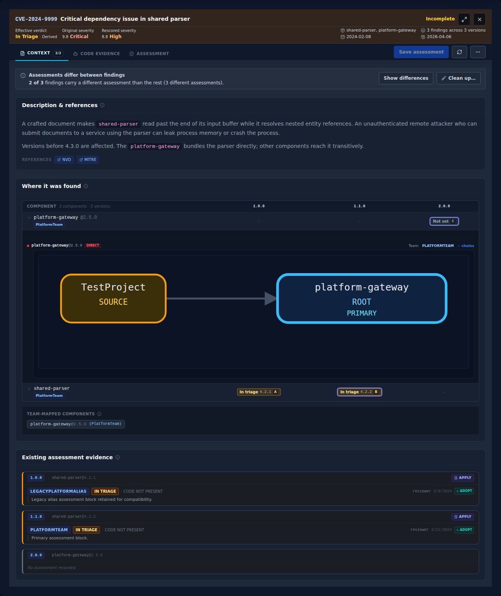
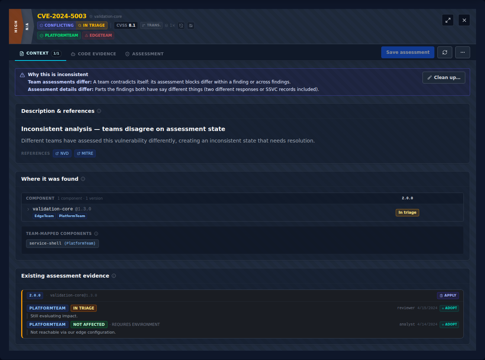
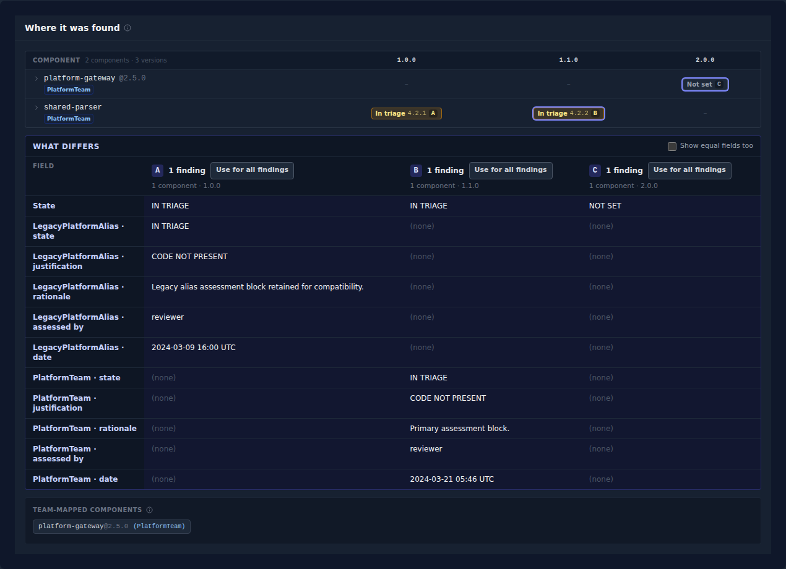
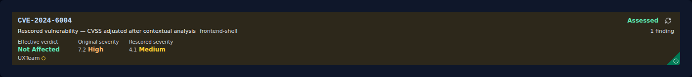
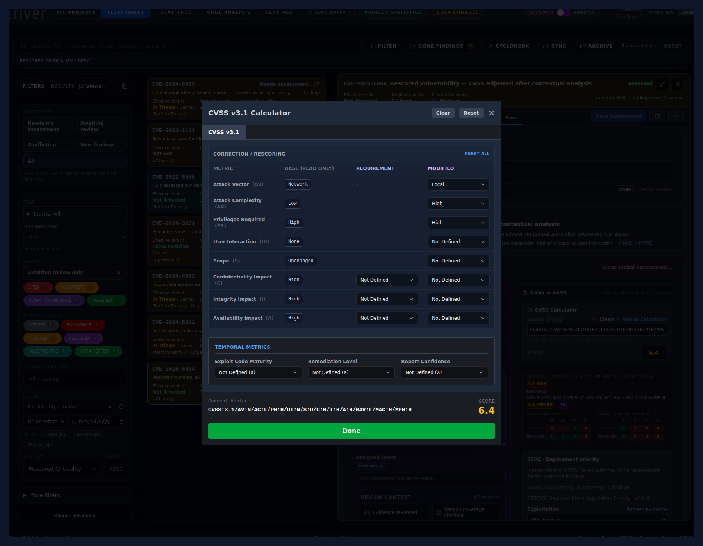
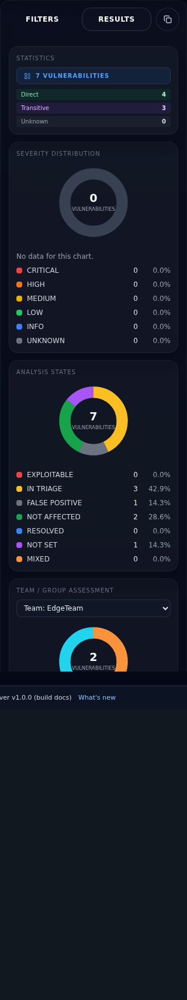
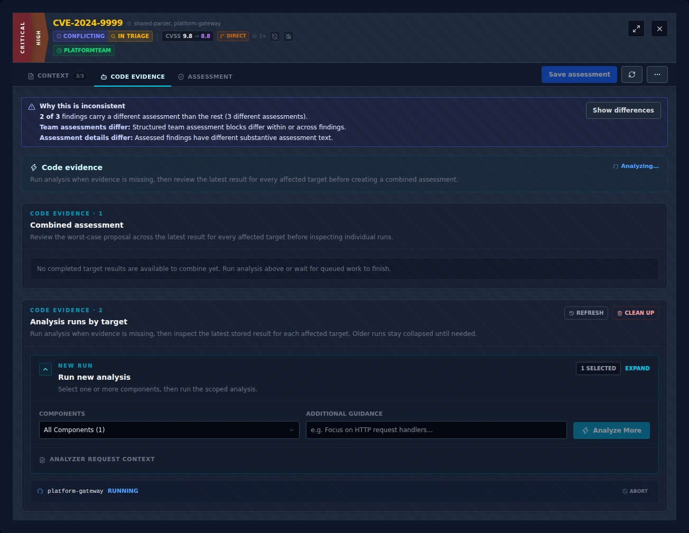

# DTVP Screen Guide

This guide describes the application screens covered by the documentation screenshot set. Regenerate the images from the repository root with:

```bash
cd frontend && npm run test:ui:docs -- --project=chromium
```

The capture flow uses mocked API fixtures and Chromium for a consistent screenshot set. Project examples explicitly select all five lifecycle categories; reviewers normally start with Ready for approval.

## Entry And Project Navigation

### Login


The login screen offers the SSO entry point used before DTVP loads project data.

### Dashboard


The dashboard lists Dependency-Track projects, versions, classifiers, and reviewer actions such as opening a project or exporting a project archive.

### Project Review


The project review page is the main vulnerability workflow. It combines grouped vulnerability cards, lifecycle state, team ownership, assessment controls, dependency-path context, and code-analysis shortcuts. Compact row badges identify the next useful analyst step; inside the opened card the tab status badges say what is still missing, and every action sits in the sticky bar next to the tabs. A Team filter also scopes the opened card's code evidence and assessment workflow, so another team's saved run or draft does not drive the selected team's next action.

### Lifecycle Badges


The lifecycle view shows Open, Incomplete, Conflicting, Ready for approval, and Assessed categories, alongside rescored CVSS values.

## Vulnerability Review Details

### Vulnerability Card Context



The Context tab uses three clearly separated sections in a fixed reading order: advisory description and references; where the vulnerability was found, as a matrix of components by project versions with the assessment state of each finding (a component row opens its dependency chains); and the existing assessment evidence.

### Assessment Workspace


From a viewport of 1280px, the header of the vulnerability detail has a workspace button next to Close. It opens the same card full screen, with the context on the left and the assessment form always visible on the right; the action bar with Save or Submit, Approve, Reload and More spans both columns. The left pane shows the differences banner and either Context or Code Evidence, chosen by the two remaining tabs. The two panes scroll on their own, so the evidence can be read while the decision, rationale and review checks are filled in.

Show differences opens the comparison in the left pane. Apply, Adopt, Use for all findings and the analyzer's apply actions fill the form without changing the left pane: the decision section scrolls into view and is briefly highlighted.


For a reviewer on the Global form the bar button reads Approve and approves in place; with a team selected it reads Review & approve and switches the form to Global. The workspace button or Esc leaves the workspace and lands on the Assessment tab with every unsaved edit kept. Esc first closes an open menu or dialog, and Esc in a text field stays with the field; on a checkbox, a button or plain text it leaves the workspace. While the workspace is open, Tab and Shift+Tab wrap inside it, and a click on plain text keeps focus in it. Close (X) still asks about unsaved edits. Below 1280px the button is not offered, and the workspace closes when the window becomes narrower than that, with focus on the Assessment tab.

### Assignee Chips And Approval


Cards show assigned users and reviewer approval actions when an analyst-submitted assessment is waiting for review.

### Assignee Filter


The assignee filter narrows the project view to vulnerabilities assigned to a specific user.

### Automatic Assessment Filter


Automatic assessment markers show groups with saved automatic code-analysis results, and the sidebar filter can narrow the list to vulnerabilities with or without those cached assessments.

### User Assignment Form


The expanded assessment form supports assigning users with known-user suggestions.

### Review Context


The Assessment tab uses the same section hierarchy as Context and Code Evidence: first confirm the Global or team scope, then complete the decision and rationale. With a Team filter, analysts see only that team's subview; reviewers start focused on it and can explicitly reveal Global and all-team controls. Team subviews present the latest scoped analyzer result as an optional proposal, while saved or manually edited team assessments remain authoritative. The reviewer-only Global subview summarizes the worst effective state across team decisions and analyzer fallbacks, and also contains CVSS and rescoring so the score and assessment can be evaluated together. Ticket references are marked required only when the current rescored severity is High or Critical.

### Conflicting Assessment



A banner above the tabs (at the top of the context pane in the [assessment workspace](#assessment-workspace)) states why the vulnerability is inconsistent and what each team decided. Existing assessment evidence in Context shows the conflicting team blocks.

### Differences Between Findings



When findings carry different assessments, each one has a letter in the matrix and "Show differences" compares them field by field.

### Rescored CVSS



Rescored vulnerabilities show the original CVSS score, the contextual score, and the direction of the change.

### Global Review CVSS And Rescoring


The Global subview of Assessment contains the vector editor, visual calculator entry point, current vector comparison, tmrescore reasoning, and analyzer CVSS notes when present.

### CVSS Calculator



The CVSS modal provides an interactive vector editor for contextual score adjustments.

### Bulk Changes Dialog


The Bulk Changes dialog previews the selected workflow before applying it in one action. Repair Assessments labels each applicable repair per vulnerability; where a new version added findings, the row states their number and offers a checkbox to synchronize them as well ([New findings](review-workflows.md#new-findings)). Restore Team Assessments From Export first asks for a Dependency-Track export, shows the uploaded file (tool, project, export time, start of its SHA-256), and then lists per vulnerability the team assessments it would add as historical blocks, with the entries it could not match.

### Conflict Resolution


The conflict dialog appears when Dependency-Track changed the underlying analysis while a reviewer was editing; it compares the current server state with the pending change.

## Statistics

### Statistics Page


The statistics page summarizes severity and state trends across project versions.

### Statistics Sidebar



The project sidebar provides compact counts and filterable state summaries without leaving the review page.

## Configuration And Archives

### Settings


Settings provide structured and raw editors for team mapping, including deterministic selectors for component names, groups, package URLs, case-sensitive matches, and no-group matches.

Every user can open Settings for the **Access Tokens** tab, which creates and revokes personal tokens for AI agents and scripts and lists the changes made with them; see [AI and API access](ai-access.md). The remaining tabs are reviewer-only, including **Export**, which lists the assessments that have not reached Dependency-Track, shows why an export is failing, and exports or discards entries on request; see [Import and export](import-export.md).

### Settings Access Tokens


The tab shows the MCP endpoint URL, the form for a new token, the user's tokens with their access level and last use, and recent changes made with tokens.

### Settings Archives


The archive tab exports, imports, previews, applies, and downloads project archive snapshots.

## Threat-Model Rescoring

### TMRescore


The threat-model rescoring screen prepares a synthetic analysis SBOM, selects latest-only or merged multi-version scope, and submits tmrescore inputs with optional LLM enrichment.
The configured model is reported by vscorer and shown read-only in DTVP.

## Code Analysis

### Running Inline Scan



The Code Evidence tab shows running and queued analyses above the evidence list, with queue position, active progress, and the current pipeline activity.

### Inline Scan Result


A queue result that is not saved yet opens in place with its outcome, follow-up question, and technical disclosures. Saved runs and agent evidence appear in one list below it; see [Code evidence reader](#code-evidence-reader). Derivative benchmark records do not displace a target's latest analysis. When a Team filter is active, history and availability badges include only compatible team-targeted runs (including configured aliases) plus legacy runs for the visible components; combining results stages only the filtered team's draft.

### Code Evidence Reader


The tab header has two controls: **Run analysis** (components and guidance; hidden when no analyzer is configured) and **More** (Refresh, Clean up analyzer data). Below it, one list holds analyzer runs and the evidence AI agents added through MCP, grouped by component, with an "All components" group for evidence about the whole vulnerability. Chips filter by source (All, Analyzer, Agents); withdrawn agent evidence stays hidden unless **Show withdrawn** is ticked. Each row is one line: the source, the verdict or suggested state with confidence, the title, the author and time, and "Used in assessment" once a saved assessment referenced it. Older analyzer runs of a component sit behind **Earlier runs**.

Clicking a row opens the reader under it: the provenance (who added it, through which token or run, when, and for which components, versions, and findings; agent evidence none of whose findings Dependency-Track still reports is marked "no longer reported"), the Markdown body rendered through an allow-list sanitiser, and for analyzer runs a collapsed **Technical details** section with the assessment draft, benchmark, component results, ticket, version coverage, LLM conversation, pipeline evidence, and the follow-up question. **Apply to the assessment** is a separate box: for agent evidence it adds a one-line reference to the draft, and the suggested decision only when ticked; for an analyzer run it fills the draft with the run's state, justification, and CVSS. Nothing is saved until the assessment is saved, and only evidence whose reference line is still in the saved text is recorded as used. If the save is rejected because referenced evidence was withdrawn in the meantime, the card names it and stops sending it; the rest of the draft stays. The reader's **More** offers Withdraw (agent evidence; reviewers and the author, with a reason) and Remove run (analyzer). At the bottom, **Apply all latest analyzer results** shows the worst case across the latest runs, with the per-target cards collapsed.

Opening LLM Conversation provides a taller vertically resizable timeline with an optional near-full-screen dialog. A summary above the timeline reports Local-to-LLM and LLM-to-Local message/token totals, captured and per-turn timing, inferred inter-turn local/tool time, retries, context adaptation, model/provider coverage, and requested-versus-locally-executed tool statistics. Every captured turn separates the Agentyzer-assembled request, tool exchange, and raw model response with explicit direction labels and copy actions. Tool activity also identifies bounded local dependent-repository inspections and their returned evidence separately from web/package fetches. If no trace was persisted, configured prompt values remain visibly marked as a non-captured fallback.
The Additional guidance used panel lists the exact component/reviewer guidance found in persisted model requests and the turn numbers that received it. Guidance saved on the analyzer request but absent from the trace is marked as not verifiable; storage-policy redaction is explicit rather than being mistaken for an empty guidance configuration. Follow-up runs resolve static guidance against their selected target component as well as initial runs.
Each request, tool, and response stage is independently collapsible. Requests and tool evidence start closed while model responses remain open; Expand all and Collapse all switch the complete conversation between audit and overview modes. Expanded stage bodies are bounded, keyboard-focusable scroll regions so unusually long prompts, traces, and answers do not obscure the rest of the conversation. Inline and nested regions pass unused wheel scrolling to the surrounding detail view when they have no overflow or reach a boundary; only the full-screen dialog contains overscroll.

### Code Analysis Dashboard


The dedicated dashboard shows DTVP worker state, queue pressure, active agents, model and LLM backend metadata, analyzer configuration, external jobs, auto-sweep status, and expandable structured scan logs. Expanded logs keep the newest line visible and use text color for log levels without boxed rows.

### Analysis Queue Dropdown


The header dropdown remains a compact shortcut for recent queued, running, and completed code-analysis jobs, with a link to the full dashboard.
