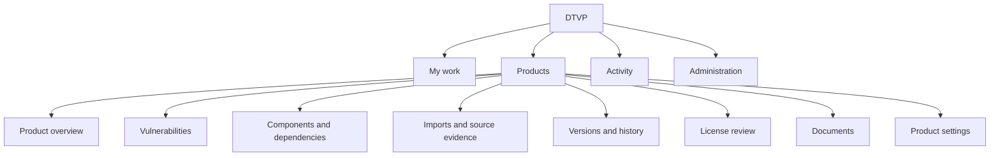

# DTVP UI review and proposed structure

Proposal dated 19 October 2026. The current application combines too many tasks in
Review. Reorganize it around work, product knowledge and configuration, then improve
the finding screen. More collapsed paragraphs or smaller text will not solve the
navigation problem. Preserve the backend workflows, searchable lists, filters,
team ownership, version history and explicit human decisions.

[Interactive wireframe](ui-proposal.html) · [Current application](../README.md)

## Findings from the current application

The review covers the current screen structure and component inventory, with live
inspection of Review, component ownership, Activity and Access. The scale playground
was inspected at 1440, 1024, 768, 390 and 320 CSS pixels. Specialist input, job and
follow-up flows were also checked against their existing browser tests. This is a
heuristic design review; workflow success with representative users and assistive
technology still needs validation.

| Priority | Finding | Consequence | Proposed change |
| :--- | :--- | :--- | :--- |
| P0 | Review contains imports, ownership, scoring policies, intelligence settings, licensing, documents and reporting | Users need implementation knowledge to find tasks; unrelated controls compete with assessment | Separate product pages, work queues and settings |
| P0 | Narrow layouts place finding details after the entire queue | In the inspected scale case, details begin about 1923px down at 1024px and 1883px down at 390px | Open a dedicated detail view below the split-view breakpoint; return to the preserved queue |
| P0 | CVE/component rows omit consuming-root identity | Identical-looking rows can represent different assessments, including within one team | Show component, consuming application, team and version scope together |
| P0 | Source severity, proposed changes, published score, assessment state and freshness require interpretation across sections | A proposal or stale assessment can be mistaken for the current decision | A stable decision summary with separate, explicitly labelled dimensions |
| P1 | More filters has many controls and a long general explanation | Users cannot easily see which restrictions are active or why counts changed | Common filters, active filter chips, grouped additional filters and reusable views |
| P1 | Information and actions remain spread across many disclosures | Reviewers must repeatedly open sections and remember earlier facts | Visible assessment evidence and comparisons; dedicated analysis task view |
| P1 | Labels expose internal concepts: pins, observations, correspondence, material changes | Users must translate storage and API terminology into tasks | Plain task labels, with exact technical identifiers available in record details |
| P1 | Statistics and comparison tools are below the primary workflow | Leads cannot quickly answer which team/version needs attention | Product overview and cross-product work summary with drill-through |
| P1 | Activity shows generic job kinds, project IDs and JSON results | It is difficult to understand subject, result and next action | Named operations with product/version/component context and human summaries |
| P1 | Access is mainly forms for memberships, credentials and sharing | Reviewing current access and responsibility is harder than entering new configuration | Separate team membership, product access and integration credential lists |
| P1 | Typography is compressed and CSS density varies by component | Dense screens remain difficult to scan; smaller text weakens hierarchy | Shared spacing/type tokens and comfortable/compact density choices |
| P1 | At 320px, measured document width is 344px | Page-level horizontal movement is required | Reflow audit of the shell, filter controls and queue, with overflow confined to true data grids |
| P2 | View URLs preserve filters but omit the selected finding/context; navigation uses replaceState | Sharing an exact case and using browser Back are unreliable workflow tools | Stable case routes, explicit historical-state links and browser history semantics |

The sampled desktop detail metadata included text around 9.7px. That is a legibility
concern, not by itself a WCAG failure. Existing strengths include searchable product
selection, server-side filtering, source/published scores shown together, distinct
analysis proposals, immutable request handling, themes and lazy branch loading.

## Structure and responsibility

Use one shared application shell. Keep product/version and responsible team visible
across product pages. Team memberships determine the default work scope; product
access remains a separate authorization rule.
A consuming application defines assessment context separately from team ownership.
Multiple responsibilities can belong to the same person without introducing more
persona-specific applications.

### Automatic team scope

Assign users to one or more teams, with roles per team. Default work queues to
**My teams**, resolved by the backend from current membership and product access.
"Their findings" means responsibility for the component/consuming context, including
under-investigation, not-affected and fixed decisions where the selected state view
includes them; it does not require confirmed affectedness.

| Membership or responsibility | Default UI |
| :--- | :--- |
| One team | Show that team's cases; a passive team label replaces the team filter |
| Multiple teams | Show the union of their teams' cases; offer optional narrowing in the shared work-scope control |
| Explicit cross-team oversight | Offer All teams within authorized products, plus My teams; do not grant assessment/approval rights for every team |
| No applicable team membership | Explain that no team work is assigned; do not silently show every team's queue |

Use a single work-scope control in the application shell when scope choice is
useful, not a repeated team filter on every screen. All teams is an explicit
oversight scope rather than automatic membership in every team or an administrator
approval privilege. New teams follow the configured oversight scope; ordinary
memberships remain explicit.

Scope filtering must apply consistently to worklists, totals, searches and scoped
exports in UI and CLI. Resolve it server-side; a UI default is not an access
boundary. Preserve API-credential team/project restrictions. Explicit broader scope
must not reveal unauthorized products. Existing project read access can still allow
related dependency/source context from other teams; strict row-level isolation
would be a separate access-policy change.

Union results by context identity. Keep the same CVE/component under different
consuming roots as separate cases. Route unassigned/conflicting ownership to an
explicit coordinator/manager queue instead of dropping it. Final scoring retains
the complete required-context gate even when the coordinator's current view is
narrower. Membership never bypasses independent-review or coordinator permissions.

| Destination | Primary responsibility | Content |
| :--- | :--- | :--- |
| My work | Analysts, independent reviewers, coordinators | Saved team queues, needs assessment, awaiting my review, changes requested, ready for contextual scoring; permitted actions determine available queues |
| Product overview | Product/security leads | Review backlog by team/version, current source coverage, import health, unresolved ownership and links to affected records |
| Vulnerabilities | Team analysts and reviewers | Contextual finding queue, evidence comparison, assessment, independent review and coordinator handoff |
| Components and dependencies | Development teams and integrators | Searchable component inventory, identity, ownership explanation, dependency tree, usage contexts and linked findings |
| Imports and source evidence | CI/integration owners | Imported SBOMs and parts, assembly, observation selection, VDR/VEX inputs, collection limitations and reconciliation tasks |
| Versions and history | Release/integration owners | Version branches, released tags, import/state comparison, synchronization proposals and retained assessments |
| License review | License analysts and reviewers | Component/license evidence, source disagreements, clearance decisions and independent approvals |
| Documents | Documentation authors and reviewers | Issued inputs, generated architecture documents, provenance, revisions and controlled approval |
| Product settings | Product/configuration managers | Component ownership rules, consuming-root configuration, source bindings, pipeline/threat-model mappings, scoring policy, CPE policy, refresh/synchronization schedules and product sharing |
| Activity | Integration operators and relevant readers | Import/refresh/analysis/export operations; readable results, failures, explicit follow-up and subject links |
| Administration | Identity/integration administrators | Team workspaces, memberships, integration credentials and organization-level settings supported by the backend |

Do not promote every specialist feature into primary navigation. CPE catalogs,
offline dictionaries and mapping rules belong under product identity settings;
CPE evidence for one component stays in its component record. Source health is
visible to reviewers, while editing source configuration belongs to managers.
Migration/archive publication belongs to administration or product maintenance.
Saved searches belong beside queues, not below reports. Global statistics belong
on My work/Products, with product statistics on Product overview.

Separate navigation access from write permission. Readers can inspect settings
and provenance where authorized; editing requires the appropriate capability.
A team administrator is not automatically an independent reviewer or coordinator.

## Vulnerability workspace

The unit of work is a vulnerability in a component's consuming context and product
version scope. Show that identity before any evidence or decision controls:

`CVE → component and version → consuming application → responsible team → product version`

Show "3 affected contexts" when the backend supplies the complete authorized count,
with a context switcher preserving separate assessments. Several dependency paths
within the same consuming root currently share one assessment context; paths are
not automatically separate decisions. Do not imply a global count from one page.

### Queue

Retain a searchable table on wide screens. Default columns: vulnerability and
component, consuming application/team, workflow state, source severity, and approved
contextual severity. Put uncommon columns behind a column chooser. Long component
names can wrap; a selected record must expose its full identity. Row actions and
keyboard access should be predictable.

Offer common filters for product/version, workflow and severity. Team scope comes
from My teams or the shared optional scope control.
Group other filters into applicability, evidence/freshness, component/dependency
and business context. Always show active filters and clear actions outside the
filter panel. Keep source and contextual severity filters distinct. Preserve v1's
useful filters and search behavior. Use server-backed totals and stable paging for
this list; tree browsing continues loading siblings inside their branches.

### Record layout

Keep a stable header and three primary areas: **Overview**, **Assessment** and
**History**. Overview answers the analyst's questions without opening accordions.
Assessment contains the role-appropriate decision/review controls alongside a
compact evidence summary. History contains the attributed decision/evidence
chronology. Analysis requests and component exploration are secondary destinations
opened through clear links/actions, with return to the same record.

| Always visible in Overview | Available on demand | Separate destination |
| :--- | :--- | :--- |
| Component, consuming application, team, version/state freshness | Full description when lengthy, vectors and metric explanations | Run or follow up an analysis |
| Source severity with provider and CVSS method | Original source files, technical receipt IDs and raw records | Prepare/download integration input files |
| Current approved contextual severity, or explicit "Not published" | Detailed identity/CPE provenance and discovery candidates | Configure identity or ownership rules |
| Applicability, review status and whether the assessment is current | Full dependency path/tree, initially collapsed | Component inventory and all usage contexts |
| Description and relevant usage/exposure/criticality/support facts, with missing or historical status | Additional source-specific detail | Product/source/pipeline settings |
| Source disagreements, missing input coverage and material evidence changes | Complete import and decision chronology | Import assembly and reconciliation |
| Compact comparison of received advisory and analysis evidence | Large reports opened alongside the assessment or in a focused report view | Cross-version/release comparison |
| Next permitted action or concrete blocking reason | Advanced scoring and scope options during the relevant task | Team and credential administration |

Group advisories and analyses by purpose, then compare actual contributions in a
consistent matrix: provider, supplied claim/score, scope, freshness, qualification
and recorded use. Distinguish "not requested", "queued", "running", "no matching
advisory", "failed", "outdated" and "not usable for this decision". No returned
result is not proof of absence. Add source date/build and coverage summaries where
available; use "Unknown" rather than fabricated completeness or confidence.

VScorer and Agentyzer proposals remain distinct from the approved decision. Preserve
CVSS method/Base/vector provenance. A disagreement banner links directly to the
conflicting records. Assessment citations identify what was considered; a matching
score does not establish adoption. Full rationales and reports remain readable
while assessing and reviewing; ordinary evidence should not require nested opens.

### Focused assessment workspace

The [assessment wireframe](ui-proposal.html#assessment) replaces the queue with a
wide task workspace. A stable header retains vulnerability, component, consuming
application, team, version, original severity and published score. A short workflow
indicator locates the analyst before independent review and coordinator scoring.

Evidence and the decision form sit side by side on wide screens. The evidence
column shows description, dependency path, exposure, criticality, source claims
and analysis proposals. Full advisory/report text opens in that column without
replacing the form. Long descriptions scroll within their own labelled region.
On narrow screens evidence and form stack in reading order.

The form asks for applicability, rationale, evidence considered and supporting
verification notes. Not affected reveals a required justification. Selecting a
citation does not adopt an analysis conclusion or score. Current version coverage
is explicit; applying an assessment to additional versions requires a backend
applicability preview, not a blanket copy. Analysts never publish contextual scores.

The prototype retains separate drafts per consuming context in page memory only.
Reloading discards them; no production save or submission is simulated as success.
The second example shows an already submitted assessment read-only to its analyst.
An independent reviewer needs a separate, permission-controlled review action on
the exact revision and coverage; the prototype does not implement that action.
Draft saving is separate from a submission preview, which checks for rationale,
not-affected justification and a citation or supporting verification notes.

### Actions and handoffs

Use a visible "Next action" with an explanation: assess, submit for independent
review, request changes, approve, or wait for other required contexts. Analysts do
not perform final rescoring. Coordinators see a dedicated ready-for-scoring queue
and the per-vulnerability team/context gate; source Base, proposals, rule output
and manual overrides stay comparable before preview/publication.

Not-affected decisions retain an explicit justification and supporting evidence.
Approval must identify the exact assessment revision, version coverage and evidence
being approved. Keep an explicit independent-review confirmation and rationale.
Reuse existing request IDs, pins, preview digests and retry protections. Show user
language such as "Submission not confirmed; retry the same submission" with exact
technical details available separately. Never silently advance scope, repin a
pending action or adopt an external proposal.

Prefer a persistent draft indicator and a scoped pending-operation banner over
locking unrelated screens. Navigation away from an unresolved operation must retain
its exact data or explicitly explain the required discard/recovery. Provide a
sticky action area where space allows without obscuring focused content.

## Language and visual hierarchy

| Current label | Proposed label or treatment |
| :--- | :--- |
| Product scope | Product |
| Context findings | Assessment cases, with "one vulnerability in one consuming context" available nearby |
| Recorded | Replace with explicit Draft / Awaiting review / Approved counts; retain overlapping count semantics where applicable |
| Published | Approved contextual score; show "Not published" until publication |
| Source Base | Original CVSS Base score/vector, with provider and method |
| Withheld / Eligible | Explain the qualification: "Cannot use: source commit differs" / "Available for human review" |
| Composition input observations | Import coverage and data quality |
| Occurrence correspondence | Match components across imports |
| Pins / heads / receipt | Version state / exact input snapshot / input record; identifiers in technical details |
| Agentyzer repository input | Prepare code analysis input |
| VScorer input files | Prepare threat-model scoring input |
| Controlled documents | Documents and approvals |

These are display labels; retain stable API vocabulary and searchable technical
terms in details. "Available for review" never means automatically approved.

Use severity colour only with numeric score, method and a severity word. Keep
workflow state, applicability and evidence freshness as separate labelled badges.
Use neutral grey for unknown/missing, amber for attention or stale evidence, and
explicit text/icons for approved states. A green approval badge means the review
was approved, not that the software is free of vulnerabilities. Preserve light,
dark and system themes with a common tested token set.

Use graphs where they answer a question: stacked workflow bars by team/version,
severity distributions with unknown values, and selected dependency paths. Every
chart needs labelled counts, accessible table alternatives and drill-through.
Avoid a default full dependency network; it obscures large products. Compare versions
with added/removed/changed summaries and a focused diff. Historical trend charts
must use historical evidence; current PostgreSQL projections alone do not provide
a valid historical trend. Cross-version and disputed-team counts can overlap;
never imply additive totals or unique-CVE counts from workload counts.

## Responsive and accessible behavior

- Wide layout, approximately 1200px and above: queue and detail together, with a
  usable minimum width for each and optional focus mode. Content fit determines
  the final breakpoint; do not force a fixed ratio on every display.
- Medium/narrow layout: selecting a case opens a full-width record route. Provide
  Back to results with filters, row selection and scroll restored. Do not stack
  the selected record after 30 queue rows. Keep the core task available on mobile.
- At small widths, render finding rows as compact labelled summaries or a carefully
  scoped table. Product/team selectors must remain understandable and searchable.
  Local horizontal scrolling can serve genuine data grids, not whole-page overflow.
- Use a small type scale: approximately 14–16px for reading, 13–14px for dense
  supporting data, and clear headings. Offer compact density rather than shrinking
  every label. These are proposed design values, not WCAG font-size requirements.
- Test keyboard order, visible focus, modal focus return, named controls, errors,
  screen-reader headings and semantic state. Real tabs need tab keyboard behavior;
  navigation destinations should be links. Repeated CVEs need distinct accessible
  names containing consuming application/component context.

WCAG 2.2 AA is the proposed accessibility target. Reflow includes 320 CSS pixels
and zoom equivalents, with exceptions for genuinely two-dimensional content.
[W3C reflow guidance](https://www.w3.org/WAI/WCAG22/Understanding/reflow.html).

Use at least 24×24px pointer targets unless a documented exception applies;
prefer larger touch controls for frequent actions. Test sticky headers/footers
against focus obstruction. [W3C target size](https://www.w3.org/WAI/WCAG22/Understanding/target-size-minimum.html),
[focus visibility](https://www.w3.org/WAI/WCAG22/Understanding/focus-not-obscured-minimum.html).

Normal text contrast should reach 4.5:1 and large text 3:1; status cannot rely on
colour alone. [W3C contrast](https://www.w3.org/WAI/WCAG22/Understanding/contrast-minimum.html),
[use of colour](https://www.w3.org/WAI/WCAG22/Understanding/use-of-color.html).

Required decision evidence should not be hidden inside accordions. GOV.UK advises
against hiding universally needed content or nesting accordions; Nielsen Norman
Group also identifies the cost of comparing hidden sections. Apply that principle
to DTVP's assessment comparison, rather than treating every advanced fact as another
collapsible paragraph. [GOV.UK accordion guidance](https://design-system.service.gov.uk/components/accordion/),
[NNG accordion research](https://www.nngroup.com/articles/accordions-on-desktop/).
Labels must identify their subject and purpose. [W3C headings and labels](https://www.w3.org/WAI/WCAG22/Understanding/headings-and-labels.html).

## Delivery order and acceptance

| Batch | Change | Completion condition |
| :--- | :--- | :--- |
| 1 | Route shell, product navigation and configuration separation | Ownership/settings reachable directly; no configuration forms in the assessment queue; scope and pending requests preserved |
| 2 | Queue identity and focused record layout | Identical CVEs in different roots distinguishable without opening rows; source/contextual scores visible; all selected records reachable at narrow widths |
| 3 | Evidence comparison and task actions | Reviewer can compare original claims, analyses and current decision together; analyst/reviewer/coordinator actions remain separate |
| 4 | Component, import, release, license and document destinations | Existing capabilities mapped above remain reachable with their permission and historical-state safeguards |
| 5 | Overview/activity, visual tokens and responsive/accessibility hardening | Readable task summaries and charts; tested themes, keyboard, reflow, focus and honest workload denominators |

Build a thin navigation slice and the finding overview first, using the existing
services. Validate with an analyst, independent reviewer, coordinator and integration
owner before migrating every specialist panel. Preserve testable routing and
shared API/CLI semantics; avoid redesigning backend decisions to suit a screen.

Acceptance scenarios: identify one CVE in two same-team consuming applications;
review a long description plus conflicting sources; explain an unusable analysis;
continue a captured submission after a head update; discover and preview a team
mapping; compare parallel versions; inspect license and document approval; verify single-team defaults, multi-team unions, explicit oversight and empty
membership without changing project access; return
from mobile detail to the original 5000-vulnerability queue; distinguish missing
collection coverage from zero findings. Use keyboard and screen-reader checks in
addition to browser assertions, at 320/390/768/1024/1440px and 200%/400% zoom.

Prototype targets for moderated testing: find an ownership rule within 30 seconds;
locate the next permitted action and its blockers without opening generic helper
sections; distinguish two same-CVE contexts on the first attempt. These are design
acceptance targets, not measured current performance or a claim of regulatory
qualification.

## Implementation anchors

- [Application shell and access](../frontend/src/App.vue)
- [Review and product tools](../frontend/src/components/KnowledgeWorkspace.vue)
- [Evidence comparison](../frontend/src/components/KnowledgeContributions.vue)
- [Ownership editor](../frontend/src/components/KnowledgeOwnership.vue)
- [Branch browsing](../frontend/src/components/KnowledgeDependencyTree.vue)
- [Input preparation](../frontend/src/components/KnowledgeSpecialists.vue)
- [Cross-product statistics](../frontend/src/components/KnowledgeOrganizationPortfolio.vue)

The wireframe uses synthetic content and demonstrates navigation, context identity,
evidence comparison and narrow-screen focus. It does not implement application
routes, authorization or backend actions. The findings above distinguish measured
layout issues from proposed design choices. Measurements refer to the current
application; the wireframe examples are synthetic.
